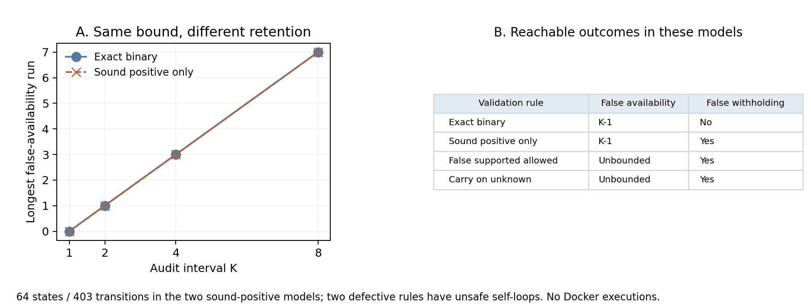

# Условия гарантий доступности и периодического аудита

Статус: формальный разбор перехода состояния, подготовленный после конечной модели
и Git/Docker опыта. Это условные утверждения о правиле обслуживания памяти, а не
установленная корректность валидатора на реальных проектах. Расширение с неполными вердиктами проверено полным обходом конечной модели.

## Обозначения и правила

Рассматривается один фиксированный claim и последовательность завершённых,
обработанных переходов. T_t ∈ {0,1} — истина сохранённого predicate на ревизии t;
A_t ∈ {0,1} — доступность записи после обслуживания этой ревизии. Ложная доступность
означает A_t=1 при T_t=0; ложное скрытие — A_t=0 при T_t=1.

Если запись выбрана, валидатор возвращает supported, contradicted или
insufficient_evidence. Завершённый переход устанавливает A_t=1 только при supported;
два остальных исхода дают A_t=0. Если запись не выбрана, A_t=A_(t−1). Это соответствует
ветке validate в advance_state; invalidation-only policies в утверждения ниже не входят.

Обычный selector дополнительно обязан выбирать запись, если A_(t−1)=0. Он может
выбирать её и по любым другим причинам. Для периодического аудита вводится возраст
b_t — число обработанных переходов после последней завершённой проверки. При
проверке b_t=0; при пропуске b_t=b_(t−1)+1. Проверка обязательна, когда b_(t−1)+1≥K,
где K — положительное целое число. Содержание постороннего файла и повтор дерева
не сбрасывают возраст.

Предполагается A_0=T_0=1 и b_0=0: исходная доступная запись действительно подтверждена.
Изменение claim, порядка истории или критерия валидатора требует отдельного контракта.
Потребление промежуточного состояния незавершённого run здесь не моделируется.

## Утверждение 1. Точная двоичная проверка исключает ложное скрытие

Пусть любая завершённая validation возвращает supported тогда и только тогда,
когда T_t=1. Если проверка выбрана, A_t=T_t, следовательно ложного скрытия нет.
Если она не выбрана, A_(t−1)=1, иначе сработало бы правило повторной проверки
недоступной записи. После переноса A_t=1, поэтому и в этом случае A_t=0 при T_t=1
невозможно.

Таким образом, при этих условиях ошибочная доступность может быть только
односторонней: ложное утверждение остаётся доступным. Неполная provenance способна
пропустить порчу, но запись, уже скрытая после обнаружения порчи, проверяется на
следующем переходе и восстанавливается сразу, когда точный validator подтверждает
predicate. Доказательство не требует полноты графа зависимостей.

Граница условия существенна: insufficient_evidence на истинном predicate даёт
ложное скрытие относительно двоичной истины. В реальной системе это допустимая
консервативная недоступность при недостаточных свидетельствах. Поэтому отсутствие
ложного скрытия в конечной модели нельзя безусловно переносить на CAMI с таймаутами,
недоступной средой и неполными валидаторами.

## Утверждение 2. Для границы K−1 достаточно sound supported

Теперь требование слабее: supported допускается только при T_t=1. На истинном
predicate валидатор может вернуть contradicted или insufficient_evidence; полнота
положительных подтверждений не требуется. Такие ответы могут ухудшить retention,
но не создают ложной доступности, поскольку A_t=0.

После любого завершённого выбранного перехода ложной доступности нет: либо
supported корректен, либо запись скрыта. Поэтому всякое состояние ложной доступности
возникает после пропуска проверки. В нём b_t>0. На каждом следующем шаге непрерывной
ложной доступности проверка снова должна быть пропущена, иначе серия закончится;
следовательно b строго растёт на единицу. До переноса с возрастом K выполняется
обязательная проверка, поэтому 1≤b_t≤K−1 и длина серии не превышает K−1.

Это уточняет прежнюю достаточную предпосылку «корректная проверка»: для данной
границы нужны корректность положительных подтверждений и скрытие записи при
остальных исходах, но не способность всегда подтвердить истинный claim.
Утверждение 1 использует более сильную предпосылку и из этого ослабления не следует.

## Контрпримеры при нарушении предпосылок

Если валидатор способен возвращать supported на ложном predicate, периодическая
проверка может снова и снова ошибочно подтверждать запись. Ни сброс возраста, ни
обязательный срок не гарантируют конечную длительность ложной доступности.

Если insufficient_evidence сохраняет прежнюю доступность и при этом сбрасывает
возраст, запись может проходить все сроки без фактического подтверждения и всё
время оставаться ложно доступной. Действующий advance_state этого не делает:
insufficient_evidence скрывает запись. Здесь описывается намеренно дефектное
альтернативное правило для проверки значимости предпосылки.

Если возраст сбрасывается из-за любого изменения исходника, предыдущий конечный
опыт уже даёт source-changing цикл ложной доступности. Если проверка назначается
после b+1>K вместо b+1≥K, серия может достигать K. Оба дефекта обнаружены в
periodic-audit-bound-v1.

## Связь с полученными свидетельствами

Точная двоичная модель behavior-reachability-v1 не содержит ложного скрытия у
исходных правил; намеренное подавление previously_unavailable создаёт такие
состояния. Конечный periodic-audit-bound-v1 достигает границы K−1 для K=1,2,4,8.
Git/Docker прототип воспроизводит ожидаемые сроки обнаружения на одной авторской
истории; отдельный тест подтверждает скрытие при insufficient_evidence и
повторную проверку на следующем шаге.

Эти свидетельства согласуются с аргументами, но не устанавливают soundness
реального behavior validator. Frozen probe проверяет только собственный predicate;
он не доказывает общее поведение функции. Независимое подтверждение исходного
claim и смысл его формулировки остаются отдельными требованиями допуска.

Результаты не выражают верхнюю границу в секундах, не ограничивают необработанную
очередь коммитов и не задают безопасное поведение потребителя при аварии между
чтением старого состояния и публикацией нового. Полная production-гарантия
требует дополнительно определить эти границы системы.

## Конечная проверка расширения

План закреплён в 184777b, runtime — f1e69b4. Рассмотрены K=1,2,4,8;
на каждом шаге истина и дополнительный trigger выбираются недетерминированно.
При выбранной проверке точный validator даёт supported для истины и contradicted
для лжи. Validator с корректными положительными ответами допускает все три
вердикта на истинном predicate и два неположительных вердикта на ложном.
Это множество возможных исходов, не вероятностная модель отказов.

| K | Состояния: точная / только положительно корректная | Переходы: точная / только положительно корректная | Максимальная ложная доступность в обеих |
| --- | ---: | ---: | ---: |
| 1 | 2 / 3 | 8 / 30 | 0 |
| 2 | 4 / 5 | 16 / 47 | 1 |
| 4 | 8 / 9 | 32 / 75 | 3 |
| 8 | 16 / 17 | 64 / 131 | 7 |

Всего проверены 64 состояния и 403 перехода. Во всех точных моделях ложного
скрытия нет; во всех моделях только положительной корректности достижимо одно
такое состояние (истина=true, доступность=false, возраст=0). Каждый допустимый
исход transition проверен отдельной явной формулой; сверены полнота successor
sets, достижимость, ранговое условие возраста и пути достижения границы K−1.

Оба намеренно дефектных правила дали достижимые unsafe self-loops при K=4.
В одном цикле ложная запись повторно получает supported; в другом
insufficient_evidence сохраняет прежнюю доступность и сбрасывает возраст.
Связность префиксов и циклов проверена отдельно по сохранённым графам.

Семь профильных тестов прошли; сверены 12 output hashes, source snapshots
совпали. Фактических probe executions нет. Полный набор до этого расширения:
1163 passed на 418f58a, ruff и mypy прошли. Конечный обход дополняет доказательство
через возраст, но сам по себе не доказывает утверждение для всех K или реального
валидатора. Все работы выполнены одним ассистентом, human review не заявляется.

Материалы: reports/research-20261104/ternary-audit-invariants-v1/.
Повтор: `.venv/bin/python -m scripts.check_ternary_audit_invariants --out runs/NEW_NAME`.
