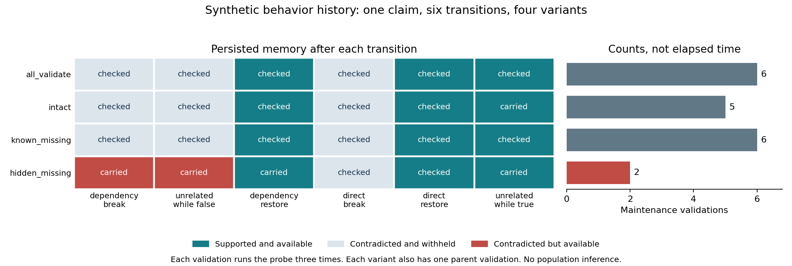

# Поведенческая память при скрытой зависимости

Это synthetic development эксперимент с одним утверждением и шестью переходами.
План закреплён в `1aceb7f` до реализации и запуска. Реализация запускалась на
`0c2f04d`. Реальные данные, человеческая разметка и held-out не использовались.

## Вопрос и устройство примера

Может ли память переносить ложное поведенческое утверждение, если её граф
зависимостей скрывает причину изменения? Сохраняется ли ошибка на следующем
переходе? Как отличаются полная provenance и явно известная неполнота?

Утверждение ограничено замороженным probe: `f() == 1`. В parent функция `f`
вызывает `g`, которая возвращает 1. Каждая проверка запускает один и тот же
pytest probe трижды в отдельных контейнерах. Кэш вердиктов отключён.
Использован локальный закреплённый образ `cami-probes` с digest
`sha256:17ad59a0efd3a62ede046c70b74213d649940e46a8330ac595ead4d647732bd6`,
Python 3.12.12. Платные API и сетевые обращения из контейнеров не нужны.

План задаёт последовательность:

1. `g` начинает возвращать 2; тело `f` не меняется.
2. Меняется только посторонний файл; `f()` по-прежнему равно 2.
3. `g` снова возвращает 1.
4. Тело `f` заменяется прямым возвратом 3.
5. Восстанавливается вызов `g` из `f`.
6. Меняется только посторонний файл; `f()` остаётся равным 1.

Сравниваются `all_validate`, `symbol_validate` с целым графом (`intact`) и два
варианта `symbol_validate` с удалённым ребром `f → g`: известная неполнота
(`known_missing`) и скрытая неполнота (`hidden_missing`). Использован первый
разрешённый seed 17 и drop 0,75. Для единственного ребра hash fraction равна
0,5329981976520891, поэтому оно удаляется. Это намеренно построенный пример
удаления ребра, а не случайная выборка 75% всех возможных зависимостей.

## Отдельный oracle

Истина не берётся из ответов CAMI или pytest. Отдельный стандартный Python AST
интерпретатор читает фактические Git blobs. Он принимает только функции без
аргументов с единственным возвратом целого числа или вызовом другой такой
функции. Неизвестные вызовы, рекурсия и неподдерживаемые конструкции отклоняются.
Значения для parent и шести children: `1, 2, 2, 1, 3, 1, 1`.

Этот oracle отделён от CAMI indexer, policy и validator, но использует тот же
CPython parser. Он не доказывает семантику произвольного Python. Все labels и
parent receipts явно обозначены `synthetic_authored_finite_oracle`; их автором
не заявлен независимый человек. Child labels не входят в публичные inputs
маскированных сценариев. Перед запуском все фактические значения сверены с
ожиданиями замороженного плана.

## Проверенный результат

| Вариант | Maintenance validations | Запуски probe при maintenance | Ложное утверждение доступно | Stale exposure | Valid retention |
|---|---:|---:|---:|---:|---:|
| all_validate | 6 | 18 | 0 | 0/3 | 3/3 |
| intact | 5 | 15 | 0 | 0/3 | 3/3 |
| known_missing | 6 | 18 | 0 | 0/3 | 3/3 |
| hidden_missing | 2 | 6 | 2 | 2/3 | 3/3 |

Каждый вариант дополнительно выполняет одну parent-validation, то есть три
запуска probe. Всего: 19 maintenance validations, 4 parent validations,
69 запусков probe. Из них 39 успешных и 30 повторяемых assertion failures;
технических отказов в этой истории не было. Эти количества проверены по
сырым payloads и cost artifacts, а не только по сводной таблице.



`hidden_missing` сохраняет доступность на первых двух переходах, хотя oracle
уже опровергает утверждение. `last_checked_commit` при этом остаётся parent:
перенос не маскируется под новую проверку. На третьем переходе утверждение
снова истинно, но его доступность также получена переносом, без проверки.
Прямое изменение функции на четвёртом переходе вызывает проверку и скрытие;
пятый переход возвращает подтверждённую доступность.

У `intact` второй переход изолирует консервативное правило
`previously_unavailable`: связанный исходник не меняется, но уже скрытая запись
проверяется снова. Успешные восстановления на третьем и пятом переходах имеют
также триггеры изменения зависимости/функции. Поэтому этот эксперимент не
изолирует успешное восстановление, вызванное только прежней недоступностью.

Меньшее число проверок у `hidden_missing` сопровождается двумя ошибками
доступности. Его нельзя представлять как безопасную экономию. `intact`
пропускает одну ненужную проверку на последнем переходе этой конкретной
истории; ускорение и полный расход ресурсов этим не установлены.

## Верификация и границы

Проверены все 24 persisted states, selection decisions, последний проверенный
и последний поддержанный commit, basis переноса, verdicts, cache flags и
число исполнений. Production scorer отдельно сопоставлен с прямым подсчётом
по oracle truth и состояниям. Нулевых знаменателей здесь нет: три child items
подтверждены и три опровергнуты. Повторения одного probe не являются новыми
независимыми claims или datasets.

19 профильных tests прошли; Ruff прошёл. Отдельный reviewer `gpt-6.1-sol`
перепроверил семь фактических Git blobs, все 69 сырых payloads, 24 состояния,
312 внешних artifact hashes, 74 input hashes, 197 вложенных artifact hashes,
34 вложенных input hashes и 166 исходных файлов на runtime commit.
Снимки до и после исполнения совпали. Блокирующих замечаний нет; ограничение
об изоляции recovery отражено выше. Новый полный suite текущего HEAD не заявляется.

Это проверка конкретного механизма отказа на одной авторской истории.
Популяционный доверительный интервал, частота скрытых зависимостей в реальных
репозиториях и эффективность CAMI на основном cohort не оценивались.

## Воспроизведение

Нужны готовая среда проекта, доступный Docker и уже установленный образ с
указанным digest. Исходники должны быть закоммичены. Каталоги результата новые:

```bash
.venv/bin/python -m scripts.check_behavior_history --out runs/behavior-history-new
.venv/bin/python -m scripts.plot_behavior_history \
  --source runs/behavior-history-new/results.json \
  --out reports/behavior-history-new-figure
```

Первичный сохранённый прогон: `runs/behavior-history-20261029-v1`.
Компактные результаты, protocol, oracle, manifest и independent review:
`reports/research-20261029/behavior-history-v1/`.
Графики PNG/SVG, таблица CSV и HTML:
`reports/research-20261029/behavior-history-figure-v1/`.
Это дополнение после evidence cutoff переносимого семистраничного отчёта;
его прежние DOCX/PDF и ZIP намеренно остаются датированным снимком.
