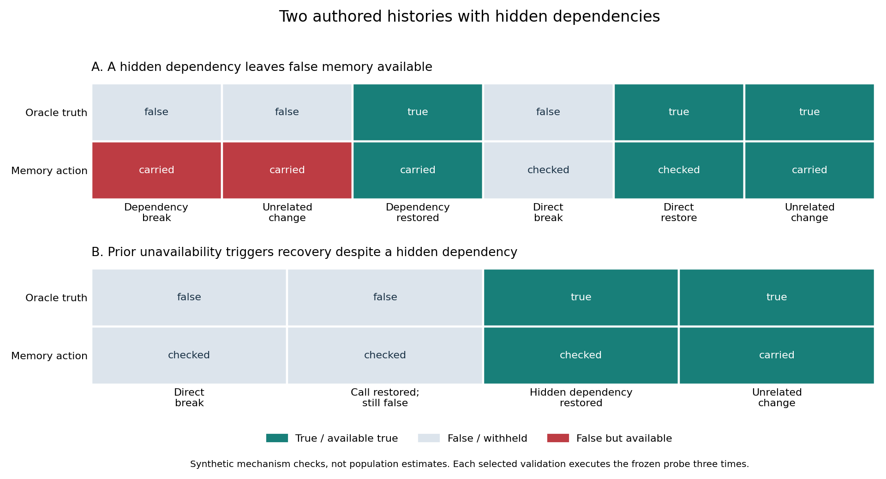

# Восстановление при скрытой зависимости

Выполнен дополнительный synthetic development эксперимент, закрывающий ограничение
предыдущей [поведенческой истории](behavior_dependency_history_2026-10-29.md):
успешное восстановление ранее нельзя было отделить от видимого изменения функции.
План закреплён коммитом e5eaf7a до реализации; запуск выполнен на e32e63e.

## Проверяемый механизм

Замороженное утверждение — только `f() == 1`. Parent: `f` вызывает `g`, `g` возвращает 1.
Четыре перехода:

1. `f` непосредственно возвращает 3: память должна скрыть утверждение.
2. `f` снова вызывает `g`, но `g` возвращает 2: утверждение остаётся ложным.
3. Только `g` снова возвращает 1: в hidden_missing изменение не видно через граф.
4. Меняется только посторонний файл: истина остаётся прежней.

Отдельный конечный AST oracle прочитал фактические Git blobs и получил значения
`1, 3, 2, 1, 1` (включая parent). Он не использует CAMI validator или исполнение probe.
Его узкий язык и синтетическое авторство те же, что в предыдущем эксперименте.

## Наблюдение

В hidden_missing третий переход выбран **только** по `previously_unavailable`.
Три реальных успешных исполнения неизменённого probe вернули supported;
сохранённые available и last_checked_commit обновились. На четвёртом переходе
проверки не было; last_checked_commit сохранил третий commit, basis — carried_forward.
Это изолирует успешное восстановление по прежней недоступности при скрытой причине
изменения истины.

Все четыре варианта дали правильную доступность на всех четырёх переходах:
16 состояний без расхождений с oracle. Maintenance validations: all_validate — 4,
intact — 3, known_missing — 4, hidden_missing — 3. Дополнительно каждому варианту
потребовалась одна parent-validation. Всего 18 validations и 54 исполнения probe:
30 passed, 24 assertion_failure, технических отказов нет. Повторы не считаются
независимыми примерами. Скорость выполнения здесь не сравнивается; параллельно
выполнялась общая проверка проекта.

Политики не изменялись. Это не означает, что скрытые зависимости безопасны:
предыдущая история уже показывает ложную доступность при первоначальном переносе.
Новая история начинается с обнаруженного прямого нарушения, поэтому правило
перепроверки уже недоступной памяти может сработать. Оно не обнаруживает ложную
память, которую система ещё считает доступной.

## Свидетельства и воспроизведение

Полный локальный прогон: `runs/behavior-recovery-20261104-v1`.
Компактные protocol, oracle, results, manifest и raw audit сохранены в
`reports/research-20261104/behavior-recovery-v1/`.
Проверены все внешние input/artifact hashes, 54 сырых JSON payloads и совпадение
снимков исходников до/после. Это аудит тем же агентом, не независимый human review.
Профильные тесты двух планов и oracle: 19 passed; Ruff прошёл.

```bash
.venv/bin/python -m scripts.check_behavior_history \
  --protocol examples/behavior_dependency/recovery_protocol.json \
  --out runs/behavior-recovery-NEW
```

Требуются чистые закоммиченные исходники, Docker и уже установленный образ
с digest из protocol. Драйвер сверяет не только итоговую истину, но и заранее
заданную точную причину отбора на восстановлении. Главный held-out эксперимент,
независимые receipts и labels остаются невыполненными.

## Две разные ситуации со скрытой зависимостью



Верхняя история показывает ложную доступность после необнаруженного изменения.
Нижняя начинается с обнаруженного нарушения, поэтому при следующем изменении
срабатывает повторная проверка недоступной записи. Это различные авторские
последовательности, а не парные наблюдения одной популяции. Рисунок построен
из сохранённых results.json; hashes источников и файлов указаны рядом в manifest.
PNG просмотрен; headless HTML-preview завершился Chrome exit1, inline HTML показан.
