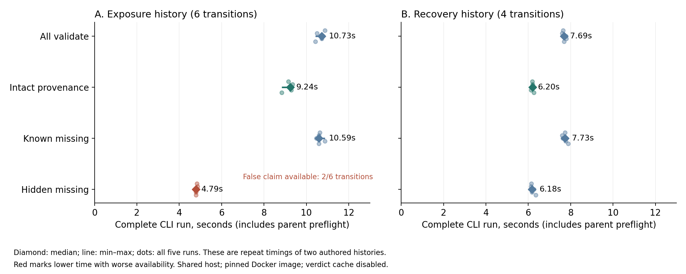

# Время обслуживания двух синтетических behavior-историй

На этой машине intact provenance показала меньшее время полного CLI run, чем
all_validate, при той же ожидаемой доступности: медианы 10.73→9.24 s для exposure
history и 7.69→6.20 s для recovery history. У known_missing устойчивого выигрыша
не наблюдалось. Hidden_missing в первой истории выполняется заметно быстрее,
но оставляет ложную запись доступной на двух из шести переходов.

Это пять повторных измерений каждого варианта на двух авторских историях с одним
claim. Они не являются пятью независимыми datasets и не устанавливают ускорение
на реальных проектах. Измерены текущие закреплённые конфигурации; варианты не
подбирались и не настраивались по результатам.

## Измеренные времена и выполненная работа

В таблице секунды полного CLI run: startup, parent preflight, все child transitions
и persistence. Подготовка fixtures, аудит и построение отчёта не входят в таймер.
Диапазон — min–max пяти запусков, не confidence interval. Probe count включает
трёхкратную parent-проверку.

| История | Вариант | Медиана, s | Min–max, s | Probe executions на запуск | Ошибочная доступность на историю |
| --- | --- | ---: | --- | ---: | --- |
| Exposure, 6 переходов | all_validate | 10.73 | 10.42–10.87 | 21 | 0/6 |
| Exposure | intact | 9.24 | 8.84–9.34 | 18 | 0/6 |
| Exposure | known_missing | 10.59 | 10.46–10.88 | 21 | 0/6 |
| Exposure | hidden_missing | 4.79 | 4.74–4.87 | 9 | 2/6 |
| Recovery, 4 перехода | all_validate | 7.69 | 7.60–7.79 | 15 | 0/4 |
| Recovery | intact | 6.20 | 6.13–6.27 | 12 | 0/4 |
| Recovery | known_missing | 7.73 | 7.59–7.88 | 15 | 0/4 |
| Recovery | hidden_missing | 6.18 | 6.13–6.35 | 12 | 0/4 |

В paired comparison разница intact−all_validate отрицательна во всех пяти
повторах: медиана−1.536 s (диапазон−1.723…−1.160) для exposure и−1.463 s
(−1.663…−1.397) для recovery. Для known_missing знак разницы меняется:
−0.317…+0.162 s и−0.158…+0.189 s соответственно. Медиана парных разностей
не обязана совпадать с разностью двух медиан из таблицы.

## Почему число проб объясняет разницу

Отдельный профилированный запуск exposure/all_validate исключён из сравнения.
Он занял 10.802 s, из которых 10.065 s пришлись на интервалы вызовов Docker-проб
(93.18%). cProfile показал 10.120 s cumulative в execute_probe и 10.166 s
в ожидании subprocess I/O через selectors.select. Эти вложенные времена нельзя
складывать. Host CPU в cost records составил 0.118 s, индексирование 0.004 s.
Профиль относится к управляющему Python-процессу и не измеряет CPU внутри контейнера.

В 40 измеряемых запусках доля интервалов Docker-проб составила 88.68–94.96% полного
CLI времени. Экономия intact связана с пропуском одной validation, то есть трёх
контейнерных исполнений. Измерение не разделяет запуск контейнера, запуск pytest
и собственно тело теста; заявлять ускорение самого теста по этим данным нельзя.
Пять парных разностей для intact заметно больше наблюдаемого разброса; для
known_missing такого устойчивого эффекта нет.

## Процедура и проверки

План закреплён в 9f5f519 до реализации runner; runtime — b95ce4f.
Варианты циклически меняют позицию в блоке, порядок двух историй чередуется.
Первые четыре повтора дают сбалансированные позиции; пятый повторяет первый
порядок вариантов. Кеш вердиктов отключён; обычный AST-кеш внутри каждого запуска
работает. Docker image заранее установлен. Host filesystem и Docker caches не
сбрасывались; отдельный профиль предшествует измерениям.

Среда: Python управляющего процесса 3.12.3, Python probe3.12.12, два доступных CPU,
закреплённый cami-probes image. Фоновые сервисы машины продолжали работать;
one-minute load на границах измерений составлял 0.75–2.75. Они не останавливались,
параллельных CAMI тестов или benchmark jobs не запускалось. Чередование уменьшает
систематическое смещение порядка, но не устраняет шум общей машины.

Все 40 CLI runs завершились успешно. На каждый проверены manifest hashes,
полнота состояний и отбора, last_checked/last_supported, причины выбора,
ожидаемые finite-oracle outcomes, отсутствие cache hits и число выполнений.
В 615 измеряемых raw probe payloads:345 passed,270 assertion_failure,
технических failures нет. С отдельным профилем всего 636 executions:357 passed,
279 assertion_failure. Assertion failures — ожидаемые опровержения predicate,
а не технические ошибки измерения.

Сверены 2160 внешних artifact hashes,136 frozen input hashes и 1853 hashes
вложенных run manifests. Source snapshots до/после совпали. Четыре отрицательных
контроля аудитора отклоняют подмену exit code, пустую collection, setup failure
и дублированный CAMI_RESULT.23 focused tests прошли до запуска.

## Свидетельства и границы вывода

Полные inputs,41 run, raw logs и pstats:
`runs/behavior-timing-20261104-v1/`. Компактные measurements, summary,
profile functions, protocol, host и audit:
`reports/research-20261104/behavior-timing-v1/`.
Фигура имеет воспроизводимый script и CSV с точными значениями.

Повтор: `.venv/bin/python -m scripts.benchmark_behavior_histories --out runs/NEW_NAME`.
Нужны чистые закоммиченные исходники и локальный pinned Docker image из протокола.
Новый каталог обязателен; при ошибке runner сохраняет partial result и останавливается.

Результат уточняет стоимость конкретных механизмов на авторских данных.
Он не включает стоимость разработки probes, независимой разметки или подготовки
provenance и не подтверждает выгодность внедрения метода на реальном cohort.
