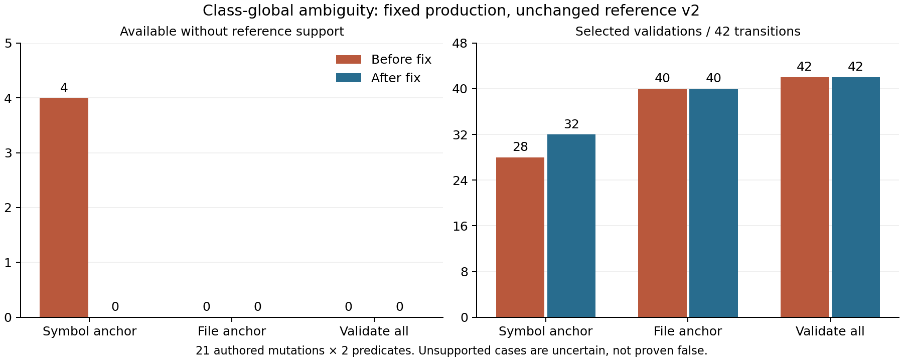

# Исправление пропущенной неоднозначности global в классах

В основном индексаторе исправлен дефект: `global f` в теле класса, включая
вложенные и условные классы, теперь делает модульный subject `f` неоднозначным.
Выборочная проверка выбирает такое утверждение, а структурный валидатор возвращает
insufficient_evidence. Версии AST-индекса и валидатора повышены до 4 и 5, чтобы прежние
ответы не возвращались из кэша. Исправление опубликовано в 700ebf2.

## Наблюдаемый дефект

Исходный модуль содержал `def f(x): return x`. После добавления

```python
class Outer:
    class Inner:
        global f
        f = 0
```

AST самой функции не изменялся. Прежний проход записывал присваивание с префиксом
класса и не связывал global declaration с модульным именем. Полный валидатор
продолжал выдавать supported, а symbol policy пропускала проверку.

Независимый reference v1 тоже пропускал вложенный класс. Сначала отдельно сохранён
его дефект: в frozenchallenge из 21 мутации он расходился с двумя заранее заданными
ответами для nested-class-global. Reference v2 исправляет только обход вложенных
классов; функции и lambda по-прежнему исключаются. Это производная от первой
реализации, а не ещё один независимый разметчик. Исходный AI-пилот не переписан.

## Разделение исправления reference и production

План: 21 мутация × 2 predicates закреплён до запуска. Дополнение для reference v2
закреплено до изменения production-кода. Все три прогона используют одинаковые
исходники и claims. После фиксации reference v2 выполнены отдельные before и after
production-прогоны; hashes reference совпадают.

| Проверка,42 claim-перехода | Production до исправления + reference v2 | Production после исправления + reference v2 |
|---|---:|---:|
| Расхождения полного валидатора с reference | 4 | 0 |
| Доступные утверждения при reference uncertain, symbol anchor | 4 | 0 |
| Доступные утверждения при reference contradicted | 0 | 0 |
| Выбранные проверки, symbol anchor | 28 | 32 |
| Выбранные проверки, file anchor | 40 | 40 |
| Выбранные проверки, all_validate | 42 | 42 |

Четыре problematic cases — два типа claim для прямого и вложенного class-global.
Это отсутствие подтверждения по выбранному критерию, не четыре доказанно ложных
утверждения. Все 42 ответа reference v2 совпали с authored controls. На 42 переходах
получено 126 состояний трёх вариантов политики. Такой авторский набор не измеряет
частоту ошибки или экономию на реальных проектах.



Независимый stdlib-аудитор заново вычислил все состояния трёх прогонов, проверил
48 substantive artifact hashes в каждом и исторические source hashes через Git.
Он подтвердил неизменность входных пар, claims и reference v2 до/после. Изменились
ровно четыре symbol-anchor состояния. Четыре подмены с пересчитанными hashes
отклонены, включая попытку переименовать uncertain в contradicted при сохранении
общего числа неподтверждённых случаев. [Аудит](../reports/research-20261104/reference-alignment-audit-v1.json).

## Изменение и регрессии

Новый небольшой проход рассматривает классы в модульной области, рекурсивно
включая вложенные классы, и собирает их global declarations. Эти имена поступают
в существующую обработку неоднозначности. Он не следует внутрь тел функций или
методов. Обычное class-local присваивание и global другого имени не затрагивают f.

Перед исправлением семь регрессий упали, четыре отрицательных контроля прошли.
После исправления прошёл 161 связанный index/structural test, Ruff и mypy.
Дополнительно проверены шесть реальных Git-историй: прямой/вложенный класс для
symbol_validate, file_validate и all_validate. Последовательность состояний при
перепривязке, постороннем изменении и восстановлении — unavailable, unavailable,
available. Все last_checked_commit совпадают с соответствующими дочерними commits.
Это реальные Git/replay исполнения авторских fixtures, не реальные project datasets.

Отдельная регрессия заполняет validation cache версией 4 с намеренно заданным старым
supported-ответом. Текущий replay не использует этот cache entry и получает
insufficient_evidence. Встроенный AST cache также не принимает version3 entry.
Всего в новом файле 18 тестов; полный набор engine и этих регрессий дал 29 passed.
Независимый reviewer не нашёл блокирующих ошибок в границах top-level subject.
Полная sealed проверка на 700ebf2 завершилась: 1248 passed без skips за 463.75 s,
Ruff и mypy прошли, source snapshots и hashes трёх логов совпали.

Исходные модули слепого пакета, искусственные source fixtures и сохранённые helpers
разметчиков исключены из Ruff как неизменяемые экспериментальные данные. Основной
код, драйверы и tests продолжают проверяться. Архивные исходники не исправлялись
ради линтера: дубликаты и неопределённые имена являются частью контролей.

## Ограничения

Объявление global без записи и недостижимый условный класс консервативно делают
имя неоднозначным. Вызовы функций и динамические namespace effects не исполняются.
Прежняя квалификация метода `C.f` при global declaration внутри C остаётся
отдельным ограничением вне принятого top-level scope. Общий parser CPython
остаётся источником потенциально общих ошибок reference и production.

Исходная provenance реальных claims, их review-pending remarks, labels, receipts
и основной допуск не изменены. В challenge known_incomplete=false относится только
к явно заданной синтетической provenance.

- [Исходный протокол](../examples/structural_closure/reference_alignment_protocol.json).
- [Дополнение для парного сравнения](../examples/structural_closure/reference_alignment_v2_addendum.json).
- [Before с reference v1](../reports/research-20261104/reference-alignment-before-v1/summary.json).
- [Before с reference v2](../reports/research-20261104/reference-alignment-before-v2/summary.json).
- [After с reference v2](../reports/research-20261104/reference-alignment-after-v2/summary.json).
- [Регрессии и независимый review](../reports/research-20261104/class-global-regression-v1/).
