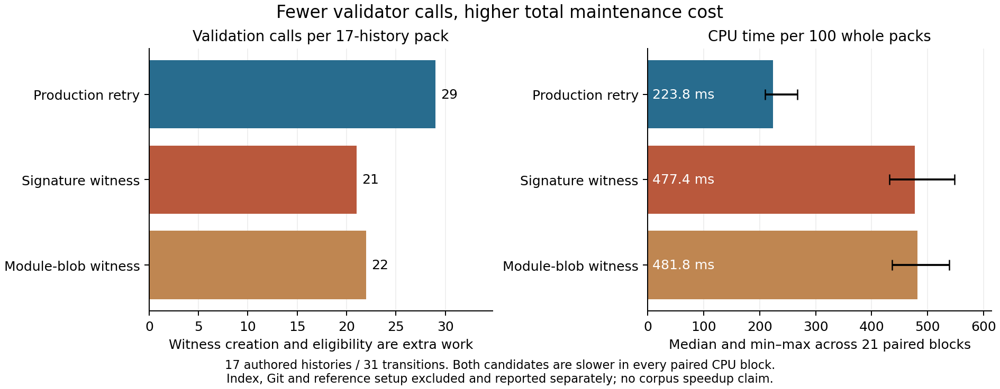

# Повторное использование отрицательного ответа: цена проверки условий

Два исследовательских варианта сократили число вызовов структурного валидатора,
но увеличили CPU-время обслуживания примерно в 2.1 раза. Все 21 парное сравнение
по CPU и wall time оказались хуже обычной перепроверки. На этом авторском workload
гипотеза об ускорении не подтвердилась. Производственная политика остаётся прежней.

## Зачем проверялся этот вариант

В реальном Click replay одно утверждение о точной сигнатуре было опровергнуто,
а следующие семь проверок повторяли тот же ответ из-за `previously_unavailable`.
Возникла проверяемая идея: сохранять отрицательный ответ, если источник,
утверждение и условия валидатора не изменились. Это анализ после наблюдения
Click, а не заранее заявленная гипотеза основного held-out эксперимента.

Слишком простое правило оказалось неверным. Удаление файла, затем замена его
каталога на symlink меняет свежий ответ с `contradicted` на `insufficient_evidence`.
Смена predicate при прежнем claim ID может сделать утверждение истинным.
Наконец, настоящий старый отрицательный ответ можно перенести через восстановление
политикой `keep_all`; совпадение двух последних версий тогда не доказывает, что
они совпадают с версией последней фактической проверки.

Поэтому проверяемые варианты используют свидетельство последнего фактического
`predicate_mismatch`, связанное с полным claim, provenance, контекстом, commit
и validation input hash. Первый сравнивает неизменность точного определения,
второй — полного regular Git blob модуля. Отсутствие, неопределённость, известная
неполнота и другие причины отбора сохраняют перепроверку. При переносе отрицательного
ответа `last_checked_commit` не обновляется. Два прежних контрпримера повторены
с явно обозначенной реконструкцией отвергнутого прототипа; исторический hash
первоначального файла для неё не заявляется.

## Закреплённый опыт

В `cbfbe28` до измерений зафиксированы 80 входов и файлов реализации, 17 конкретных
авторских Git-историй с 31 переходом, три варианта, два warmup-блока и 21 парный
повтор. До фиксации уже прошли 14 тестов, включая correctness-check этих историй;
это раскрыто в протоколе. Реальные corpus-данные в новом опыте не читаются.
Полного перебора произведения всех возможных мутаций здесь нет.

Один измеряемый блок повторяет весь набор 100 раз: 1700 коротких историй,
3100 переходов. Порядок трёх вариантов ротируется и разворачивается между
повторами. В измерение входят production selection, контроль применимости,
создание и обновление свидетельств, фактическая валидация, переход состояния
и учёт работы. Подготовка Git, snapshots, индекса и reference вынесена отдельно.
Связывание контекста кандидатов при подготовке также показано отдельно;
его повторное хеширование во время обслуживания входит в замер.

## Измерение

| Вариант | Проверки на один набор | Пропущено проверок | CPU median на 100 наборов, ms | Wall median, ms |
|---|---:|---:|---:|---:|
| Обычная перепроверка | 29 | 0 | 223.799 | 225.910 |
| Свидетельство сигнатуры | 21 | 8 | 477.429 | 480.222 |
| Свидетельство полного blob | 22 | 7 | 481.752 | 490.317 |

CPU-разность «кандидат минус baseline» положительна во всех 21 парах:
для сигнатуры диапазон 213.137–322.077 ms, для blob — 212.669–320.475 ms.
Все блоки длиннее заранее заданного порога 10 ms. Это диапазоны повторов,
не доверительные интервалы для популяции программ. Индексы уже построены,
workload авторский, хост общий; результат относится к измеряемому обслуживанию.

Сохранены 93 correctness-записи: 31 переход × 3 варианта. На обычных переходах
состояния совпадают со свежей полной production-проверкой. Все 15 пропусков
двух кандидатов сохраняют точный `contradicted/predicate_mismatch`.
В истории переключения политики один шаг намеренно использует `keep_all`:
в каждом варианте он сохраняет скрытым уже истинное утверждение. Эти три
контрольных состояния не скрыты из отчёта; на следующем шаге повторная проверка
восстанавливает доступность. Их нельзя смешивать с ошибками обычного отбора.

## Что добавило стоимость

Отдельный cProfile-прогон выполняет один набор на вариант после всех замеров;
его времена и вызовы не входят в 63 timing samples. В нём baseline вызывает
`digest` 29 раз, а кандидаты — 172 и 177 раз. Дополнительные вызовы обслуживают
связывание claim, provenance, контекста и последнего результата. Сериализация
контекста через `dataclasses.asdict` повторяется 38 и 39 раз. При этом сам
структурный валидатор уже использует готовый индекс и сравнительно дёшев.
Вложенные cumulative intervals профиля нельзя складывать как независимые затраты.

Полученный результат отклоняет эти две реализации как ускорение данного workload.
Он не доказывает бесполезность любого кэширования отрицательных ответов.
Возможный следующий вариант должен связывать неизменные данные при регистрации,
сохраняя проверенные условия идентичности и происхождения ответа. Его потребуется
сравнить на том же наборе с учётом стоимости регистрации, без подмены workload
ради выгодного результата.

## Проверяемые материалы

Исходники до и после замера совпали, ошибок исполнения нет, проверен 151 artifact
hash. Оригинальный каталог содержит вложенные Git repositories, поэтому для Git
исследования подготовлена побайтная копия файлов evidence без внутренних `.git`.
Полный raw-архив отдельно сохраняет все 17 Git databases, fixture symlink и
80 закреплённых файлов реализации. Архив проверен повторным чтением каждого
manifest payload; его SHA-256 приведён в delivery JSON. Исходный run не изменён.

- [Протокол](../examples/negative_structural_carry/protocol.json).
- [Счётчики работы](../reports/research-20261104/negative-carry-maintenance-evidence-v1/expected-work.json).
- [Все timing samples](../reports/research-20261104/negative-carry-maintenance-evidence-v1/timings.jsonl).
- [Сводка измерений](../reports/research-20261104/negative-carry-maintenance-evidence-v1/summary.json).
- [Correctness records](../reports/research-20261104/negative-carry-maintenance-evidence-v1/correctness.jsonl).
- [Полный raw-архив](../reports/research-20261104/negative-carry-raw-v1.tar.gz).
- [Проверка упаковки](../reports/research-20261104/negative-carry-raw-delivery.json).

Независимый stdlib-аудитор проверил 151 artifact hash, 80 sealed inputs,
237 исторических source files, 48 Git snapshots, 31 reference packet, все 93
correctness records и 63 timing samples. Он заново вычислил состояния,
привязки свидетельств, счётчики, медианы и парные разности без запуска benchmark
или импорта production/reference. На обычных 90 записях нет false availability,
available unknown или withheld supported; три контрольных `keep_all` выделены.
Пять подмен с пересчитанными hashes отклонены; всего прошли семь групп контролей.
Установленная версия аудитора повторно проверила mirror с Git databases,
извлечёнными из опубликованного raw-архива. Это дополнительно проверяет упаковку.

Аудит не восстанавливает прошедшее физическое время из артефактов. Числа работы
для untimed warmup и calibration выводятся из закреплённого schedule и per-pack
переходов, а не выдаются за отдельные логи каждого вызова. Метаданные профилей
сверены с бинарными `.prof`; неоднозначные имена зависимостей после `strip_dirs`
не приписываются нашему исходному коду.
[Аудит и его ограничения](../reports/research-20261104/negative-carry-audit-v1/report.json).

Полная проверка 1259 tests относится к `49dc9c2`; новый эксперимент покрыт своими
14 тестами, которые не прибавляются к старому результату полного suite.
