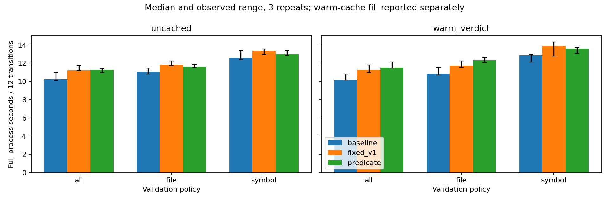

# Проверка CAMI и следующий эксперимент

Работа выполнена на исходном commit `f8e6054c1d243d464c2765ffe7117e0e4493a27e`. Пользовательское изображение `change-aware-memory-workflow.png` сохранено. Исследовательское предложение, ТЗ 1.0 и прежние отчёты не переписаны. Новые материалы находятся в `reports/next-stage-20261001/` и `runs/next-stage-20261001/`.

## Почему получилось 120 из 120

Результат воспроизведён на тех же 12 переходах Click и тех же 120 утверждениях. Это утверждения только о наличии точных функций, а не об их поведении. Ни один из 120 subject не изменился по AST. Только пять находились в изменившемся файле.

Путь выбора выглядит так. Индексатор записывает неразрешённый импорт как неизвестный узел целого модуля `Node(path, qualname=None)`. Отбор строит множество поддерживающих узлов claim. Если в нём есть файл с таким неизвестным узлом, claim получает `unresolved_dependency`. Для file policies без графа любая неразрешённость дополнительно вызывает `graph_free_unresolved_fallback` во всём репозитории.

| Признак исходного запуска | Число claim-transition |
|---|---:|
| Неизвестная поддержка на уровне модуля | 120 |
| Неизвестность непосредственно в subject | 108 |
| Прямое изменение AST subject | 0 |
| Влияние на subject при depth 1 | 0 |
| Изменение файла subject | 5 |
| Выбор symbol_validate только из-за fallback | 120 |
| Выбор file_validate только из-за fallback | 115 |
| Явно неполная provenance | 0 |
| Повторная проверка ранее недоступного claim | 0 |

У symbol_validate причина `unresolved_dependency` встречается 120 раз. У file_validate два fallback-кода встречаются одновременно у всех 120. Ещё у пяти одновременно есть `subject_file_changed` и `anchor_file_changed`. Это пересекающиеся причины, их нельзя складывать как независимые выбранные claims. Та же картина наблюдается у соответствующих invalidation-baselines. `all_validate` получает `all_claims` 120 раз.

В каждом из 12 переходов индекс помечает репозиторий как имеющий global unresolved. Однако код `global_unresolved_fallback` не применяется к этому структурному cohort ни разу, он предназначен для behavior/prose. File fallback расширяется до всех десяти claims в каждом переходе, всего 120 решений. Symbol fallback тоже охватывает весь cohort, потому что все sampled subject принадлежат модулям с неизвестными импортами. Это не доказывает, что каждое локальное неизвестное вычисление влияет на весь репозиторий.

Диагностика разбирает 16 различных ревизий. На первом parent `53f14d3ac4791718f259531dec3433e04a6e45ce` найдены 132 импорта стандартной библиотеки вне индекса, 118 импортов символов, которые индекс не разрешает как однозначную функцию, и восемь внешних либо отсутствующих импортов. Также найдены 935 вызовов атрибутов, 356 вызовов имён встроенных функций, 256 других кандидатов неразрешённых вызовов, 58 вызовов через параметры или затенённые имена и десять вычисляемых callable. Эти категории объясняют исходный код, но не являются взаимно исключающими причинами выбора. Один узел может содержать несколько конструкций. Отдельно зафиксированы 52 определения с флагом неоднозначности во всём parent; это не 52 неоднозначных sampled claims.

Конкретные примеры первого перехода Click:

- `_is_compat_stream_attr` в `src/click/_compat.py` не менялся. Функция и модуль имеют unresolved. Импорты `codecs`, `io`, `os`, `re`, `sys`, `typing` находятся вне индексируемого проекта. Этого достаточно для проверки утверждения о наличии функции.
- `_is_compatible_text_stream` в том же файле не имеет собственной непосредственной unresolved-пометки в исходном индексаторе. Отбор всё равно проверяет её из-за module-level unknown и поддержки `_is_compat_stream_attr`. Так видна разница между локальной неопределённостью и расширением до модуля.
- `_force_correct_text_stream` в том же файле содержит вызовы через параметры `is_binary` и `find_binary`. Для поведения эти вызовы важны. Для утверждения о точном синтаксическом определении функции они не определяют истинность предиката.

Полные пути, commits, пересечения причин и дополнительные примеры сохранены в `reports/next-stage-20261001/baseline-diagnostics/selection_diagnostics.json`. Скрипт `scripts/diagnose_selection.py` воспроизводит диагностику и записывает hash реально импортированного индексатора.

## Исправления ошибок реализации

Для каждого исправления сохранены регрессионные проверки. Первоначальные падения находятся в `reports/next-stage-20261001/reproductions/`.

1. После `def f` последующий `from other import f`, `import other as f` или `del f` не учитывался при проверке неоднозначности. Валидатор возвращал supported. Индексатор теперь отмечает конфликт binding, валидатор возвращает insufficient_evidence. Это осторожная трактовка неоднозначности по исходному ТЗ. Проверки также покрывают for/with/match/except, wildcard import и присваивания через walrus в defaults, декораторах, аннотациях, lambda и выражениях class.
2. При `X = 1; def f(): return X` изменение `X` не выбирало поведенческий claim о `f`. Граф учитывал вызовы, но не неизвестные чтения имён. Теперь такие чтения дают unresolved в поддержке функции. Объединение старого и нового графа и проверка неизвестной поддержки сохранены.
3. Tokenizer parent-oracle мог принять повторное условное определение, tuple assignment, некоторые augmented assignments или синтаксически неверный файл. Теперь кандидат отбрасывается при таких признаках. `compile` используется только для проверки синтаксиса, без исполнения полученного code object. Отбор по именам по-прежнему выполняет tokenizer, а не исследуемый AST-валидатор. Новый фильтр намеренно консервативен и может отбрасывать безвредные совпадения имён во вложенных областях. Он не применяется задним числом к исходным 120 claims.
4. Время фаз не включало публикацию части JSONL и финальное хеширование. Добавлено отдельное `end_to_end_seconds` в manifest и измеренная разница `overhead_seconds`. Последняя запись самой телеметрии не входит в этот интервал. Внешний benchmark измеряет весь процесс, включая эти операции и запуск Python.
5. Pareto-сравнение учитывало только maintenance. Теперь восстановленная стоимость учитывает preflight и полное измерение engine, если оно есть. Для старых артефактов доступна только сумма компонентов фаз; она не называется новым полным измерением. Стоимость генерации provenance и человеческой разметки не подменяется нулём.
6. Версия индексатора повышена до 2, валидатора — до 3. Версия 3 также исключает кеши промежуточного варианта до защиты от конфликта модулей runner. Старый кеш мог содержать supported для определений, которые новая проверка считает неоднозначными. Версия валидатора входит в cache key, поэтому такие записи больше не используются.

Переходы valid, stale, retired и needs_validation, восстановление после revert и повторная проверка ранее недоступных claims сохранены. Labels не входят в SelectionContext или ValidationContext. `run` не вызывает scorer и не открывает child labels. Проверка held-out seal также не читает содержимое labels. Freeze и annotation import относятся к отдельным исследовательским инструментам, которым labels доступны.

Новый parent-фильтр отклоняет часть старых candidates из осторожности, в том числе при безвредном использовании имени в RHS или локальном импорте. Это не доказательство ошибочности старых parent claims. Аудит исходных 120 parent definitions не обнаружил parser limitations или ambiguity flags. Такой аудит production-индексатором не является независимой разметкой.

## Изменение протокола

Сужение fallback не названо исправлением ошибки. Оно записано до запуска в `docs/protocol_1_1.md`.

В версии 1.1 точный структурный claim без явно заданных зависимостей выбирается по изменениям собственного AST и anchors. Автоматически найденные вызовы и импорты не делают его поведенческим утверждением. Сигнатура всё ещё учитывает синтаксис defaults, annotations, decorators и async. Изменение тела тоже может выбрать claim; минимизацию до одного поля предиката мы не вводили.

Известная неполнота provenance, отсутствующие anchors, ограничения парсинга, file anchors, явно заявленные зависимости и повторные проверки недоступных claims остаются консервативными. Изменение разрешения графового binding тоже может выбрать структурный subject. Behavior/prose сохраняют прежние fallback-правила. Поэтому ни одно из исходных 120 утверждений не требует обхода всех зависимостей для своего формального предиката, но из этого нельзя сделать вывод о достаточности такой поддержки для поведенческих утверждений.

Сравнение 1.0 с 1.1 является development-абляцией. Это две разные версии исследовательского протокола на одинаковых входных claims и commits. Независимых child labels по-прежнему нет.

Измерения ограничены одной машиной: Python 3.12.14, macOS 27.0 arm64,
зависимости из неизменённого `uv.lock`. Временная серия выполняется последовательно,
без параллельного запуска тестов и Docker. Файловый кеш ОС и нагрузка других
приложений не управляются. Диапазон трёх повторений — наблюдаемый разброс, а не
доверительный интервал. CPU дочерних процессов и контейнеров не измерен.

## Итоговое сравнение до и после

Завершены все 1188 запусков по сохранённому расписанию: три повторения, seed 42,
12 исходных переходов, три варианта кода/протокола. Проверены одинаковые hashes
claims, provenance, parent evidence и receipts, одинаковый cohort без исключений.
Число выбранных claims, причины и verdicts совпадают во всех трёх повторениях.

`baseline` — исходный код с протоколом 1.0; `fixed_v1` — исправленный код с 1.0;
`predicate` — тот же исправленный код с 1.1. Без кеша логические и фактические
проверки равны числу выбранных claims. Время ниже — сумма по 12 переходам,
медиана трёх повторений; в скобках наблюдаемые минимум и максимум, в секундах.

| Вариант | Политика | Выбрано / проверено | Индекс, с | Полное время процесса, с |
|---|---|---:|---:|---:|
| baseline | all_validate | 120 / 120 | 5.066 | 10.254 [10.097; 10.979] |
| baseline | file_validate | 120 / 120 | 4.971 | 11.074 [10.787; 11.439] |
| baseline | symbol_validate | 120 / 120 | 6.378 | 12.558 [12.420; 13.398] |
| fixed_v1 | all_validate | 120 / 120 | 6.020 | 11.213 [11.174; 11.750] |
| fixed_v1 | file_validate | 120 / 120 | 5.986 | 11.811 [11.732; 12.236] |
| fixed_v1 | symbol_validate | 120 / 120 | 7.534 | 13.325 [12.950; 13.567] |
| predicate | all_validate | 120 / 120 | 5.997 | 11.289 [10.954; 11.416] |
| predicate | file_validate | 5 / 5 | 5.991 | 11.637 [11.510; 11.886] |
| predicate | symbol_validate | 0 / 0 | 7.387 | 12.977 [12.872; 13.371] |

Исправления реализации сами по себе не сократили 120/120. В 1.1 file_validate
сделал 5 проверок, symbol_validate — 0, all_validate — 120. У file_validate
остались только пять `subject_file_changed` и пять пересекающихся `anchor_file_changed`.
У symbol_validate не осталось причин выбора. У вариантов 1.0 причины fallback
полностью повторили baseline: 120 unresolved у symbol, два fallback-кода по 120 у file.

Экономия числа проверок не превратилась в преимущество полного времени перед
all_validate. В 1.1 file_validate занял 11.637 с против 11.289 с у all_validate,
symbol_validate — 12.977 с. Медианы немного меньше соответствующих fixed_v1,
но диапазоны перекрываются; это не доказательство устойчивого ускорения.
Исправленная реализация с протоколом 1.0 в этом замере также дороже исходной.

Причина масштаба расходов видна в измерениях: 120 структурных вызовов валидатора
у fixed_v1 all_validate заняли лишь 0.0363 с после подготовки evidence. Индексация
заняла 6.020 с, preflight — 3.376 с. У symbol_validate 1.1 начальная сборка parent
заняла 5.874 с, обновление и сравнение — 1.516 с. Отказ от столь дешёвых проверок
не оплачивает дополнительную работу индекса. Эти значения — отдельные медианы,
их сумма не обязана точно совпадать с медианой общего времени.

### Прогретый кеш verdicts

AST-кеш каждый раз начинается пустым. До измерения выполняется отдельный
all_validate для заполнения общего кеша; его стоимость не включена в строки
ниже и явно приведена после таблицы. Все фактические валидации в измеряемой
части равны нулю, а логические проверки равны cache hits.

| Вариант | Политика | Логические / фактические / hits | Полное время, с |
|---|---|---:|---:|
| baseline | all_validate | 120 / 0 / 120 | 10.185 [10.151; 10.788] |
| baseline | file_validate | 120 / 0 / 120 | 10.857 [10.681; 11.524] |
| baseline | symbol_validate | 120 / 0 / 120 | 12.861 [12.127; 12.971] |
| fixed_v1 | all_validate | 120 / 0 / 120 | 11.273 [10.987; 11.810] |
| fixed_v1 | file_validate | 120 / 0 / 120 | 11.738 [11.552; 12.267] |
| fixed_v1 | symbol_validate | 120 / 0 / 120 | 13.893 [12.772; 14.323] |
| predicate | all_validate | 120 / 0 / 120 | 11.535 [11.466; 12.162] |
| predicate | file_validate | 5 / 0 / 5 | 12.324 [12.094; 12.637] |
| predicate | symbol_validate | 0 / 0 / 0 | 13.609 [13.083; 13.739] |

Заполнение кеша потребовало по 120 реальных проверок за повторение:
10.808 с у baseline, 11.836 с у fixed_v1 и 11.446 с у predicate (медианы).
Прогретая серия также не показала преимущества выборочных политик над all_validate.
Восстановленные времена проверок сохранены отдельно от фактических и не называются
измеренным полным временем. Preflight, сериализация, хеширование и запуск Python
входят во внешнее измерение процесса. Подготовка набора и труд людей в него не входят.

Во всех 1188 процессах exit code равен нулю. Все выполненные структурные проверки
дали supported; contradicted и insufficient_evidence не было. Это результаты
исследуемого валидатора, а не доказательство истинности всех переносимых claims.
Без независимых labels показатели качества и подтверждение гипотезы остаются неизвестными.

Полные таблицы всех семи политик, отдельные начальные/инкрементальные расходы,
время самих проверок, cache fill, причины, расписание, hashes кода и исходные
измерения: `reports/next-stage-20261001/timing-verified/`. Raw runs находятся
в `runs/next-stage-20261001/timing-verified/`. Незавершённые предварительные серии
`timing` и `final-timing` сохранены, но в итоговые числа не входят.



## Границы готовности

Программа обслуживает фиксированный cohort и позволяет воспроизводить технические измерения. Она не завершает исследование автоматически. Научные показатели точности, stale exposure, retention и selection recall для реального Click здесь не вычисляются. Supported от исследуемого валидатора не превращается в эталон.

Основной набор требует независимого подтверждения parent, проверки исторических поведенческих сред, child-разметки, второго независимого человека минимум для 20% основного набора и adjudication. До этого нельзя утверждать сохранение качества, подтверждение гипотезы или готовность диссертационного результата. M6 и платные API не запускались.

Дополнительные проверки нашли два дефекта измерений и исполнения. На первом переходе symbol-policy сначала индексировала child, а затем parent; поле initial_index_seconds ошибочно показывало уже прогретую сборку parent. Порядок исправлен, регрессия проверяет отдельно холодную сборку и обновление. Поэтому исходное поле initial_index_seconds нельзя трактовать как корректную оценку холодного parent. Для сравнения baseline с исправлением используется общее index_seconds и внешнее время процесса; раздельные cold/incremental значения содержательно интерпретируются у исправленных вариантов.

При подготовке pytest обнаружена более серьёзная проблема исполнения. Runner заранее импортирует установленный pytest. Затем probe с `from _pytest.compat import safe_getattr` мог получить установленный модуль вместо исторического исходника. В искусственном Git-репозитории историческая функция возвращала неправильную строку, но тест ошибочно получал supported. Новый runner обнаруживает конфликт исходных модулей с уже загруженной инфраструктурой и возвращает техническую неопределённость. Он не выдаёт результат установленной библиотеки за проверку исследуемого коммита. Это оставляет конкретное ограничение для исторических behavior-probes pytest: им требуется отдельно проверенный способ исполнения без такого конфликта.

## Подготовленный основной набор

Созданы реальные материалы в `runs/next-stage-20261001/main-ready/`. Сводка находится в `reports/next-stage-20261001/main_preparation_summary.json`, правила и object IDs также сохранены в `data/manifests/main-20261001.*`.

| Репозиторий | Split | Chronological pairs | Enriched pairs | Replay sequences |
|---|---|---:|---:|---:|
| Click | development | 10 | 10 | 0 |
| Requests | heldout | 10 | 10 | 2 |
| pytest | heldout | 10 | 10 | 1 |

Каждая replay-последовательность содержит десять последовательных немержевых переходов. Все исходные claims сохраняются на всех ревизиях. Replay и основные пары не пересекаются; исходный Click-пилот также исключён. Соседние пары внутри одного непрерывного first-parent эпизода имеют общий cluster ID. Основные пары дают 16 Click-, 17 Requests- и 20 pytest-кластеров, а не автоматически 60 независимых наблюдений.

Выборка использует seed 20261001, окно до 2000 first-parent коммитов с 1 января 2018 года и закреплённые refs Click 8.1.8, Requests v2.32.3, pytest 8.3.5. Enriched означает совпадение заранее записанного выражения с Git subject, не известное устаревание claim. Chronological выбирается по фиксированной сетке оставшейся истории. Метаданные child не передаются генератору claims.

Основные пары содержат 600 кандидатов: 240 existence, 240 signature, 60 behavior и 60 prose. Для replay создано ещё 30 начальных кандидатов. Три повторных запуска генератора, включая запуск с окончательным исправлением tokenizer, дали одинаковые hashes всех 630 claims. Это проверка воспроизводимости, а не независимости oracle. Сигнатуры строятся общей функцией нормализации CAMI и требуют независимого подтверждения. Замороженные behavior-probes не были автоматически превращены в parent receipts. Prose ограничено строкой docstring, его не следует считать поведенческой истиной.

Генератор не выбирает claims по изменениям child. Поддержанные на child claims будут controls после независимой разметки. Их доля сейчас неизвестна; подбирать её по ответам policies нельзя.

Подготовлены 1530 пустых первичных заданий и 306 заданий второго разметчика. Это 630 parent-заданий, 600 child-заданий основных пар и 300 child-заданий replay. Для child отдельно сохранены знаменатели main и replay. Назначено 20% второго просмотра в каждой части, но ни один человеческий ответ пока не получен.

У всех кандидатов честно отмечена неполная provenance. Никакой claim ещё не допущен в основной cohort; receipts и labels пусты. Prose исключается из offline оценки, поэтому после подтверждения структурных и поведенческих кандидатов получится не более 540 основных claims. Если исторические behavior-среды не пройдут проверку, останется не более 480. Это ограничение подготовленного набора, а не выполненный эксперимент на 600 истинных claims. ТЗ допускает уточнение объёма до финальной фиксации, но расширять набор после held-out результатов ради значимости нельзя.

Инструкция, формы, команды импорта и оставшиеся действия приведены в `docs/annotation_next_stage_ru.md`. Финальный научный seal не создавался на пустых receipts, поскольку он зафиксировал бы пустой допущенный cohort. Подготовка выборки и hashes уже зафиксирована, финальный freeze выполняется после независимого parent-подтверждения и проверки сред.

## Воспроизведение

Команды выполняются из корня репозитория после `uv sync --locked --extra dev`.
Используйте новый каталог для каждого запуска. Здесь `runs/reproduce-001` — пример
нового пути; существующий каталог намеренно отклоняется. Нужны сохранённые Git objects
Click, Requests и pytest. Для Docker нужен запущенный daemon и локальный образ с
фактическим digest. Платные API не требуются.

```bash
export CAMI_TEST_IMAGE='docker.io/library/cami-probes@sha256:120054cdb5169f81dce7ecf88b644f6879911981a2b5e1df750752d095e0d636'
.venv/bin/python scripts/verify_cami.py --out reports/reproduce-checks-001
.venv/bin/python -m cami.cli demo --out runs/reproduce-demo-001
```

На другом компьютере образ нужно собрать по `docker/Dockerfile.probes` и указать
его действительный digest. Итоговый журнал этой работы:
`reports/next-stage-20261001/frozen-code-verification/checks.json`.
Исходные 99 тестов повторены с прежним исходным кодом после запуска Docker:
`reports/next-stage-20261001/restored-docker/baseline_pytest.log`.
До этого три падения были вызваны недоступным Docker; они сохранены, а не скрыты.

Для повторения исходного анализа не переключайте рабочее дерево назад. Извлеките
исходный `src` отдельно и используйте его через `PYTHONPATH`:

```bash
mkdir -p runs/reproduce-001/baseline
git archive f8e6054c1d243d464c2765ffe7117e0e4493a27e src | tar -x -C runs/reproduce-001/baseline
PYTHONPATH="$PWD/runs/reproduce-001/baseline/src" .venv/bin/python -m cami.cli pilot-run \
  --dataset data/pilot/click-8.1.8/dataset.json --out runs/reproduce-001/baseline-pilot
PYTHONPATH="$PWD/runs/reproduce-001/baseline/src" .venv/bin/python scripts/diagnose_selection.py \
  --dataset data/pilot/click-8.1.8/dataset.json --runs runs/reproduce-001/baseline-pilot \
  --out reports/reproduce-diagnostics-001
.venv/bin/python scripts/benchmark_pilot.py \
  --dataset data/pilot/click-8.1.8/dataset.json \
  --baseline-src runs/reproduce-001/baseline/src --repetitions 3 \
  --out runs/reproduce-001/timing
.venv/bin/python scripts/report_benchmark.py \
  --input runs/reproduce-001/timing --out reports/reproduce-timing-001
```

Не регенерируйте исходный Click cohort новым parent-фильтром для сравнения
до/после: нужен сохранённый `data/pilot/click-8.1.8/dataset.json`.

Отдельный finite environment pilot:

```bash
.venv/bin/python -m cami.cli pilot-environments \
  --dataset data/pilot/click-8.1.8/dataset.json --image "$CAMI_TEST_IMAGE" \
  --out runs/reproduce-environments-001
```

В этой работе smoke выполнен как исходным, так и окончательным кодом: по 72
выполнения теста на 24 ревизиях, по 24 объединённых supported-результата без исключений.
Окончательные результаты находятся в
`runs/next-stage-20261001/completion-environments/`; исходный повтор сохранён в
`runs/next-stage-20261001/click-environments/`. Demo окончательным кодом снова дал
15 проверок all_validate и 8 symbol_validate:
`runs/next-stage-20261001/completion-demo/`. Команды, exit codes и журналы завершающих
проверок находятся в `reports/next-stage-20261001/completion/`. Это проверка одного
замороженного Click smoke, не полных исторических test suites и не эталонные labels.

Для воспроизведения подготовки основного набора:

```bash
.venv/bin/python scripts/prepare_main.py select \
  --corpora data/corpora --pilot-recipe data/manifests/click-pilot.recipe.json \
  --window 2000 --seed 20261001 --out runs/reproduce-main-selection-001
.venv/bin/python scripts/prepare_main.py generate \
  --parents runs/reproduce-main-selection-001/parent_inputs.jsonl \
  --out runs/reproduce-main-candidates-001
.venv/bin/python scripts/prepare_main.py assemble \
  --selection runs/reproduce-main-selection-001/selection.json \
  --candidates runs/reproduce-main-candidates-001 --out runs/reproduce-main-ready-001
```

Исходные URL и закреплённые object IDs приведены в
`data/manifests/main-20261001.selection.json`. Нужны локальные клоны этих трёх
репозиториев. Скрипт сохраняет разрешённые refs, seed, hashes и входы генератора.
Пакеты для передачи людям уже собраны в `runs/next-stage-20261001/main-ready/`;
заново выполнять команды для начала разметки не требуется.

## Что остаётся после этого этапа

1. Получить независимые parent-подтверждения и проверить provenance на parent.
2. Подготовить и проверить исторические среды новых behavior-probes, включая
   отдельное решение конфликта pytest. Не считать ошибки среды отрицательными labels.
3. Провести child-разметку, двойной человеческий просмотр минимум 20% и adjudication;
   сохранить исходные ответы, личность разметчика и фактическое время.
4. Зафиксировать окончательный допущенный cohort, exclusions, все варианты policies
   и финальный seal. Затем выполнить held-out эксперимент без настройки по его ответам.
5. Измерить replay, варианты неполноты provenance и масштабирование на 10/100/1000
   разных допущенных claims там, где они доступны. Здесь 1000 подтверждённых claims
   нет; дубли не выдавались за новые научные наблюдения. На пилоте из одного эпизода
   не строится популяционный доверительный интервал и не объявляется ненаблюдаемая
   точка окупаемости.

M0–M5 теперь имеют дополнительные воспроизводимые проверки, но готовность инструментов
не равна завершению основного исследования. Конкретная внешняя зависимость —
независимые разметчики; техническая — исторические поведенческие среды. M6 остаётся
за пределами текущего задания.
