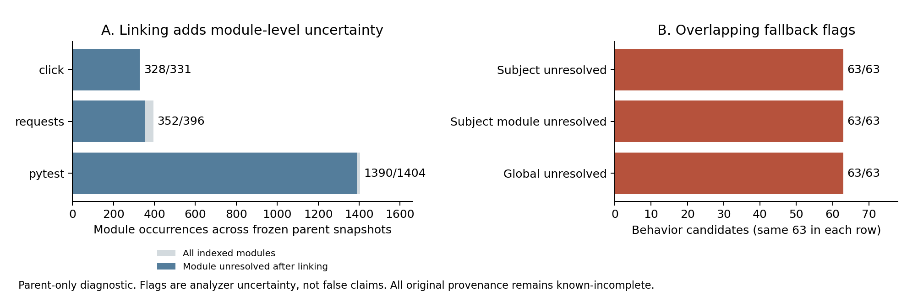

# Ограничения графа на реальных parent-снимках

На всех 63 подготовленных behavior-кандидатах анализатор выставляет одновременно
три флага: unresolved у subject, unresolved у его модуля и global_unresolved
в графе. Поэтому отключение только глобального fallback не сделает эти кандидаты
выборочно проверяемыми. Это parent-only диагностика анализатора; истинность claims
и child-результаты не оценивались.

## Данные и исполнение

Использован прежний фиксированный inventory: 63 parent-группы, 630 candidates
из Click, Requests и pytest. По видам: 252 symbol_exists, 252 signature_equals,
63 behavior_test и 63 prose. Исходные claims/provenance/draft сверены по hashes.
Все 630 provenance по-прежнему known_incomplete; закрытие remarks, receipts,
labels, допуск и MemoryStates не создавались.

Первый план a04464b ошибочно ожидал 126 behavior-кандидатов. Preflight runtime
5c1deca обнаружил 63 и остановился до построения графов и создания output.
Исправление inventory count закреплено в 1714dee; набор не менялся. Успешный
запуск выполнен на 1714dee, только по parent commits. Эта ошибка сохранена в
parent-graph-first-attempt.json. Три профильных теста прошли до запуска.

Для каждого parent read_snapshot и build_index использовали исходные source_roots.
Граф с общим прогретым AST-кешем сравнивался со свежим; все 63 пары совпали.
Сохранены полные графы, факты по модулям и отдельная строка для каждого claim.
Модули, встречающиеся в нескольких parent snapshots, считаются повторно.

## Наблюдения

| Проект | Parent-группы | Behavior-кандидаты | Модули по parent-снимкам | Module unresolved добавлен при связывании |
| --- | ---: | ---: | ---: | ---: |
| Click | 20 | 20 | 331 | 328 |
| Requests | 22 | 22 | 396 | 352 |
| pytest | 21 | 21 | 1404 | 1390 |
| Всего | 63 | 63 | 2131 | 2070 |

Во всех 63 графах global_unresolved=true. У всех 63 behavior-кандидатов
subject_direct_unresolved=true и subject_module_unresolved=true. Кандидатов
с чистым subject и модулем, затронутых только глобальным флагом, не найдено.
Три флага пересекаются: 63+63+63 не являются 189 различными наблюдениями.

У 2131 индексированного модуля не было parse/encoding/size limitations. Модульных
unresolved-флагов непосредственно после parse_module тоже не было; 2070 таких
флагов добавились при связывании imports. Это не означает, что сами функции
не имели unresolved-флагов, или что все runtime-зависимости извлечены.

Дополнительный post-hoc разбор сохранённых imports нашёл явно достаточные
условия связывания у 1912 из этих 2070 модулей. У 1669 есть обычный module import,
который текущий linker консервативно оставляет unresolved; у 1892 есть import
модуля, не найденного в индексируемом наборе. Категории пересекаются. Остальные
158 не объясняются этими двумя простыми признаками; качество разрешения
импортируемого symbol отдельно не оценивалось. Это описание реализации,
не причинная абляция и не разрешение удалить fallback.

## Следствие для выборочной перепроверки

В действующей реализации compare_indexes объединяет unresolved старого и нового
индекса. Поэтому unresolved из parent сохранится в ChangeSet первого следующего
перехода независимо от содержимого child. Selector для behavior проверяет и
subject/module unresolved, и global_unresolved. Если такой parent-кандидат будет
независимо подтверждён и допущен, а исходный граф используется без masks,
первый следующий переход выберет его по unresolved_dependency и
 global_unresolved_fallback даже при закрытой known_incomplete provenance.

Это условное следствие кода и наблюдений parent, не выполненный policy run.
Сейчас known_incomplete уже сам по себе вызывает перепроверку. Даже гипотетическое
снятие этого признака и одного глобального fallback оставило бы локальную причину
у всех 63 behavior-кандидатов. Частота проверок на последующих child transitions
не измерялась, их исходники в этом опыте не читались.

Следовательно, экономию на коротких synthetic fixtures без сложных imports нельзя
переносить на подготовленный реальный behavior-набор без отдельного обоснования.
У структурных predicates protocol1.1 иной контракт; эти наблюдения не опровергают
результат структурного переноса. Для behavior нужен обоснованный способ описывать
границы зависимости и неопределённости либо явное признание полной перепроверки
в неприменимой части набора. Отключение guard без такого контракта не является
улучшением корректности.

## Аудит и пределы

Сверены 68 output hashes, 190 input hashes, 63 Git trees и все 2131 module blob
occurrences. Через git cat-file независимо от индексатора перечитаны 1098
уникальных Git blobs и проверены SHA-256. Флаги всех 630 claims сопоставлены с
сохранёнными графами; snapshots до и после запуска совпали.

Данные зависимы между версиями одного проекта, графы построены тем же CAMI parser,
а audit проверяет соответствие артефактов и исходников. Это не независимая оценка
полноты графа и не человеческое review. Флаг unresolved не означает ложный claim.
Production code, основной протокол и admission не изменены.

Материалы: reports/research-20261104/parent-graph-profile-v2/.
Повтор: `.venv/bin/python -m scripts.check_parent_graph_profile --out runs/NEW_NAME`.
