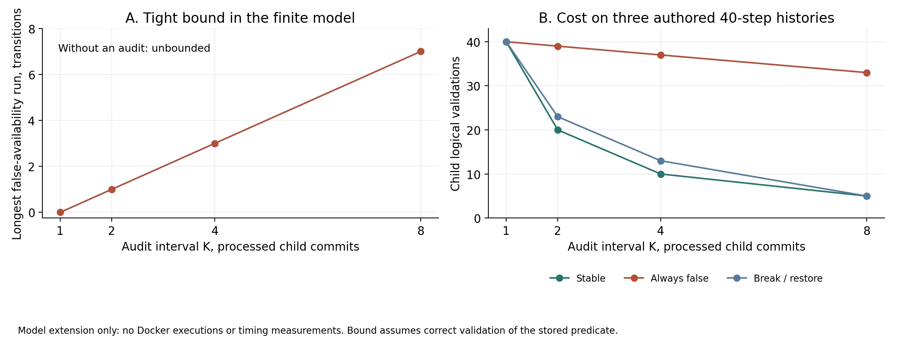
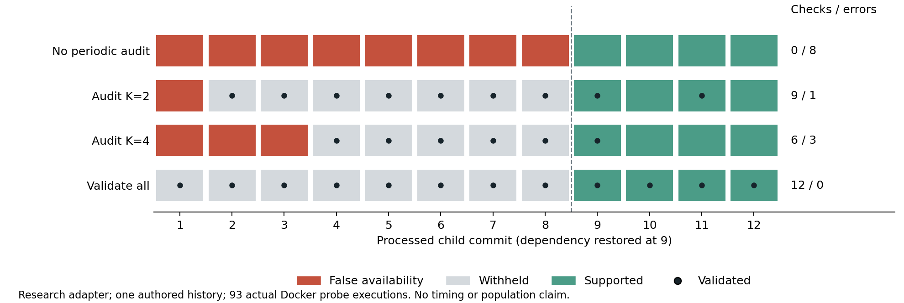

# Ограничение ложной доступности периодической перепроверкой

Проверено исследовательское расширение конечной модели: при обязательной проверке
через K обработанных коммитов непрерывная ложная доступность ограничивается K−1
переходами, если проверка правильно определяет сохранённый predicate. Для K=1,2,4,8
полный обход дал точные границы 0,1,3,7. Действующая production policy не изменена.

Это простой периодический аудит, не заявляемый как новая идея. Результат уточняет,
какую гарантию он может дать CAMI, на какой предпосылке она держится и сколько
логических проверок требует на трёх авторских историях.

## Правило и условный аргумент

К исходному hidden_missing selector добавляется условие `age+1 >= K`.
Age — число уже обработанных child commits после последней validation.
Первоначально age=0. Если сработал обычный selector либо наступил срок, validation
определяет доступность и сбрасывает age=0. При пропуске available сохраняется,
age увеличивается на один. Считается каждый переход, включая коммит с прежним
деревом. Смена постороннего файла сама по себе возраст не сбрасывает.

После корректной validation ложно доступного состояния нет. Поэтому каждое
ложно доступное состояние возникает только после пропуска и имеет положительный
age. Пока ложная доступность продолжается, проверки нет, а age строго растёт.
Проверка выполняется до переноса с age=K и прекращает ложную доступность.
Следовательно, непрерывная серия содержит не более K−1 таких состояний.

Это условный аргумент для завершённых обработанных переходов. Он не ограничивает
время в секундах или число необработанных коммитов. Неверный supported-результат
валидатора нарушает предпосылку; инфраструктурный отказ и поведение потребителя
памяти при незавершённом run требуют отдельной спецификации. Production-гарантия
из одного добавления счётчика не следует.

## Конечная проверка и отрицательные контроли

Взяты запечатанные 14 состояний и 168 переходов исходного hidden_missing графа.
К состоянию добавлен age. Каждый исходный переход сохраняется, а в срок его
доступность определяется известной конечной истиной. Проверено, что полученное
базовое состояние существует в исходном графе. Обход выполняется до полного
замыкания достижимого множества.

| K | Состояния | Переходы | Максимальная ложная доступность подряд |
| --- | ---: | ---: | ---: |
| 1 | 12 | 144 | 0 |
| 2 | 20 | 240 | 1 |
| 4 | 36 | 432 | 3 |
| 8 | 68 | 816 | 7 |

У каждого состояния проверены все 12 successor programs. Всего: 136 состояний,
1632 перехода. Для каждой границы сохранён достигающий её путь; циклов ложной
доступности и состояний ложного скрытия в этих четырёх графах нет.

Два намеренных дефекта обнаружены. Сброс age при любом изменении исходника при
K=4 снова создаёт цикл ложной доступности. Условие `age+1 > K` вместо `>= K`
допускает четыре ложных состояния подряд и нарушает требуемую границу три.

## Цена на фиксированных историях

Каждая история содержит 40 child transitions, f вызывает g, посторонняя VALUE
меняется на каждом шаге. Stable: g=1 всегда. Always false: g=2 с первого child.
Break/restore: g=2 на шагах 1–8, g=1 начиная с шага 9. Parent задан поддержанным;
стоимость его подтверждения в этих модельных счётчиках отсутствует.

В каждой ячейке: **логические проверки / ложно доступные child items**.
Это не время и не число исполненных Docker-проб.

| Правило | Stable | Always false | Break/restore |
| --- | ---: | ---: | ---: |
| Без аудита | 0 / 0 | 0 / 40 | 0 / 8 |
| K=1 | 40 / 0 | 40 / 0 | 40 / 0 |
| K=2 | 20 / 0 | 39 / 1 | 23 / 1 |
| K=4 | 10 / 0 | 37 / 3 | 13 / 3 |
| K=8 | 5 / 0 | 33 / 7 | 5 / 7 |

На stable-истории счётчик требует ровно floor(40/K) проверок. После обнаруженной
порчи прежнее правило previously_unavailable перепроверяет запись на каждом
переходе; поэтому persistent-false история остаётся дорогой даже при большом K.
На break/restore восстановление после обнаруженной порчи происходит сразу
на следующем поддерживающем переходе. Выбор одного «лучшего K» здесь не делается:
цена и допустимая длительность ложной доступности требуют внешнего критерия.

## Проверка результатов и пределы

План закреплён в 1118604 до реализации; runtime — 7ab2d2c. Семь профильных тестов
прошли. Сверены девять output artifact hashes и три frozen input hashes;
source snapshots совпали. Дополнительная проверка по явному deadline-правилу
сверила все 1632 перехода, полноту и достижимость графов, пути достижения границ
и агрегаты всех 15 сорокашаговых workloads.

Фактических Docker executions — ноль. Используется конечная truth из предыдущего
запечатанного графа; новые реальные labels, provenance или receipts не создаются.
Это расширение модели и условная гарантия, а не реализованная production policy,
основная абляция или доказательство для произвольного Python. Все работы выполнены
одним ассистентом, независимое человеческое review не заявляется.

Материалы: `reports/research-20261104/periodic-audit-bound-v1/`.
Повтор: `.venv/bin/python -m scripts.check_periodic_audit_bound --out runs/NEW_NAME`.
Для практической реализации отдельно потребуются контракт возраста по истории
Git, правила обработки незавершённых запусков и проверки реального engine.

## Проверка исследовательского прототипа в Git и Docker

После конечной модели выполнен отдельный опыт на настоящем engine. Протокол
закреплён в 7144fd0 до Docker-запуска, runtime — 04dd04c. Это временная обёртка
selector, не новый production policy и не изменение основного протокола.
Она сохраняет обычный отбор, добавляя `periodic_audit` при наступлении срока.
Возраст вычисляется по `last_checked_commit` и позиции текущего child в
зафиксированной истории; отдельного изменяемого счётчика нет.

Созданы parent и 12 child commits. С первого child g возвращает 2 вместо 1;
на девятом восстановлено g=1. Посторонняя VALUE меняется на каждом шаге.
Все варианты используют один claim `f() == 1`; у selective-вариантов скрыто
ребро f→g. Вердикты исполнения сопоставлены с отдельным ограниченным AST oracle,
читающим фактические Git blobs.

| Вариант | Перепроверки child | Ложно доступные состояния | Docker executions, включая parent |
| --- | ---: | ---: | ---: |
| Без периодического аудита | 0 | 8 | 3 |
| K=2 | 9 | 1 | 30 |
| K=4 | 6 | 3 | 21 |
| Полная проверка | 12 | 0 | 39 |

Все 93 executions проверены по raw payloads: 33 passed, 60 ожидаемых assertion
failures, технических ошибок нет. Все 48 состояний, причины отбора и
last_checked/last_supported соответствуют плану. Отдельная формула по возрасту
сверила каждый переход. Проверены 429 output hashes, 159 input hashes и 253
вложенных artifact hashes; source snapshots совпали. Повторяющиеся деревья Git
имеют разные commits и продолжают учитываться в возрасте.

Результат `insufficient_evidence` отдельно проверен тестом: engine скрывает запись,
а `previously_unavailable` вызывает новую проверку на следующем переходе.
Четырнадцать тестов обёртки проверяют также повторное создание, неверный возраст,
несогласованную историю и маркировку прерванного опыта. Вместе с модельными тестами
прошла 21 проверка. Полный набор до добавления обёртки: 1140 passed на 61a04bf,
ruff и mypy прошли; полный набор на 04dd04c отдельно не запускался.

Каждый manifest с самого начала помечен `evaluation_eligible=false` и содержит
исследовательский override, его SHA-256 и hash истории. Метка сохраняется при
ошибке запуска; существующий результат не перезаписывается. Production source,
схемы, реальные provenance, receipts и labels не изменены.

Это подтверждение конкретной последовательности и интеграционного механизма,
а не универсальная production-гарантия, реализация resume или оценка частоты
ошибок в реальных проектах. Ошибочный supported-вердикт остаётся вне предпосылок.
Время здесь не сравнивалось. Материалы:
`reports/research-20261104/periodic-audit-docker-v1/`; повтор:
`.venv/bin/python -m scripts.check_periodic_audit_docker --out runs/NEW_NAME`.

## Полный пакет исходных свидетельств

Архив `output/periodic-audit-raw-20261104-v1.zip` содержит оба полных raw runs,
включая синтетический Git-репозиторий, все логи 93 Docker executions, графы модели
и точные Git-архивы исходников каждого runtime. Размер — 17104407 bytes; SHA-256:
`7d83ed71d17db7c6ea0d3ff7cbf23fb06efdddcaf07610d87a9519364e16dc38`.

Внутри лежит `audit_bundle.py`, работающий на стандартной библиотеке Python.
Он проверяет ZIP непосредственно, без исполнения вложенных исходников и hooks:
`python3 audit_bundle.py PATH_TO_ZIP`. Проверены 490 файлов пакета, 600 исходных
hash references, 253 вложенных hashes и 384 исходных файла двух runtime snapshots.
Три подмены с пересчитанными внешними hashes отклонены: изменение raw log,
изменение исходника внутри Git-архива и статус failed у исходного run.

Байты Docker image не включены: его digest и версия Python закреплены в protocol.
Сохранённые абсолютные пути описывают исходную машину; повторный опыт следует
создавать архивированным runner в новом каталоге, не переписывая старые artifacts.
Этот пакет позволяет проверить исходные свидетельства и точность runtime-кода;
проверка hashes не является независимым научным review или доказательством
подлинности. Хеш всего ZIP опубликован отдельно в `periodic-raw-delivery.json`.
