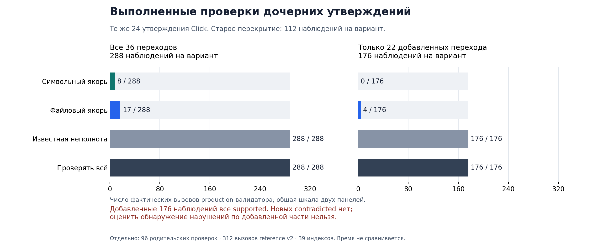

# Расширение Click replay по первым родителям merge-коммитов

На тех же 24 синтаксических утверждениях Click символьный вариант выполнил 8 дочерних проверок, файловый 17, варианты с известной неполнотой и полной проверкой по 288. В добавленной части числа составили 0, 4, 176 и 176. Однако все 176 добавленных наблюдений получили `supported` от reference v2. Новых `contradicted` нет, поэтому расширение не оценивает способность обнаруживать новые нарушения.

Запуск `real-first-parent-replay-v1` завершён на исходном коде `02fcd4a`. Его [manifest](../reports/research-20261104/real-first-parent-replay-v1/manifest.json) фиксирует неизменность реализации до и после исполнения. Ни production `repository.chain`, ни прежний runner не менялись. Отдельный исследовательский driver разрешает только зафиксированную последовательность первых родителей и проверяет полные списки родителей до чтения снимков.



[Открыть HTML с таблицами](../reports/research-20261104/real-first-parent-figure-v1/index.html). [Векторный SVG](../reports/research-20261104/real-first-parent-figure-v1/validation_calls.svg). Источники чисел и их SHA-256 записаны в [plot-data.json](../reports/research-20261104/real-first-parent-figure-v1/plot-data.json).

## Покрытие расширилось, число исходных claims осталось прежним

Три траектории содержат по 12 переходов. В 36 переходах есть 10 merge-коммитов. Каждый merge сравнивается с предшествующим снимком его первого родителя. Деревья боковых родителей в это сравнение не входят.

Единица наблюдения здесь представляет пару "фиксированный claim × дочерний снимок". На один вариант приходится 288 таких пар. Из них 112 уже были в предыдущем запуске, а 176 добавлены сейчас. Четыре варианта дают 1152 строки, но используют те же 24 claims и связанные версии модулей. Это не 288 независимых примеров и не новый набор утверждений.

| Исходная группа | Старых переходов | Добавленных переходов | Добавленных пар на вариант |
| --- | ---: | ---: | ---: |
| `click-1c2fc1b0152f` | 1 | 11 | 88 |
| `click-1e53748f80eb` | 12 | 0 | 0 |
| `click-8c7491d9b0d7` | 1 | 11 | 88 |

[Проверка перекрытия](../reports/research-20261104/real-first-parent-replay-v1/overlap-check.json) подтвердила семантическое совпадение всех 448 старых строк четырёх вариантов и 24 parent-записей. Сравнение сохраняет claims, provenance, выбор проверок, предыдущие и текущие состояния, входные хеши и решения валидаторов. Исключены время исполнения и пути к пакетам входных случаев.

## Меньше вызовов валидатора не означает измеренное ускорение

| Вариант | Все 288 пар | Только 176 добавленных пар | 80 пар на merge-переходах |
| --- | ---: | ---: | ---: |
| Символьный якорь | 8 | 0 | 0 |
| Файловый якорь | 17 | 4 | 1 |
| Известная неполнота | 288 | 176 | 80 |
| Проверять всё | 288 | 176 | 80 |

Таблица показывает фактические дочерние вызовы production-валидатора. Логическое число выбранных проверок совпало с числом исполнений. Каждый вариант использовал собственные provenance и состояния, без подстановки результата другого варианта.

Родительская и общая работа учтена отдельно. Инициализация потребовала 96 actual parent-валидаций, по 24 на вариант. Reference v2 вызван 312 раз: 24 для родителей и 288 для дочерних пар. Три родительских и 36 дочерних снимков дали 39 построений индекса, общих для вариантов. Число вызовов в таблице не включает эти затраты и не доказывает сокращение общего времени.

Источник таблицы и раздельного учёта: [report.json](../reports/research-20261104/real-first-parent-replay-v1/report.json), поля `/variants`, `/primary_new_coverage/variants`, `/topology_strata/merge/variants`, `/parent_initialization` и `/separate_work`.

## Четыре добавленные файловые проверки относятся к трём коммитам

Во всех четырёх случаях файловый вариант выбрал claim с причинами `anchor_file_changed` и `subject_file_changed`. Его production-проверка и reference v2 вернули `supported`. Соответствующая функция отсутствует в записанном множестве изменённых символов. Символьный вариант эти строки не выбрал.

| Claim | Функция и вид predicate | Шаг и коммит | Изменённые файлы |
| --- | --- | --- | --- |
| `click-1c2fc1b0152f-07` | `src/click/core.py::batch`, `signature_equals` | 2, `d5741a2ca2eb`, merge | `CHANGES.rst`, `src/click/core.py`, `src/click/decorators.py` |
| `click-8c7491d9b0d7-01` | `click/core.py::invoke_param_callback`, `symbol_exists` | 6, `72f1f3e20834` | `click/core.py` |
| `click-8c7491d9b0d7-02` | `click/core.py::fast_exit`, `symbol_exists` | 6, `72f1f3e20834` | `click/core.py` |
| `click-8c7491d9b0d7-05` | `click/decorators.py::option`, `signature_equals` | 8, `5d1df0e042b2` | `CHANGES`, `click/decorators.py`, `tests/test_commands.py`, `tests/test_formatting.py` |

Единственная такая проверка на merge относится к `batch` в `d5741a2ca2ebc21d525c903f628b1bebad75b735`. Первый родитель равен `fb7c6dbab505c319dfcbb882e66f313fcbf06a0f`, второй `e234cf958d2416d4b20b53ae850c487fed32fa35`. Изменённые файлы записаны относительно первого родителя. Список родителей служит топологическим свидетельством, а не основанием читать дерево второго родителя.

Эти строки показывают различие отбора по целому файлу и по точному синтаксическому subject. Они не устанавливают, что файловое свидетельство избыточно для любых runtime-утверждений. В этом исследовании predicates ограничены наличием определения и нормализованной синтаксической сигнатурой.

Полные строки, номера строк в `observations.jsonl`, причины и хеши трёх файлов `changes` сохранены в [plot-data.json](../reports/research-20261104/real-first-parent-figure-v1/plot-data.json). Это описание использует записанные артефакты запуска; дополнительное чтение корпуса для него не выполнялось.

## В добавленной части нет отрицательных случаев

Все варианты сохранили доступными 176 добавленных reference-supported наблюдений. Для этой части нулевые `false_available`, `available_unknown` и `withheld_supported` описывают только наблюдавшиеся строки. Условная частота ложной доступности среди reference-contradicted имеет значение `null` с причиной `zero_reference_contradicted_observations`.

На всей траектории есть восемь `contradicted` на вариант. Все восемь уже находились в старом перекрытии и относятся к одному claim, `click-1e53748f80eb-04`, о сигнатуре `src/click/shell_completion.py::shell_complete`. Это последовательные состояния одной изменившейся функции. Первый выбранный шаг был пятым, последующие семь выбирались из-за прежней недоступности. Новое расширение не добавило независимых отрицательных примеров.

На всех 288 парах каждый вариант имеет 280 доступных reference-supported наблюдений, восемь недоступных reference-contradicted и ноль reference-unknown. Ложной доступности в этих данных нет. Положительная добавленная часть не позволяет оценить чувствительность, а восемь связанных отрицательных состояний не задают независимую популяционную частоту ошибки. Сравнение merge и nonmerge также не измеряет причинный эффект слияния.

Reference v2 отделён от отбора и ведения состояния, но разделяет с production CPython `ast` и синтаксический контракт. Его `supported` не подтверждает runtime-поведение. Этот development replay использует выбранные после прежних наблюдений траектории и не является held-out оценкой. AI-подтверждения родителей остаются AI-подтверждениями, без человеческого review или production admission.

Для воспроизведения рисунка нужен только сохранённый запуск:

```bash
.venv/bin/python scripts/plot_real_first_parent.py \
  --run reports/research-20261104/real-first-parent-replay-v1 \
  --out reports/research-20261104/real-first-parent-figure-v2
```

Helper сверяет точный хеш manifest, хеши использованных артефактов и согласованность report с actual rows и costs. Он не вызывает Git и не читает новые снимки корпуса. Эти сверки проверяют целостность представления и не заменяют независимый аудит эксперимента. Каталог результата должен быть новым.

## Независимый аудит записей

Установленный stdlib-аудитор проверил 1290 артефактов, 134 закреплённых входа,
251 исторический файл реализации, все 1152 наблюдения, 312 пакетов Git/AST и
1048 строк учёта работы. Он заново вычислил состояния и метрики без импорта CAMI,
драйвера или reference. Прежние 448 наблюдений и 24 parent records совпали.
Десять подмен с пересчитанными хешами отклонены; отдельно проверены семь отказов
за пределами поддерживаемого синтаксиса и положительный случай deferred body.

Проверка читала только 39 разрешённых исходных снимков, без side-parent trees.
Общий CPython AST и узкий синтаксический контракт остаются ограничениями.
Учёт записанных вызовов не является независимым наблюдением прошлого физического
исполнения или времени. [Результат и ограничения](../reports/research-20261104/real-first-parent-audit-v1/report.json),
[контрольные подмены](../reports/research-20261104/real-first-parent-audit-v1/tamper-checks.json).
