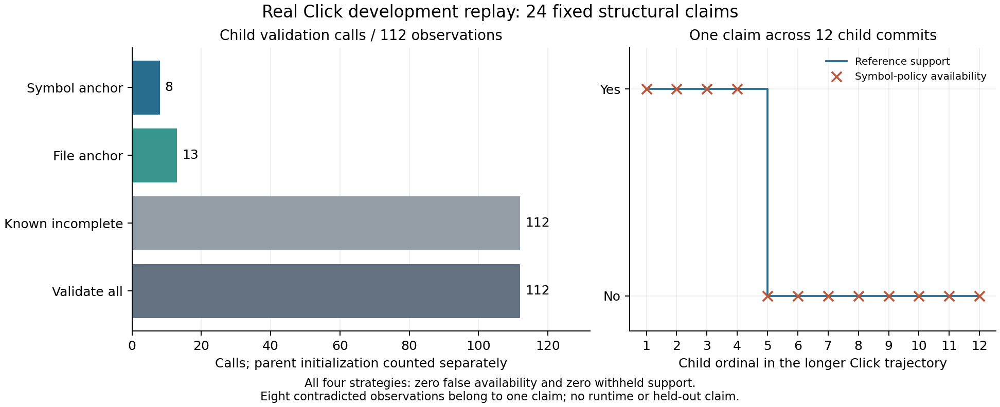

# Реальная история Click: фиксированные структурные утверждения

В development-опыте отбор по символу выполнил 8 дочерних проверок вместо 112 у
`all_validate`. Во всех четырёх вариантах доступность совпала с независимым
синтаксическим reference: 104 подтверждённых состояния доступны, 8 опровергнутых
скрыты, неопределённых состояний нет. Это результат на 24 заранее закреплённых
утверждениях одного проекта. Экономия относится к числу вызовов валидатора;
ускорение полного исполнения здесь не измерено.

## Что было закреплено до доступа к дочерним исходникам

Commit `56750dd` содержит протокол, исходные claims, варианты provenance,
точные Git IDs, AI-confirmations, reference v2, драйвер и seal из 117 файлов.
Три development-группы выбраны ранее для слепого AI-пилота. Все 24 authentic claims
сохранены побайтно по полям; 12 авторских controls в этот replay не включены.
Точное соответствие AI-ответа оригинальному claim проверяется через private map,
публичный case, hash claim и parent-исходника. Это AI-подтверждения, не human labels.

Правило продолжения истории использует локальную границу Click 8.1.8:
12 последовательных single-parent commits, начиная с исходного child; если в
12 шагах есть merge, целиком остаётся исходная пара parent/child. До чтения кода
получились три длины: 1, 12 и 1. На группу приходится 8 claims, поэтому знаменатель
равен 8 + 96 + 8 = 112 claim-child observations на вариант, всего 448 записей.
Отклонённые продолжения, side parents и held-out группы не входят в область доступа.

Первоначальный provenance не переписан. Отдельные экспериментальные варианты
используют один symbol anchor, один file anchor либо symbol anchor с флагом
`known_incomplete`. Заявленная полнота первых двух — предположение этого
исследовательского опыта; он не создаёт admission, receipts или права включить
эти данные в прежний основной протокол. `evaluation_eligible=false`.

## Наблюдаемые результаты

| Вариант | Дочерние вызовы валидатора | Переносы без проверки | Ложно доступны | Подтверждены, но скрыты |
|---|---:|---:|---:|---:|
| Symbol anchor | 8 | 104 | 0 | 0 |
| File anchor | 13 | 99 | 0 | 0 |
| Known incomplete | 112 | 0 | 0 | 0 |
| All validate | 112 | 0 | 0 | 0 |

Все 24 parent claims прошли reference и фактическую production-инициализацию;
исключений и первоначально скрытых состояний нет. К указанным числам отдельно
относятся 24 parent validations на вариант, 24 parent reference calls,
112 child reference calls и 17 общих построений индекса. Production-валидация
каждого выбранного варианта действительно вызывалась со своим provenance;
готовые verdict results между вариантами не переиспользовались. Индексы и AST
cache общие. Поэтому ни отношения вызовов, ни записанные интервалы отдельных
фаз нельзя выдавать за ускорение самостоятельного запуска каждой стратегии.

В двух коротких группах ни одно из 16 утверждений не изменило истинность:
symbol/file не выполняли дочерних проверок, остальные варианты сделали по 16.
В длинной группе symbol выполнил 8 проверок, file — 13, остальные — по 96.
Таким образом, преимущество измерено на нескольких связанных последовательностях,
а не на 112 независимых случайных примерах.

## Что именно устарело

Утверждение `click-1e53748f80eb-04` задаёт точную нормализованную сигнатуру
`src/click/shell_completion.py:shell_complete`. На пятом дочернем commit
`8473b3ced140296b9dd869957e0026eebd94634b` аннотация параметра `ctx_args`
изменена с `t.Dict[str, t.Any]` на `t.MutableMapping[str, t.Any]`.
Имя параметра, его вид и default не изменились. Это нарушение точного
синтаксического утверждения; из него не следует поведенческая несовместимость API.

Несовпадение сохраняется до двенадцатого child. Восемь contradicted observations
принадлежат **одному claim и одному возникновению изменения**. Symbol policy
выбрала его при изменении AST, затем ещё семь раз из-за `previously_unavailable`.
Все восемь раз состояние осталось скрытым. Ноль ошибок на этой последовательности
не даёт основания оценивать надёжность на других проектах или видах claims.

## Воспроизводимость и границы

Драйвер применяет реальные `read_snapshot`, `build_index`, `select_claims`,
`validate_claim` и `advance_state`. Сначала фиксируются переходы всех четырёх
политик, затем вычисляется child reference; reference не управляет отбором.
Отдельный Git reader получает точный путь по закреплённому commit, сохраняет
raw tree, исходный blob, case и решение. Код проекта не выполняется.
Reference реализован отдельно от production, но обе реализации используют
CPython AST; общие ошибки синтаксического критерия остаются возможны.

Запуск завершён на `56750dd` с одинаковыми source snapshots до и после.
Manifest содержит 562 hashes артефактов. Перед запуском прошли 11 тестов драйвера
на авторских Git fixtures; полный suite из 1248 tests относится к предыдущему
production commit `700ebf2`, а не ко всем позднее добавленным исследовательским
скриптам. Новый независимый аудит raw records выполняется отдельно.

- [Протокол и входы](../examples/real_structural_replay/protocol.json).
- [Итоговые счётчики](../reports/research-20261104/real-structural-replay-v1/report.json).
- [Все переходы](../reports/research-20261104/real-structural-replay-v1/observations.jsonl).
- [Manifest и source seals](../reports/research-20261104/real-structural-replay-v1/manifest.json).
- [Драйвер](../scripts/run_real_structural_replay.py).
