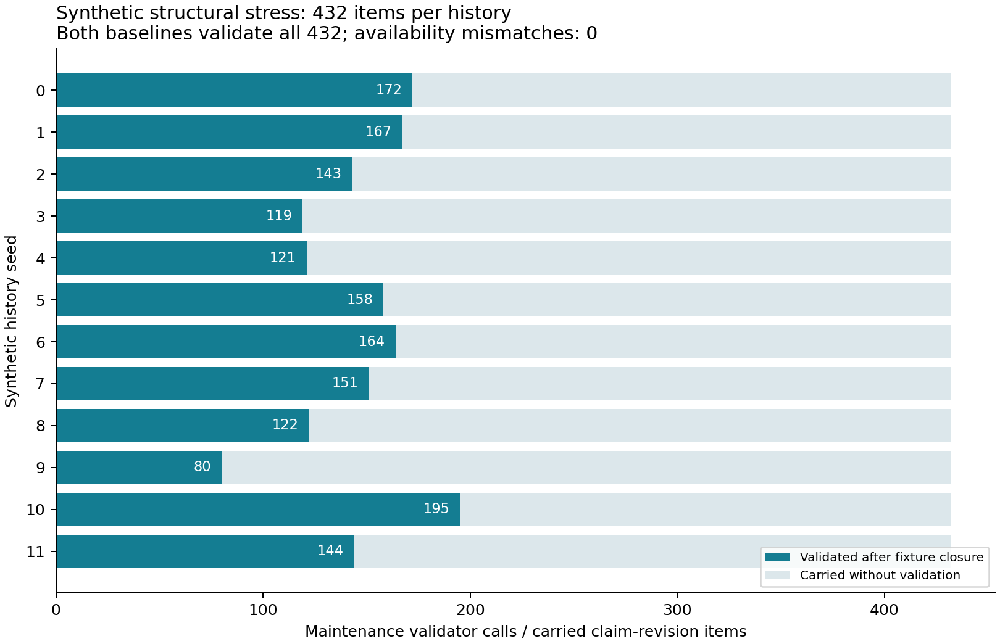
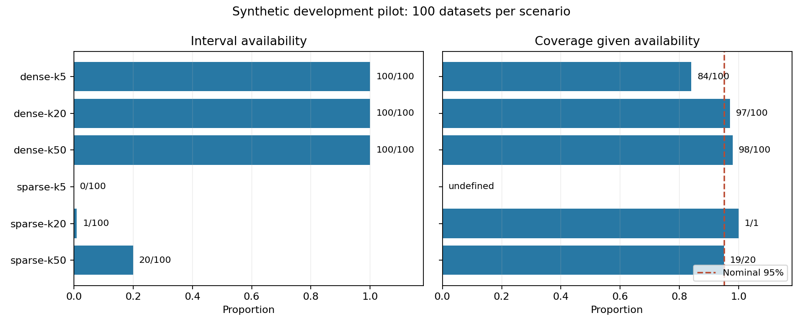

# CAMI: предварительные научные результаты

**Проверка реализации, development эксперименты и условия основного исследования**

29 октября 2026 года. Материалы к магистерской работе.

CAMI реализует обслуживание памяти об утверждениях о коде: изменения репозитория
выбирают записи для повторной проверки, после которой обновляется их доступность.
На текущем этапе проверена работа конкретных механизмов и выявлены ограничения
статистической оценки. Основная гипотеза об экономии при сохранении качества
на реальных исторических изменениях ещё требует независимой разметки и допуска
основного набора данных.

Отчёт объединяет воспроизводимые результаты разработки. Он не заменяет исходное
исследовательское предложение и не является финальным отчётом по held-out
эксперименту. Все синтетические данные обозначены явно. Техническую перепроверку
проводила отдельная модель gpt-6.1-sol; она не заменяет человеческую разметку
или независимое авторство предметных подтверждений.

Состояние доказательств: commit `4e13583`. Полные команды, журналы и последующая
история сохранены в репозитории; основные источники перечислены в конце отчёта.

---

## 1. Исследовательский вопрос и критерии

Выборочная проверка должна уменьшать стоимость обслуживания памяти, сохраняя
полезные записи и ограничивая доступность устаревших. Это три разных измерения.
Меньшее число вызовов валидатора не означает автоматически меньшее полное время
работы: индекс, provenance, подготовка данных и работа разметчиков тоже имеют
стоимость.

Политика выбирает утверждение для проверки; валидатор устанавливает степень
поддержки; состояние памяти определяет доступность. Эталонная разметка находится
за пределами этих решений. Иначе оценка повторяла бы ответ самого исследуемого
метода. Недостаточные основания сохраняются как `uncertain`, а не превращаются
в отрицательную истину.

Пусть A — доступные записи, S — независимо подтверждённые, C — независимо
опровергнутые. Основные показатели:

```text
stale_exposure  = |A ∩ C| / |C|
valid_retention = |A ∩ S| / |S|
```

Нулевой знаменатель означает неопределённую метрику. Exposure измеряет возможность
выдать устаревшую запись, а не наблюдаемую частоту её показа пользователю.
Очистка всей памяти исключает и устаревшие, и полезные записи, поэтому результат
оценивается совместно по exposure, retention и стоимости. До основного эксперимента
не вводится подобранный по development результатам порог приемлемого риска.

## 2. Смешанные структурные истории

План был зафиксирован до полного запуска. Двенадцать seeds задают истории из
18 переходов; parent fixture содержит три файла по четыре функции. Для каждой
функции заданы existence и signature claims, всего 24 утверждения. Истории
включают изменения тела и сигнатуры, повторное определение, удаление функции
и файла, синтаксическую ошибку, восстановление и отсутствие изменений.

Ожидания задаются состоянием генератора и отдельно проверяются по фактическим
Git blobs через tokenizer с compile-only проверкой синтаксиса. Oracle не вызывает
индексатор или валидатор CAMI. Его независимость ограничена реализацией проверки:
CPython остаётся общей зависимостью, грамматика fixture узкая, независимых
человеческих labels здесь нет.

Сравнивались три варианта. Closure подготовлена по parent до создания child
commits и разрешена только для synthetic development данных. Известная неполнота
provenance реальных claims этим действием не снимается.

| Вариант | Maintenance validations | Items без повторной проверки |
| --- | ---: | ---: |
| all_validate | 5184 | 0 |
| symbol_validate, исходная неполная provenance | 5184 | 0 |
| symbol_validate, fixture-only closure | 1736 | 3448 |

Все 36 запусков завершены. На вариант приходится 5184 child claim-revision items;
всего проверены 15 552 сохранённых состояния. Предусмотренных расхождений с oracle
не обнаружено. Проверялись доступность, verdict, основания переноса и lineage
последней проверки и поддержки. Среди child items oracle выделил 3761 supported,
751 contradicted и 672 uncertain. Из 216 запланированных событий 185 действительно
изменили Git tree.



*Рисунок 1. Число maintenance validations. Источник: E1. Расходы на closure,
oracle, индекс и Git I/O в эти числа не входят.*

В этом наборе closure позволила избежать 3448 вызовов, или 66,5123% от baseline.
Это результат конкретного сочетания структурной provenance и выборочной политики.
Он не является измерением ускорения, экономии ручного труда или качества на
реальных репозиториях. Общий parent и частично общие префиксы историй исключают
трактовку всех сохранённых строк как независимых наблюдений. Ноль обнаруженных
расхождений не означает нулевую вероятность будущей ошибки.

## 3. Проверка статистической процедуры

### 3.1 Доступность интервала и покрытие

Development pilot содержит шесть сценариев по 100 независимо сгенерированных
datasets. Число кластеров K равно 5, 20 или 50, вероятность активности q — 1
или 0,1. Политики внутри пары используют общие случайные элементы. Истинная
разность популяционных micro rates выведена из генератора и равна 0,1.
Производственный paired cluster bootstrap не менялся.

| Сценарий | CI доступен | Покрывает среди доступных | Доступен и покрывает среди всех |
| --- | ---: | ---: | ---: |
| dense-k5 | 100/100 | 84/100 | 84/100 |
| dense-k20 | 100/100 | 97/100 | 97/100 |
| dense-k50 | 100/100 | 98/100 | 98/100 |
| sparse-k5 | 0/100 | не определено | 0/100 |
| sparse-k20 | 1/100 | 1/1 | 1/100 |
| sparse-k50 | 20/100 | 19/20 | 19/100 |

Условное покрытие 19/20 в sparse-k50 скрывает 80 недоступных интервалов из 100.
При 100 trials верхняя граница Monte Carlo standard error доли составляет 0,05;
для условной доли с одним наблюдением она равна 0,5. Это стандартные ошибки
симуляционного pilot, не доверительные интервалы исследуемого эффекта.
Результат не устанавливает универсально достаточное число кластеров.



*Рисунок 2. Разные знаменатели availability и conditional coverage.
Источник: E2. Все 600 datasets искусственные; номинальное покрытие не считается
подтверждённым для будущих реальных данных.*

При существующем правиле любой resample с нулевым знаменателем делает CI
недоступным. Если Z из K кластеров пусты и Z<K, вероятность доступного интервала
после B независимых resamples равна `[1 − (Z/K)^K]^B`. При Z=K уже исходная
sample estimate не определена. Для исходного Bernoulli-генератора точное
суммирование по распределению Z объясняет наблюдаемые отказы.

Увеличение B не исправляет отсутствие поддержки: оно повышает шанс обнаружить
недопустимый resample. Этот вывод не разрешает уменьшать B ради более красивого
отчёта или молча удалять неудачные resamples. Любая альтернатива требует отдельного
описания и проверки coverage. Источник: E3.

### 3.2 Разные знаменатели у двух политик

Отдельный условный анализ фиксирует support sets. Пусть L и R — числа кластеров
с положительными знаменателями слева и справа, J — размер их пересечения.
Вероятность недопустимого resample вычисляется включением-исключением:

```text
r = ((K-L)/K)^K + ((K-R)/K)^K - ((K-L-R+J)/K)^K
P(CI available | support sets) = (1-r)^B
```

Формула второй строки применяется при K≥2 и L,R>0. При L=0 или R=0 исходная
rate estimate не определена. При K<2 обычный CI не рассчитывается.
При фиксированном seed исход детерминирован; вероятность относится к распределению
bootstrap draws. Это не безусловная вероятность по генератору datasets.

Рассчитаны все 60 заранее запланированных комбинаций. При K=20, L=R=8 и B=2000:

| Пересечение J | Условная вероятность доступного CI |
| --- | ---: |
| 8, полное | 92,948510% |
| 4, частичное | 86,395923% |
| 0, отсутствует | 86,394024% |

Отсутствие jointly-positive cluster само по себе не запрещает CI. При K=2,
L=R=1 и J=0 resample может выбрать разные кластеры для разных сторон. Для B=2
вероятность доступности равна 1/4. Очень малые вероятности сохраняются Decimal
строками: для этого примера при B=2000 значение около 8,709809816e-603 остаётся
положительным, хотя binary float округлил бы его до нуля.

Независимая перепроверка использовала целочисленный подсчёт с четырьмя состояниями,
точную рациональную степень и 160-значное деление. Все 60 строк согласованы
в пределах половины последнего сохранённого разряда. Дополнительно проверены
67 328 resamples и 144 последовательности производственного bootstrap.
Это анализ availability; выводов о coverage или эффективности CAMI он не даёт.
Источник: E4.

### 3.3 Область применимости к метрикам CAMI

Основные exposure и retention имеют общие label denominators при одинаковых
cohort, labels и кластеризации. Поэтому разное пересечение J не является
отдельным источником различий их сравнительной availability. Общие знаменатели
также имеют valid_withholding, selection_recall, false_invalidation и
invalidation_recall, когда соответствующая метрика применима.

Policy-dependent support возможна у available_contamination, invalidation_precision
и invalidation_f1. Для F1 знаменатель равен размеру P плюс размер C, где P
ограничено бинарно размеченными подтверждёнными инвалидациями. Поэтому поддержка
F1 может различаться только в кластерах без contradicted labels.

Эти тождества проверены на 729 искусственных комбинациях трёх labels и трёх
состояний для трёх claims. Отдельно проверены 14 580 applicability условий.
При not_applicable scorer сохраняет raw counts, но value=null; aggregate проверяет
reason до bootstrap. Наличие числового знаменателя не делает метрику применимой.
Replay-последовательности имеют отдельный запрет population CI. Это проверка
алгебры scorer, не исполнение политик или доказательство всех возможных входов.
Источник: E5.

## 4. Работа памяти на настоящих исходниках

Foreground memory проверена через публичный CLI в отдельных закреплённых копиях
Click, Requests и локального TypeScript проекта. Для одного subject в каждом
проекте создавались existence claim, signature claim и ручная заметка. Проверялись
регистрация, сохранение между процессами, изменения тела и сигнатуры, parse error,
удаление, возврат исходных bytes и явное обновление заметки. Все три итоговые
серии по 18 CLI-команд завершились успешно. Копии восстановлены и чисты по Git.

Отдельный watcher-прогон на TypeScript source tree охватывал 492 начальных source
references. Состояние читалось независимым stdlib SQLite reader до любого context
query, который сам мог бы обновить память. Затем запрос должен был вернуть ту же
generation без новой публикации. Восемь изменений исходников обработаны фоном;
явный CAS update заметки отдельно отнесён к foreground-команде.

Все 12 этапов повторного прогона завершены. Сохранены 11 persisted proofs и
35 foreground CLI-команд. Независимый reviewer сопоставил все исторические heads,
record states и source references с конечной SQLite. Owned watcher завершился,
lease свободен; bytes и mode исходного файла восстановлены. Источник: E6.

Первый watcher-прогон сохранён как failed: драйвер ошибочно ожидал, что historical
latest_successful watcher подтвердит уже выполненный foreground note update.
Перед повтором уточнён план атрибуции; все мутации сохранены. Это исправление
ожидания эксперимента, а не скрытое исключение неудобного случая.

Настоящие файлы здесь подвергались авторским мутациям. Эти проверки устанавливают
работу конкретных контрактов продукта, но не естественную частоту устаревания,
пользу для разработчика или ускорение. Код целевых приложений не исполнялся.

## 5. Готовность основного исследования

Восстановлены 630 parent candidates в 63 группах: 600 claims для 60 основных пар
и 30 исходных claims трёх replay-групп. На child-стороне это 600 основных и
300 последовательных claim-revision items. Повторы replay не являются новыми
независимыми утверждениями. Подготовлены пустые формы и проверенные исходники;
независимых ответов и parent receipts пока нет. Все флаги known_incomplete
сохранены. Источник: E7.

Технические parent diagnostics не являются независимым допуском. Например,
дополнительный pytest-профиль v2 завершил 63 прямых вызова одного frozen probe
на 21 parent после явного восстановления зависимости packaging. Он не использует
обычный pytest framework, fixtures или plugins и не заменяет production validator.
Первая версия с тремя техническими ошибками сохранена. Источник: E8.

Для основного сравнения остаются необходимые условия:

- Независимые parent decisions с корректным авторством и разрешением разногласий.
- Содержательная проверка provenance для каждого допускаемого claim.
- Независимые child labels с честным uncertain и изоляцией от policy/validator process.
- Фиксация cohort, протокола, episode clusters, метрик и порядка измерений стоимости.
- Проверки допуска и freeze до исполнения real held-out policies.

Автоматические hashes и успешные авторские probes не заменяют эти условия.
Реальные оценки stale exposure, retention и эффективности остаются неизвестными.

## 6. Проверяемость и ограничения

Последний полный suite на `44c77d3`: 1046 passed без пропусков; Ruff и mypy прошли.
После него production-код и схемы не менялись; новые исследовательские drivers
проверялись профильными suites и реальными запусками. Последний профильный набор
содержал 87 tests. Это не новый полный suite текущего HEAD. Источник: E9.

Сохраняются исходные inputs, revisions, команды, stdout/stderr и hashes.
Незавершённые прогоны помечаются отдельно. В частности, частичный parent diagnostic
сохраняет завершённые наблюдения, но не выдаёт их число за точный общий расход
при сбое следующей группы. Hash связывает файлы; сам по себе он не доказывает
истину, авторство или правильность статистического метода.

Существенные ограничения результатов: узкая синтетическая грамматика, зависимость
наблюдений внутри историй, авторский выбор product subjects и мутаций, ограниченная
Monte Carlo точность pilot и отсутствие независимой разметки реального cohort.
Исторические persisted JSON и логическая история watcher проверены; отдельные
raw SQLite bytes каждой промежуточной фазы не архивировались.

Обоснованный итог текущего этапа — проверенная осуществимость конкретных механизмов,
воспроизводимые development результаты и явные условия их научной оценки.
Универсальная экономия, безопасность памяти и основная эмпирическая гипотеза
этими проверками не установлены.

## Источники и воспроизведение

Все пути ниже заданы относительно корня репозитория CAMI. Переносимый пакет
содержит этот текст, DOCX/PDF, графики и выбранные компактные evidence. Полные raw
runs и локальные репозитории остаются отдельными входами; пакет не заменяет их.

- E1: `docs/structural_closure_demo_ru.md`; `reports/research-20261029/structural-stress-v1/`.
- E2: `docs/bootstrap_study_2026-10-29.md`; `reports/research-20261029/bootstrap-study-v1/`.
- E3: `docs/bootstrap_availability_mechanism_2026-10-29.md`; `reports/research-20261029/bootstrap-availability-v1/`.
- E4: `reports/research-20261029/paired-support-v1/independent-review.json`; `reports/research-20261029/paired-support-v2/`.
- E5: `reports/research-20261029/metric-denominators-v2/`; `scripts/audit_metric_denominators.py`.
- E6: `docs/product_memory_real_repositories_2026-10-29.md`; `docs/product_watch_real_repository_2026-10-29.md`.
- E7: `docs/annotation_restoration_2026-10-29.md`; `docs/parent_review_instructions_ru.md`.
- E8: `reports/research-20261029/parent-functions-v1/`; `reports/research-20261029/parent-functions-v2/`.
- E9: `reports/research-20261029/parent-function-full-verification/checks.json`; `reports/research-20261029/metric-denominators-focused.log`.

Для повторения вычислительных этапов предусмотрены команды в соответствующих docs.
Они требуют новых output directories и сохраняют старые результаты. История решений
и commits: `docs/research_run_2026-10-29.md` и `reports/research-20261029/decisions.tsv`.
