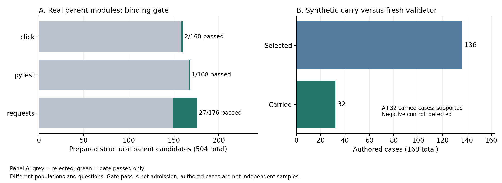
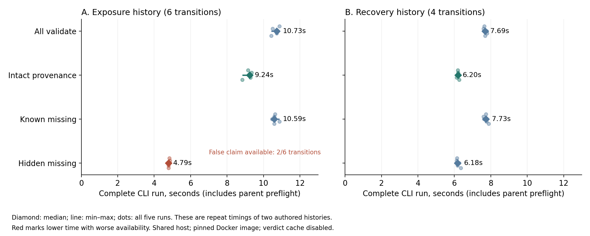
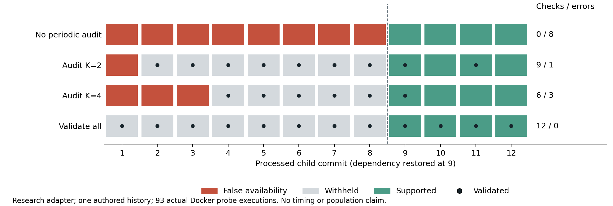
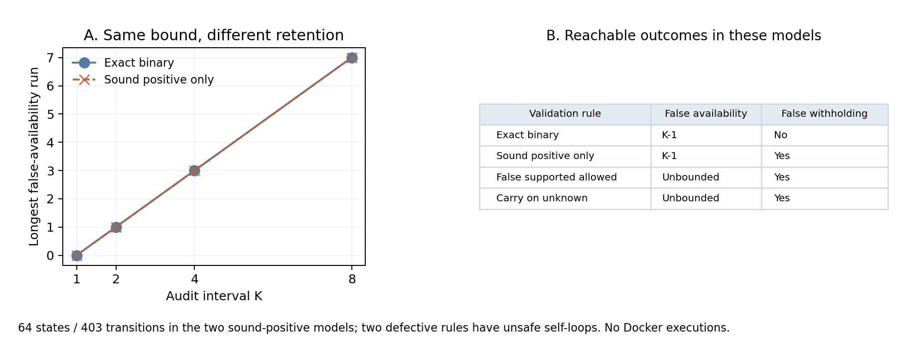
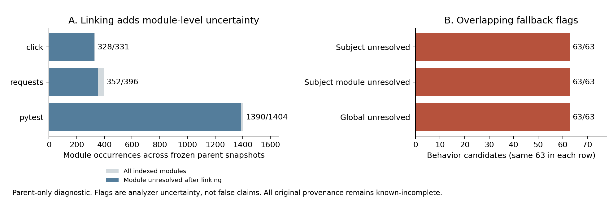
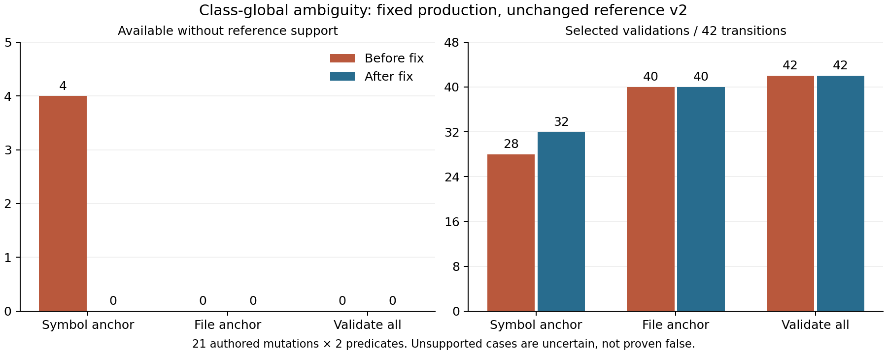
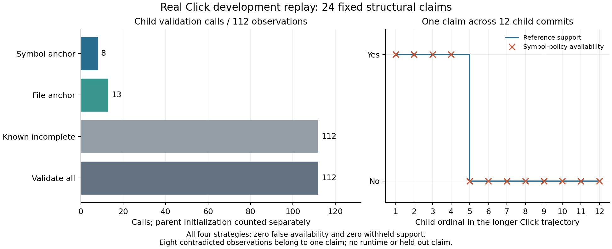
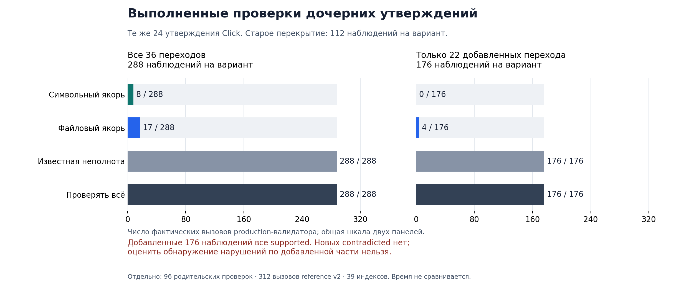
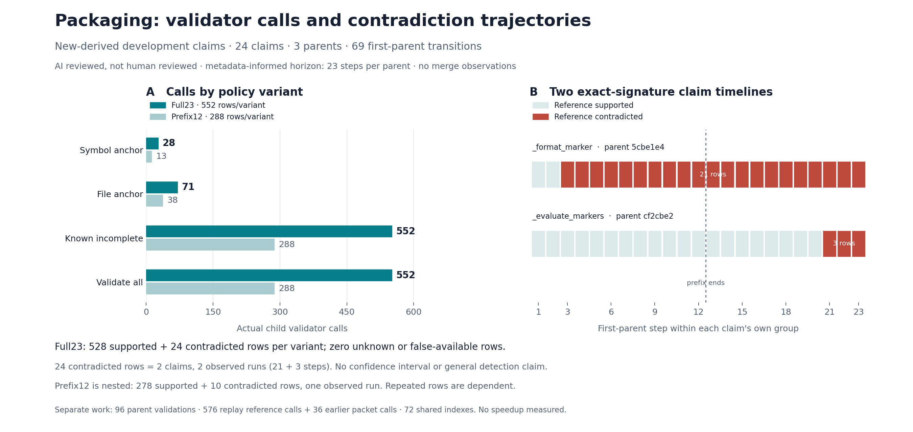
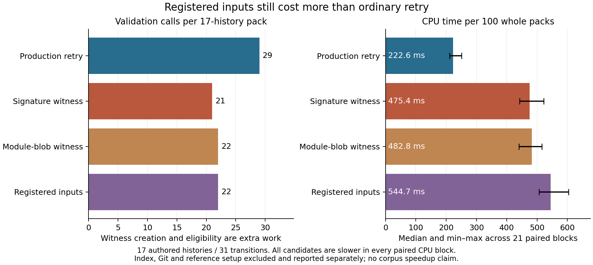

# CAMI: результаты исследования на 4 ноября 2026 года

Рабочий отчёт для обсуждения магистерского исследования. Новые результаты дополняют отчёт от 29 октября. Основное сравнение на held-out данных пока не выполнено: независимая проверка parent-утверждений и child-разметка для основного cohort остаются незавершёнными.

## Исследовательский вопрос и текущий вывод

CAMI обслуживает фиксированный набор утверждений о репозитории после последовательных изменений кода. Метод должен решать, какие утверждения перепроверить, какие временно скрыть и какие можно перенести без новой проверки. Исследуется компромисс между стоимостью обслуживания, доступностью памяти и риском сохранения неподтверждённых утверждений при неполной информации об источниках и зависимостях.

Новый development replay на Packaging добавил два эпизода изменения точных аннотационных сигнатур. Все варианты согласовали доступность с отдельным синтаксическим reference на этой истории. Это новая производная когорта, а не основное held-out сравнение.

Другой результат на реальных данных — ограниченная применимость принятого для синтетических примеров критерия полноты provenance. Его binding gate проходит у 30 из 504 подготовленных структурных кандидатов. Это проверка одного необходимого условия, а не подтверждение истинности или разрешение допустить эти 30 записей в основной эксперимент.

Отдельно получены проверяемые результаты о механизмах метода: восстановление ранее скрытой записи, согласованность структурного отбора с полным валидатором и исправление ошибки кеша при смене типа Git-записи. Также найден цикл неограниченной ложной доступности и проверено её ограничение периодическим аудитом. Эти результаты укрепляют реализацию и уточняют границы метода; они ещё не устанавливают преимущество CAMI на основной популяции проектов.

| Проверка | Наблюдаемый результат | Что он позволяет заключить |
| --- | --- | --- |
| Слепой AI development-пилот | 36 совпадающих решений, все 12 контролей ожидаемы | Работоспособность узкого синтаксического пакета, не независимость ошибок |
| Связь модели с кодом | 499 совпавших переходов, два обнаруженных отрицательных контроля | Ограниченное соответствие реальным функциям отбора и состояния |
| Class-global regression | Четыре случая доступности при uncertain устранены | Исправлен конкретный пропуск неоднозначности; кэши обновлены |
| First-parent история Click | 36 переходов, включая 10 merges; прежние 448 записей совпали | Новая часть проверяет перенос сохраняющихся утверждений, новых опровержений нет |
| Packaging, отдельная development-когорта | 24 новых утверждения, два первых синтаксических опровержения; 28/71/552/552 дочерних проверок | Согласованность с узким reference на этой истории; не ускорение и не поведенческие API breaks |
| Цена negative carry | Три реализации сокращают проверки, но увеличивают время обслуживания | На коротких авторских историях создание и проверка свидетельств не окупаются |
| Binding gate на реальных parent-данных | 30 passes, 474 rejects | Текущий fixture-критерий имеет узкую применимость |
| Структурный перенос, 168 авторских случаев | 32 пропуска, все supported у полного валидатора | На этих случаях перенос согласован с тем же валидатором |
| Восстановление behavior-памяти | 16 состояний, 54 Docker executions, без расхождений доступности | previously_unavailable действительно запускает повторную проверку |
| Requests package-only projection | 22 parent-группы, 66 passed | Frozen probe выполним в отдельно определённой среде |
| Исправление AST-кеша | Воспроизведён сбой; исправление прошло 1124 теста | Устранена конкретная ошибка доступности и восстановления |

## Применимость критерия на реальных данных

Проверены 63 parent snapshots: 504 структурных кандидата из Click, Requests и pytest. Кандидаты относятся к 345 различным сочетаниям проекта, parent commit и пути модуля. Проверка читает только parent-источники и вызывает binding gate существующего fixture-критерия. Она не использует child-изменения, не закрывает provenance и не создаёт receipts или labels.

На уровне модулей прошли 23 из 345. На уровне claims прошли 2 из 160 для Click, 27 из 176 для Requests и 1 из 168 для pytest. Несколько claims могут относиться к одному модулю, поэтому эти наблюдения зависимы. Частоты описывают подготовленный набор, а не случайную выборку Python-проектов.

Чаще всего первой причиной отказа были косвенные записи в namespace — 228 claims — и динамические операции с namespace — 167. Gate проверяет весь модуль, поэтому допустимая для исполнения конструкция в другой его части способна отклонить claim о простой функции. Причины приводятся по первому отказу: они пересекаются и зависят от порядка обхода.

Дополнительный post-hoc профиль установил, что все 504 кандидата проходят наблюдаемые условия вне binding gate: точные формулировки, читаемые исходники, anchors и однозначные определения. Все 252 требуемых сравнения сигнатуры также совпали; у остальных 252 symbol_exists сравнение не требуется. Таким образом, среди проверенных технических условий ограничение сосредоточено в whole-module binding gate. Этот профиль использует определения CAMI и не является независимым подтверждением claims.

Практическое следствие: будущий протокол должен либо обосновать более точный критерий для строго синтаксических утверждений, либо явно ограничить применимую часть набора и показать долю консервативных перепроверок. Автоматическое снятие known_incomplete из этих результатов не следует.

Рисунок 1. Слева — реальные parent-кандидаты; справа — авторские синтетические случаи. Единицы наблюдения различаются. Gate pass не означает допуск; пропуски проверки справа оцениваются относительно того же структурного валидатора.

## Проверка условия структурного переноса

Для точного синтаксического predicate проверялось условие: если parent поддерживает claim и алгоритм не выбирает child для перепроверки, свежий полный валидатор тоже должен поддержать claim на child. Это относительная согласованность отбора с валидатором, а не независимая проверка смысла утверждения.

До реализации runner закреплён план: четыре контекста модуля, 21 изменение и два predicates — symbol_exists и signature_equals. Рассмотрены комментарий, посторонняя переменная, тело, параметры, default, аннотации, async, decorator, дублирование, перепривязка, import alias, wildcard import, conditional definition, удаление определения или файла, parse failure, смена Git mode и ограничение чтения. Получены 168 случаев; восемь из них дополнительно меняют внешний лимит чтения и находятся вне аргумента с неизменной конфигурацией.

136 случаев были выбраны для проверки; 32 перенесены. Все перенесённые случаи остались supported у свежего полного валидатора. Индекс с прогретым кешем совпал со свежим во всех случаях. Отрицательный контроль намеренно скрывал изменение сигнатуры: проверка обнаружила ошибочный перенос contradicted claim.

Снимки конструировались как Snapshot/Blob с вычисленными Git blob SHA-1. Это не end-to-end Git эксперимент. Parser и validator общие с CAMI; конечный авторский набор не доказывает корректность для любого Python-кода. Он дополняет условный аргумент переноса и реальную Git-регрессию, описанную ниже.

Отдельная проверка распространения изменений по графу сравнила impacted с независимым вычислением достижимости на конечных пространствах трёх- и четырёхвершинных графов. Проверены 208896 входных случаев без расхождений; после учёта совпадающих эффективных множеств начальных вершин остаётся 118272 сочетания графа, глубины и seeds. Это проверка обхода графа, а не полноты извлечённых зависимостей.

## Восстановление памяти и ошибка кеша

В авторской behavior-истории функция сначала непосредственно нарушает frozen probe. Затем её тело начинает зависеть от g, отсутствующей в неполной provenance; изменение только g восстанавливает истину claim. Проверка запускается по причине previously_unavailable, поскольку запись уже была скрыта. После восстановления последующее постороннее изменение допускает перенос.

Четыре варианта политики и provenance дали 16 состояний без расхождений доступности с предусмотренным oracle. Выполнены 54 Docker executions: 30 passed и 24 assertion_failure, включая parent-проверки и повторы. Этот опыт дополняет прежний контрпример, в котором скрытая зависимость оставляла ложную запись доступной: ранее скрытое состояние помогает восстановлению, но не обнаруживает любую скрытую порчу доступной памяти.

При разборе предпосылок переноса найдена реальная ошибка кеша. Git позволяет заменить обычный файл symlink с тем же blob ID. Старый AST-кеш использовал blob ID, но не учитывал текущий limitation. В результате symbol_validate сохранял доступность записи на неподдерживаемой symlink; file_validate и all_validate могли не восстановить запись после возврата обычного файла.

Три регрессионных теста сначала воспроизвели ошибки на реальных Git commits. Исправление исключает reuse и сохранение обычного Module для blob с ограничением. Версии индексатора и валидатора повышены, чтобы старый дисковый verdict cache не сохранял прежние решения. Before/after запуск с уже заполненным кешем подтвердил переход от доступности [false, false] к [false, true] для проверенной истории all_validate.

После прежнего исправления кеша на e810a09 прошли 1124 теста, а исторический полный прогон a1dc53c дал 1290 passed. Новый полный прогон на неизменном 07cb633 дал 1361 passed и четыре skips за 544.52 секунды; Ruff и mypy прошли, все 53 production-файла без ошибок типов. Снимки исходников до и после совпали, SHA-256 трёх логов сверены. Четыре опциональных Docker-теста были пропущены из-за незаданного CAMI_TEST_IMAGE. Они отдельно прошли на 2071f54 с прежним закреплённым образом за 14.96 секунды. Все прежние исходники двух запусков совпали; единственное добавление между ними — скрипт рисунка. Вместе проверены 1365 случаев, но это не выдаётся за один полный прогон без skips. Поздние аудиторы и упаковщик офлайн-корпуса проверены отдельно и не приписываются полному suite. Данные: full-verification-07cb633/ и docker-supplement-2071f54/.

## Может ли ложная память сохраняться неограниченно долго

Полный обход конечной модели показал более сильную границу, чем несколько ошибочных шагов одной истории. Рассмотрены 12 программ: f возвращает 1, 2 или g(); g возвращает 1 или 2; посторонняя переменная принимает 0 или 1. Состояние — программа и available. Selector читает из прежнего MemoryState только available, поэтому эта проекция достаточна для рассматриваемой динамики доступности при фиксированных inputs; metadata lineage ею не доказывается.

Для all_validate, intact и known_missing достижимы по 12 состояний и 144 перехода без расхождения доступности с конечным oracle. Для hidden_missing достижимы 14 состояний и 168 переходов, включая два состояния ложной доступности. Они образуют цикл: после скрытой порчи g можно чередовать VALUE=0 и VALUE=1 в постороннем файле, сохраняя ложный claim доступным без проверки. В этой модели нет конечной верхней границы длительности такого сохранения в числе коммитов.

Рисунок 2. Достижимый цикл с изменением исходников и без перепроверки. Вывод относится к конечной модели, а не к вероятности возникновения ошибки в реальном проекте.

Отдельный stdlib-only аудитор сверил все 600 переходов по явной формуле для этой грамматики, полноту графа и свидетеля. Два отрицательных контроля модели и пять подмен артефактов обнаружены. Затем извлечённый префикс и один оборот цикла воспроизведены в настоящем Git: пять commits с дополнительным terminal restore, 48 Docker executions — 21 passed и 27 ожидаемых assertion failures. Hidden_missing не выполняет child-проверок и сохраняет три ложных доступности; остальные варианты скрывают запись корректно. Изменения на двух рёбрах цикла затрагивают только unrelated.py, а дерево после оборота совпадает с его началом.

В конечном обходе вместо исполнения probe использован отдельный AST oracle; реальные Docker executions относятся только к последующему свидетелю. Один фактический оборот подтверждает воспроизведение примера, а произвольная длительность следует из цикла и аргумента достаточности проекции. Проверка не распространяется на произвольный Python, flakiness или меняющуюся конфигурацию. Подробности: docs/behavior_reachability_2026-11-04.md.

## Измеренное время на двух behavior-историях

Отдельный план измерений закреплён до запуска: 40 CLI runs, по пять повторов каждого из четырёх вариантов на двух историях. Время включает startup, parent preflight, обслуживание всех child transitions и persistence; подготовка fixtures и аудит выполняются вне таймера. Варианты меняют позицию в блоке, порядок историй чередуется. Кеш вердиктов отключён, Docker image закреплён; фоновые сервисы общей машины продолжали работать.

Для intact provenance медиана полного run снизилась с 10.73 до 9.24 секунды в шестипереходной exposure history и с 7.69 до 6.20 секунды в четырёхпереходной recovery history. Все пять парных разностей для intact отрицательны: диапазоны −1.723…−1.160 и −1.663…−1.397 секунды. Ожидаемая доступность сохранилась. Для known_missing знак парной разницы менялся; устойчивого выигрыша не наблюдалось.

Hidden_missing в exposure history занял 4.79 секунды по медиане, но сохранил ложное утверждение доступным на двух переходах. Это снижение стоимости с ухудшением качества. В recovery history скрытая неполнота дала 6.18 секунды и ожидаемую доступность благодаря правилу previously_unavailable. Повторы измерений не являются независимыми новыми историями.

Рисунок 3. Ромб — медиана, точки — все пять повторов, отрезок — min–max, не доверительный интервал. Красный вариант быстрее ценой ложного переноса. Единицы наблюдения и длительность двух историй различаются.

В измерениях проверены 615 raw probe payloads: 345 passed, 270 ожидаемых assertion failures, без технических отказов. Отдельный профиль, исключённый из сравнения, показал 93.18% времени в интервалах Docker-проб. Экономия intact соответствует пропуску одной validation, то есть трёх запусков probe. Профиль не разделяет запуск контейнера и внутреннюю работу pytest. На границах измерений one-minute load составлял 0.75–2.75 при двух доступных CPU.

Это измерение конкретных авторских workloads на общей машине. Оно не включает стоимость разработки probes и независимой разметки и не устанавливает преимущество на реальном cohort. Полные диапазоны, все парные разности и сведения о нагрузке сохранены в behavior-timing-v1/; отдельный разбор — docs/behavior_timing_2026-11-04.md.

## Периодический аудит: граница и цена

Исследовательское расширение добавляет перепроверку через K обработанных child commits после последней validation. Каждый переход считается, даже если дерево уже встречалось. Обычный selector сохраняется; срок только добавляет проверки. Периодический аудит не заявляется как новая идея: здесь уточняется его гарантия для CAMI и проверяется связь модели с исполнением.

Если завершённая validation правильно определяет predicate, после неё ложной доступности нет. При пропуске возраст увеличивается; до переноса с возрастом K выполняется проверка. Поэтому непрерывная серия ложной доступности содержит не более K−1 состояний. Это граница по обработанным переходам, не по секундам или необработанным коммитам; ошибочный supported-вердикт нарушает предпосылку.

В конечной модели для K=1,2,4,8 проверены все 136 достижимых состояний и 1632 перехода. Максимальные серии равны 0,1,3,7; сохранены достигающие их пути. Циклов ложной доступности нет. Намеренный сброс возраста при изменении исходника возвращает неограниченный цикл; срок с ошибкой на единицу нарушает границу. Оба отрицательных контроля обнаружены.

Для проверки механизма подготовлена временная исследовательская обёртка engine selector. Возраст вычисляется из last_checked_commit и позиции в frozen history, без отдельного изменяемого счётчика. Протокол закреплён в 7144fd0 до Docker-исполнения, runtime — 04dd04c. Все manifests с первого сохранения помечены evaluation_eligible=false и содержат hash обёртки и истории; production policy не изменена.

В реальном Git созданы parent и 12 children. С первого child скрытая зависимость нарушает predicate; на девятом истина восстановлена. Без аудита получены 8 ложно доступных состояний при нуле перепроверок. K=2 дал 1 такое состояние при 9 проверках; K=4 — 3 при 6; all_validate — 0 при 12. Все 48 состояний и lineage совпали с заранее заданными ожиданиями и отдельным ограниченным AST oracle фактических Git blobs.

Рисунок 4. Цвет показывает доступность и истину claim; точка — перепроверку. Все 93 Docker executions проверены по raw payloads: 33 passed и 60 ожидаемых assertion failures, технических ошибок нет. Parent-подтверждение и три повтора каждого вызова включены в 93, но не в число child-перепроверок справа.

На трёх модельных 40-шаговых историях посчитана цена аудита. При неизменно истинном claim она равна floor(40/K). После обнаружения ложного claim правило previously_unavailable проверяет его на каждом шаге; поэтому большой K не делает persistent-false историю дешёвой. Выбор лучшего K требует внешнего ограничения на риск и стоимость. Один authored Git/Docker опыт не оценивает популяционный эффект, production resume или время исполнения.

## Предпосылки гарантии при неполных вердиктах

Для границы K−1 достаточно, чтобы выбранный supported никогда не подтверждал ложный predicate, а остальные результаты скрывали запись. Validator может не подтвердить истинный claim: это ухудшает retention, но завершает ложную доступность. Поэтому отсутствие ложного скрытия и ограничение длительности ложной доступности требуют разных предпосылок. При точной двоичной проверке правило previously_unavailable исключает ложное скрытие: скрытая запись обязательно проверяется, а пропущенная остаётся доступной.

Расширенная конечная модель допускает недетерминированные вердикты. Для K=1,2,4,8 полный обход двух вариантов охватил 64 состояния и 403 перехода. Максимальные серии ложной доступности в обоих равны 0,1,3,7. При точной проверке ложного скрытия нет; при корректности только положительных ответов оно достижимо. Два намеренных нарушения — ложный supported и перенос доступности при insufficient_evidence со сбросом возраста — дали достижимые unsafe self-loops.

Рисунок 5. Одна и та же граница ложной доступности совместима с разной доступностью истинной памяти. Положительная корректность не означает полноту validator. Графики относятся к конечной модели, не к измеренной частоте ошибок.

Затем выполнена символическая проверка вручную записанного перехода в QF_LIA над неограниченными Int. Возраст удовлетворяет 0≤b<K, а ложная доступность требует b>0. Проверены начальный инвариант, его сохранение, необходимость пропуска при ложной доступности, увеличение возраста между двумя такими состояниями, отсутствие ложного скрытия при точной проверке и шаблон достижения границы для любого K≥2.

Закреплённый Z3 4.16.0.0 выполнил 18 проверок: 6 отрицаний целей получили UNSAT, 6 наборов предпосылок отдельно получили SAT, ещё 6 SAT-запросов предъявили предусмотренные примеры и контрпримеры. Проверка предпосылок исключает общее противоречие условий. Все 12 SAT-переходов повторно вычислены обычным Python; две подмены с пересчитанными hashes отклонены. Сохранены формулы, вывод решателя и proof objects.

Условия перехода вместе с отдельным индуктивным аргументом дают границу для произвольного положительного K в этой модели. Proof objects не проверены независимым kernel; связь ручной формализации с engine и корректность положительных подтверждений остаются предпосылками. Начальная доступная запись предполагается истинной. Завершённые обработанные переходы не задают границу в секундах и не определяют чтение промежуточного состояния при аварии. Подробности и команды: docs/symbolic_availability_verification_2026-11-04_ru.md.

## Ограничения behavior-графа на реальных parent-данных

Отдельная диагностика построила графы 63 фиксированных parent-групп и записала свойства всех 630 кандидатов. Набор содержит 252 symbol_exists, 252 signature_equals, 63 behavior_test и 63 prose. Первоначально в плане ошибочно ожидались 126 behavior-кандидатов; preflight остановился до построения графов, число исправлено с сохранением того же inventory. Child-исходники и результаты не использовались.

У всех 63 behavior-кандидатов одновременно присутствуют subject unresolved, subject-module unresolved и global_unresolved. Среди 2131 module occurrences флаг уровня модуля добавился при связывании imports в 2070 случаях: Click 328/331, Requests 352/396, pytest 1390/1404. Модули повторяются между версиями; это не независимые наблюдения. Все 63 warm-cache индекса совпали со свежими. Parse/encoding/size limitations в индексированных модулях не обнаружены.

Рисунок 6. Слева — повторные наблюдения модулей по parent snapshots, справа — пересекающиеся флаги тех же 63 behavior-кандидатов. Unresolved не означает ложность claim. Все исходные provenance остались known_incomplete.

В текущем compare_indexes unresolved старого и нового индекса объединяются. Поэтому, если parent-кандидат будет независимо подтверждён и допущен при исходном графе без masks, первый следующий переход выберет его по локальному unresolved_dependency и глобальному fallback независимо от содержимого child. Уже существующий known_incomplete также требует проверки. Снятие только этого маркера и глобального fallback оставило бы локальную причину у всех 63 behavior-кандидатов. Это условное следствие кода, не выполненное policy-сравнение или оценка частоты последующих проверок.

Post-hoc разбор imports нашёл простые достаточные признаки связывания у 1912 из 2070 unresolved-модулей: обычный module import и/или target module вне индекса. Эти категории пересекаются; 158 случаев таким разбором не объяснены. Сверены 63 Git trees, 2131 module blob occurrences и 1098 уникальных blobs, прочитанных через git cat-file независимо от индексатора. Все 630 claim/graph flags сопоставлены с сохранёнными графами.

Практический вывод: экономия synthetic fixtures не переносится автоматически на подготовленный реальный behavior-набор. Нужен обоснованный контракт зависимости и неопределённости либо явное признание полной перепроверки неприменимой части. Отключение guard без такого контракта не улучшает доказанную корректность. Структурные predicates protocol1.1 имеют иной контракт, поэтому этот результат не опровергает согласованность структурного переноса.

## Исполнимость Requests и готовность разметки

Для одного Requests-parent полное развёртывание дерева ранее блокировалось symlinks в tests/certs. Новый диагностический контекст сохраняет только исходные blobs внутри requests/ или src/requests/, их bytes и mode. Symlinks внутри выбранного пакета по-прежнему запрещены. Production full-tree materialization не изменена.

Во всех 22 parent-группах прежний frozen probe успешно выполнился трижды в том же закреплённом Docker image: 66 passed. Проверены 144 уникальных Git blobs. Отдельный аудитор сверил деревья, состав проекции, identities claim и probe, raw stdout и summary. Четыре подмены отклонены; в трёх из них контрольные суммы артефактов были пересчитаны. Отдельная контейнерная проверка исключила fallback на установленный Requests.

Успех относится к package-only контексту. Он не переносит старые receipts в новую среду и не устанавливает child labels. Это подготовка выполнимого способа независимого подтверждения parent-claim после фиксации соответствующего протокола.

Для людей готов автономный parent-only HTML-пакет: 630 заданий, 126 назначений второму reviewer, полный текст claims, scope и predicate, исходники с номерами строк и frozen probes. Формы остаются пустыми. ZIP занимает примерно 6.5 МБ и открывается после распаковки без установки CAMI. Число заданий не равно числу выполненных reviews.

## Слепой AI-пилот и проверка связи модели с кодом

Для автономной проверки узких синтаксических predicates подготовлен отдельный development-пилот. Три Click parent-группы выбраны по фиксированному хешированному seed до получения ответов. Включены все 24 исходных структурных claim и 12 авторских контролей. Два свежих AI-контекста получили полный исходный код, predicate, rubric и схему ответа. Происхождение случаев, private map, reference и ответы другого reviewer были скрыты.

Все три метода — два AI reviewer и отдельно написанный механический checker — дали одинаковые решения: 24 supported, 9 contradicted, 3 uncertain. Девять отрицательных контролей отклонены; три контроля с дубликатами определения получили uncertain. Исходные ответы, самостоятельные helpers и methodology сохранены. Во всём пакете 21 уникальный source hash, у 24 исходных claims — 18; наблюдения внутри трёх parent-групп зависимы.

Это успешная проверка заданного узкого пакета, а не доказательство замены человеческой семантической разметки. Все реализации используют CPython ast, модели могут иметь общие ошибки и обучающие данные. Контроли с искусственными случайными именами просты. Человеческих reviews, новых labels, receipts и admission не создано. Дополнительный аудит проверил обязательные факты и методологию исходных ответов.

Отдельно проверена связь конечной модели периодического аудита с реальным кодом. Все 403 ребра восьми замороженных графов развёрнуты в 499 проверок с 76 каноническими MemoryState-контекстами. Реальные selector и advance_state совпали с моделью по всем 499 случаям, включая причины отбора и исторические метаданные. Обе внесённые ошибки обнаружены. Независимый stdlib-аудитор заново вычислил записи и отклонил три подмены с пересчитанными hashes. ValidationResult здесь является входом модели; probes и Docker не запускались.

## Class-global: найденный дефект и отдельное исправление

Аудит AI reference выявил пропуск `global f` во вложенном классе. В исходном слепом пакете целевых global declarations нет, поэтому этот конкретный дефект к его 36 случаям неприменим. Но согласия реализаций оказалось недостаточно для общего вывода о корректности: отдельный синтетический challenge обнаружил связанный дефект и в основном индексаторе.

Зафиксирован набор из 21 изменения модуля и двух predicates, всего 42 claim-перехода. Сначала исправлен только reference, затем отдельно production. При неизменном reference v2 прежний production сохранял доступность в четырёх случаях, где reference требовал uncertain. После исправления индексатора таких случаев нет; ответы полного валидатора и reference совпадают во всех 42 сравнениях. Symbol selection теперь выполняет 32 проверки вместо 28; file anchor — 40, all_validate — 42 в обоих прогонах. Это стоимость устранения пропуска на авторском наборе, не оценка экономии на популяции проектов.

Проход индексатора собирает module globals в классах, включая вложенные и условные, и передаёт их существующей обработке неоднозначности. Тела функций и методов остаются вне этого прохода. Старые версии AST и validation cache не используются. Шесть реальных Git-историй с авторскими fixtures подтвердили withholding, повторную проверку и восстановление для symbol, file и all policies. Найденные случаи uncertain не выдаются за доказанно ложные утверждения. Независимый stdlib-аудитор проверил все состояния трёх прогонов, неизменность входов и historical source hashes. Он отклонил четыре подмены с обновлёнными hashes, включая смешение uncertain и contradicted.

## Реальный development-replay Click

После фиксации протокола и 117 входов на 56750dd выполнен replay 24 исходных структурных claims на трёх цепочках Click длины 1, 12 и 1. Получено 112 claim-child observations на вариант, 448 состояний четырёх вариантов. Все parent claims прошли AI-подтверждения и отдельный синтаксический reference; фактическая production-инициализация тоже подтвердила все 24. Исходные claims и provenance сохранены, экспериментальные anchors выделены отдельно. Опыт имеет evaluation_eligible=false и не подменяет основной held-out протокол.

| Вариант | Дочерние проверки | Переносы | Ложно доступны | Подтверждены, но скрыты |
|---|---:|---:|---:|---:|
| Symbol anchor | 8 | 104 | 0 | 0 |
| File anchor | 13 | 99 | 0 | 0 |
| Known incomplete | 112 | 0 | 0 | 0 |
| All validate | 112 | 0 | 0 | 0 |

На пятом шаге длинной цепочки у shell_complete параметр ctx_args сменил аннотацию t.Dict на t.MutableMapping. Точное синтаксическое утверждение перестало совпадать; это само по себе не доказывает поведенческий разрыв API. Оно остаётся опровергнутым ещё семь шагов. Все восемь contradicted observations относятся к одному claim и одному возникновению изменения. Symbol policy обнаружила изменение сразу, затем семь раз повторяла проверку из-за previously_unavailable.

Во всех вариантах доступны 104 подтверждённых состояния и скрыты восемь опровергнутых; unknown нет. Разница относится к дочерним вызовам валидатора. Отдельно выполнены 24 parent validations на вариант, 136 reference calls и 17 общих построений индекса. Общие индексы и зависимые наблюдения не позволяют объявить отношение вызовов ускорением либо популяционной оценкой надёжности. Два коротких фрагмента не содержат изменения истинности. Полные исходники, состояния, selection reasons, validation results и source seals сохранены; reference вычислялся после переходов всех политик.

Независимый stdlib-аудит проверил 562 артефакта, 117 входов, 228 исторических source files, 136 Git packets и все 448 записей. Сигнатуры, selection, state и метрики вычислены повторно без импорта CAMI или исходного reference. Пять подмен с пересчитанными hashes отклонены; всего пройдены десять групп контролей. Согласие сохраняет ограничения общего CPython AST и узкого синтаксического критерия. Данные: real-structural-replay-v1/; аудит: real-structural-replay-audit-v1/.

## Расширение истории через merge-коммиты

Два коротких фрагмента прежнего опыта упирались в правило, исключающее merges. Для расширения создан отдельный драйвер: каждая версия сравнивается с её непосредственным первым родителем. Исходный драйвер, production-код, reference v2 и все 24 claims сохранены. Новый протокол и 134 файла закреплены в 02fcd4a до доступа к добавленным child-исходникам. Метаданные всех цепочек проверяются до чтения любого снимка; исходники боковых родителей не используются.

Получены три цепочки по 12 переходов, включая 10 merges. На вариант приходится 288 claim-child observations. Из них 112 повторяют прежний опыт, а 176 относятся к добавленным 22 переходам. Все 448 прежних записей четырёх вариантов и 24 parent records совпали семантически при повторном запуске, включая provenance, причины выбора, состояния и хеши входов. Исключены только поля времени и явно перечисленные пути пакетов.

| Вариант | Проверки на всей цепочке, 288 наблюдений | Проверки в добавленной части, 176 наблюдений |
|---|---:|---:|
| Symbol anchor | 8 | 0 |
| File anchor | 17 | 4 |
| Known incomplete | 288 | 176 |
| All validate | 288 | 176 |

В добавленной части все 176 утверждений supported у независимого синтаксического reference; ложной доступности, available unknown и скрытых supported нет. Нулевой знаменатель contradicted означает, что частота обнаружения новых опровержений не оценивается. Восемь отрицательных наблюдений полной цепочки относятся к прежнему единственному изменению аннотации. Поэтому расширение даёт свидетельство о переносе стабильных claims через реальные изменения, но не добавляет новых случаев обнаружения устаревания.

Merge-срез содержит 80 наблюдений на вариант: 0/1/80/80 проверок в том же порядке. Это описание части тех же данных, а не причинный эффект merges. Отдельно оплачены 96 parent validations, 312 reference calls и 39 общих построений индекса. Число дочерних проверок не трактуется как ускорение. Данные: real-first-parent-replay-v1/.

Независимый stdlib-аудит заново проверил 1152 наблюдения, 312 пакетов Git/AST, 1048 строк затрат, 1290 артефактов, 134 закреплённых входа и 251 исторический файл. Десять подмен с пересчитанными хешами отклонены. Установленная версия воспроизвела исходный аудит; пределы поддерживаемого синтаксиса проверены отдельными контролями. Деревья боковых родителей не читались. Учёт записанных вызовов не доказывает прошлое физическое исполнение независимо. Аудит: real-first-parent-audit-v1/.

## Packaging: новая development-когорта и два синтаксических события

В Packaging выполнен отдельный development replay: три parent-группы, по четыре выбранные функции и два утверждения на функцию — существует ли символ и совпадает ли точная нормализованная сигнатура. Всего получены 24 новых производных claims. Три цепочки по 23 перехода дают 69 children и вместе с parents — 72 snapshots. Это дополнение к исследованию; исходные 630 кандидатов не переименованы и не заменены. Данные топологии: packaging-topology-v2/topology.json, параметры и результат replay: packaging-replay-v2/manifest.json.

Исходный план с горизонтом 24 остановился до чтения исходников: в заданных границах нашлись 72 first-parent позиции при требуемых 75. Неудачный запуск сохранён. Затем отдельно закреплён горизонт 23 с раскрытой поправкой на основании метаданных, до чтения parent- и child-кода. Поэтому v2 обозначается metadata-informed; первоначальный план не выдаётся за выполненный без изменений. Сохранённая невозможность h24: packaging-frame-infeasibility-v1/report.json, методическая запись v2: packaging-parents-v2/manifest.json.

Шесть свежих слепых AI-контекстов дали 72 первичных решения, включая контроли. Все 12 авторских контрольных случаев прошли установленный gate. Все 24 реальных claims получили parent eligibility; исключений и замены рецензентов не было. Это AI-проверка, human credit равен нулю; независимость ошибок моделей не установлена. Результаты parent review: packaging-parent-review-results-v2/manifest.json.

| Вариант | Фактические child-валидации | Наблюдения claim × шаг |
| --- | ---: | ---: |
| Symbol anchor | 28 | 552 |
| File anchor | 71 | 552 |
| Known incomplete | 552 | 552 |
| All validate | 552 | 552 |

Во всех четырёх вариантах reference определил 528 supported и 24 contradicted наблюдения; unknown не было. Ложная доступность, доступность при reference-unknown и скрытые supported равны нулю в каждом варианте. Эти нули описывают подготовленный набор, а не гарантируют отсутствие ошибок на других проектах. Парные predicates, повторные функции, модули и версии зависимы: 552 строки не являются 552 независимыми случаями. Полные счётчики: packaging-replay-v2/report.json.

Отрицательные наблюдения относятся к двум claims: два первых события и 22 продолжающихся повтора. На шаге 3 второй группы у `_format_marker` в `markers.py` изменились записи `Optional[bool]` → `bool | None` и `Union[List[str], MarkerAtom, str]` → `list[str] | MarkerAtom | str`. На шаге 21 третьей группы у `_evaluate_markers` аннотация `environment` сменилась с `dict[str, str]` на `dict[str, str | AbstractSet[str]]`. Оба первых события были выбраны для проверки и скрыты всеми четырьмя вариантами. Это расхождения точного синтаксического контракта; поведенческий API break и семантическая неэквивалентность типов этим не установлены. Последующий разбор событий является описательным post-hoc анализом. События и причины отбора: packaging-event-analysis-v1/report.json.

У symbol anchor 22 из 28 проверок вызваны `previously_unavailable`: уже скрытые claims перепроверяются на последующих шагах. Ещё четыре выбранных наблюдения оказались supported. File anchor добавил 43 проверки по сравнению с symbol anchor; все эти дополнительные наблюдения supported. Эти трассы объясняют состав вызовов, но не являются причинным разложением времени. Описательный разбор: packaging-event-analysis-v1/report.json.

Отдельно выполнены 96 parent-валидаций — по 24 на вариант; 576 reference calls внутри replay — 24 parent и 552 child; ещё 36 reference-решений относятся к более ранней review-фазе. Построены 72 общих для вариантов индекса. Число child-вызовов не объявляется ускорением полного обслуживания. Префикс 12 вложен в полную траекторию и не является отдельной выборкой. Это development-результат с `evaluation_eligible=false`, без human admission и без основного held-out сравнения. Раздельный учёт replay: packaging-replay-v2/report.json, ранняя review-фаза: packaging-parent-review-results-v2/manifest.json.

Независимый stdlib-аудитор повторно проверил 2378 артефактов, 578 закреплённых входов, 272 исторических файла, 576 Git/AST-пакетов, все 2208 наблюдений и 1947 строк затрат. Все 53 production Python-файла совпали с `700ebf2`; отбор, состояния и разрезы вычислены без импорта CAMI или reference. Установленная версия воспроизвела отчёт на извлечённом офлайн-корпусе. Восемь подмен с пересчитанными хешами отклонены; unknown-as-contradicted отмечен неприменимым к реальным данным без unknown и проверен на авторской нагрузке. Аудитор знал предварительные сводки; слепая репликация не заявляется. Данные: packaging-result-audit-v1/.

## Почему меньше проверок не дало ускорения

Семь повторных проверок уже опровергнутого claim в исходной истории Click мотивировали отдельный эксперимент. Исследовательские адаптеры сохраняют отрицательный ответ, только если свидетельство последней фактической проверки всё ещё применимо. Проверены свидетельство синтаксической сигнатуры, неизменного Git blob и вариант с однократной регистрацией неизменных входов. Они не меняют production policy.

Протоколы закреплены до замеров: cbfbe28 для первых двух реализаций, 8e4241c для регистрации. Набор содержит 17 авторских Git-историй и 31 переход: восстановление сигнатуры, скрытая смена входов, неоднозначные определения, отсутствие, parse failure, symlink, лимит чтения и восстановление после keep_all. Это отдельная нагрузка, не измерение времени на Click. Один блок повторяет весь набор 100 раз; выполнены два прогревочных и 21 парный измеряемый повтор на вариант. Порядок четырёх вариантов сбалансирован по полным восьмиблочным циклам; последний цикл неполный.

| Вариант во втором опыте | Проверки на набор | Медиана CPU блока, мс | Медиана wall блока, мс |
|---|---:|---:|---:|
| Production | 29 | 222.55 | 223.08 |
| Signature witness | 21 | 475.41 | 476.57 |
| Module blob witness | 22 | 482.81 | 486.30 |
| Registered inputs | 22 | 544.74 | 549.33 |

Во всех 21 парных сравнениях каждого кандидата CPU и wall время больше baseline. Измерение включает создание владельца и свидетелей, регистрацию и проверку применимости, фактическую валидацию и обновление состояния. Подготовка Git, индексов и reference вынесена из таймера. У регистрации удалены из измеряемого участка вычисления, нужные только для сериализации диагностического следа; она всё равно не окупилась. Отдельный профиль одного набора указывает на стоимость защитного копирования и проверки входов; вложенные cumulative times не складываются и не выдаются за причинное разложение обычного замера.

Все 31 состояния регистрации совпали с blob-вариантом. В 120 обычных записях четырёх вариантов нет ложной доступности, available unknown или скрытых supported. Четыре намеренных keep_all-контроля со скрытым supported учитываются отдельно. Независимый stdlib-аудитор проверил 124 correctness records, 84 замера, 153 артефакта и 88 закреплённых входов; восемь подмен с пересчитанными хешами отклонены в десяти группах контролей. Проверка выполнена также на Git fixtures, извлечённых из опубликованного raw-архива.

Получен отрицательный результат для этих трёх реализаций на короткой фиксированной нагрузке. Он не доказывает бесполезность отрицательного кеширования вообще. Повторяемая проверка предпосылки сохраняет все сравнения; дальнейшая оптимизация на той же предпосылке остановлена. Данные обоих опытов, исходники и полные авторские Git fixtures сохранены в двух raw-архивах. Их аудит не восстанавливает прошедшее физическое время из записей.

## Научное позиционирование и следующий этап

Близкая работа Impact Is Not Invalidation уже отделяет область воздействия изменения от истинности конкретного утверждения. EA-Graph связывает память с артефактами и разделяет актуальность источника и доказательство. Поэтому новизна CAMI не формулируется как первое введение памяти с provenance или первое различение impact и invalidation. Проверяемая заявка — последовательное обслуживание фиксированного набора claims с учётом стоимости перепроверки, доступности памяти и неполной provenance.

Для основного эмпирического вывода остаются необходимыми независимая проверка parent-утверждений, фиксация применимого критерия и финального cohort, child-разметка и заранее объявленное сравнение политик. До этого новые авторские примеры не превращаются в популяционную оценку экономии, а собственный валидатор не используется как независимый источник truth labels.

Источники для позиционирования: Impact Is Not Invalidation, arXiv:2609.25130v1; EA-Graph, arXiv:2608.04278v1. Версии и ссылки сохранены в evidence/literature-sources.json. Более подробный разбор: docs/research_positioning_2026-11-04_ru.md.

## Воспроизводимость

В комплект входят исходный Markdown, DOCX, PDF, рисунки, компактные данные и manifest с контрольными суммами. Компактный комплект не выдаётся за полную копию всех Docker execution evidence. Для периодического опыта отдельно подготовлен полный raw ZIP с Git fixture, всеми логами и точными runtime sources; Docker image в него не включён. Его хеш и stdlib-аудитор указаны в periodic-raw-delivery.json.

Для Packaging дополнительно сохранён проверенный офлайн-корпус: 72 снимка, 296 Git blob, архив 1 130 413 байт. Установленный проверяющий сверил все деревья и содержимое объектов с отключённой сетью; три подмены отклонены. Исходный репозиторий остался неизменным. Это копия ограниченного корпуса, не всей Git-истории, CAMI-среды или всех данных исследования. Инструкции: packaging-offline-corpus-v1/README.md.

Планы, исходники и команды находятся в Git. Для структурного переноса план закреплён в 2895ac2, runner — в f4eeab9. Команда из корня репозитория: `.venv/bin/python -m scripts.check_structural_carry --out runs/NEW_NAME`. Выходной каталог должен быть новым.

Ключевые записи комплекта: binding-gate-v1/summary.json; structural-carry-v1/cases.jsonl и negative-control.json; behavior-recovery-v1/results.json; requests-projection-v1/summary.json и requests-projection-final-audit.json; same-blob-cache-before-after.json; sealed-verification-v2/checks.json; full-verification-61a04bf/checks.json; periodic-audit-bound-v1/summary.json; periodic-audit-docker-v1/results.json. Пути указаны относительно evidence/.

Ключевые числа также связаны с точными полями хешированных источников в fact-ledger-v9/: 152 показателя, 24 разреза, единицы, scope и limits. В каждой версии сохранён registry.json. Эта проверка предотвращает ошибки переноса чисел, но не подтверждает научную интерпретацию.
