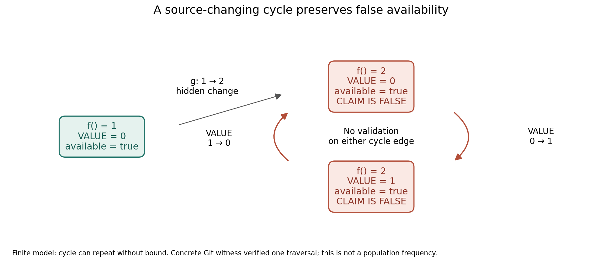

# CAMI: результаты исследования на 4 ноября 2026 года

Рабочий отчёт для обсуждения магистерского исследования. Новые результаты дополняют отчёт от 29 октября. Основное сравнение на held-out данных пока не выполнено: независимая проверка parent-утверждений и child-разметка остаются незавершёнными.

## Исследовательский вопрос и текущий вывод

CAMI обслуживает фиксированный набор утверждений о репозитории после последовательных изменений кода. Метод должен решать, какие утверждения перепроверить, какие временно скрыть и какие можно перенести без новой проверки. Исследуется компромисс между стоимостью обслуживания, доступностью памяти и риском сохранения неподтверждённых утверждений при неполной информации об источниках и зависимостях.

Новый результат на реальных данных — ограниченная применимость принятого для синтетических примеров критерия полноты provenance. Его binding gate проходит у 30 из 504 подготовленных структурных кандидатов. Это проверка одного необходимого условия, а не подтверждение истинности или разрешение допустить эти 30 записей в основной эксперимент.

Отдельно получены проверяемые результаты о механизмах метода: восстановление ранее скрытой записи, согласованность структурного отбора с полным валидатором и исправление ошибки кеша при смене типа Git-записи. Также найден цикл неограниченной ложной доступности и проверено её ограничение периодическим аудитом. Эти результаты укрепляют реализацию и уточняют границы метода; они ещё не устанавливают преимущество CAMI на основной популяции проектов.

| Проверка | Наблюдаемый результат | Что он позволяет заключить |
| --- | --- | --- |
| Binding gate на реальных parent-данных | 30 passes, 474 rejects | Текущий fixture-критерий имеет узкую применимость |
| Структурный перенос, 168 авторских случаев | 32 пропуска, все supported у полного валидатора | На этих случаях перенос согласован с тем же валидатором |
| Восстановление behavior-памяти | 16 состояний, 54 Docker executions, без расхождений доступности | previously_unavailable действительно запускает повторную проверку |
| Requests package-only projection | 22 parent-группы, 66 passed | Frozen probe выполним в отдельно определённой среде |
| Исправление AST-кеша | Воспроизведён сбой; исправление прошло 1124 теста | Устранена конкретная ошибка доступности и восстановления |

## Применимость критерия на реальных данных

Проверены 63 parent snapshots: 504 структурных кандидата из Click, Requests и pytest. Кандидаты относятся к 345 различным сочетаниям проекта, parent commit и пути модуля. Проверка читает только parent-источники и вызывает binding gate существующего fixture-критерия. Она не использует child-изменения, не закрывает provenance и не создаёт receipts или labels.

На уровне модулей прошли 23 из 345. На уровне claims прошли 2 из 160 для Click, 27 из 176 для Requests и 1 из 168 для pytest. Несколько claims могут относиться к одному модулю, поэтому эти наблюдения зависимы. Частоты описывают подготовленный набор, а не случайную выборку Python-проектов.

Чаще всего первой причиной отказа были косвенные записи в namespace — 228 claims — и динамические операции с namespace — 167. Gate проверяет весь модуль, поэтому допустимая для исполнения конструкция в другой его части способна отклонить claim о простой функции. Причины приводятся по первому отказу: они пересекаются и зависят от порядка обхода.

Дополнительный post-hoc профиль установил, что все 504 кандидата проходят наблюдаемые условия вне binding gate: точные формулировки, читаемые исходники, anchors и однозначные определения. Все 252 требуемых сравнения сигнатуры также совпали; у остальных 252 symbol_exists сравнение не требуется. Таким образом, среди проверенных технических условий ограничение сосредоточено в whole-module binding gate. Этот профиль использует определения CAMI и не является независимым подтверждением claims.

Практическое следствие: будущий протокол должен либо обосновать более точный критерий для строго синтаксических утверждений, либо явно ограничить применимую часть набора и показать долю консервативных перепроверок. Автоматическое снятие known_incomplete из этих результатов не следует.

Рисунок 1. Слева — реальные parent-кандидаты; справа — авторские синтетические случаи. Единицы наблюдения различаются. Gate pass не означает допуск; пропуски проверки справа оцениваются относительно того же структурного валидатора.

## Проверка условия структурного переноса

Для точного синтаксического predicate проверялось условие: если parent поддерживает claim и алгоритм не выбирает child для перепроверки, свежий полный валидатор тоже должен поддержать claim на child. Это относительная согласованность отбора с валидатором, а не независимая проверка смысла утверждения.

До реализации runner закреплён план: четыре контекста модуля, 21 изменение и два predicates — symbol_exists и signature_equals. Рассмотрены комментарий, посторонняя переменная, тело, параметры, default, аннотации, async, decorator, дублирование, перепривязка, import alias, wildcard import, conditional definition, удаление определения или файла, parse failure, смена Git mode и ограничение чтения. Получены 168 случаев; восемь из них дополнительно меняют внешний лимит чтения и находятся вне аргумента с неизменной конфигурацией.

136 случаев были выбраны для проверки; 32 перенесены. Все перенесённые случаи остались supported у свежего полного валидатора. Индекс с прогретым кешем совпал со свежим во всех случаях. Отрицательный контроль намеренно скрывал изменение сигнатуры: проверка обнаружила ошибочный перенос contradicted claim.

Снимки конструировались как Snapshot/Blob с вычисленными Git blob SHA-1. Это не end-to-end Git эксперимент. Parser и validator общие с CAMI; конечный авторский набор не доказывает корректность для любого Python-кода. Он дополняет условный аргумент переноса и реальную Git-регрессию, описанную ниже.

Отдельная проверка распространения изменений по графу сравнила impacted с независимым вычислением достижимости на конечных пространствах трёх- и четырёхвершинных графов. Проверены 208896 входных случаев без расхождений; после учёта совпадающих эффективных множеств начальных вершин остаётся 118272 сочетания графа, глубины и seeds. Это проверка обхода графа, а не полноты извлечённых зависимостей.

## Восстановление памяти и ошибка кеша

В авторской behavior-истории функция сначала непосредственно нарушает frozen probe. Затем её тело начинает зависеть от g, отсутствующей в неполной provenance; изменение только g восстанавливает истину claim. Проверка запускается по причине previously_unavailable, поскольку запись уже была скрыта. После восстановления последующее постороннее изменение допускает перенос.

Четыре варианта политики и provenance дали 16 состояний без расхождений доступности с предусмотренным oracle. Выполнены 54 Docker executions: 30 passed и 24 assertion_failure, включая parent-проверки и повторы. Этот опыт дополняет прежний контрпример, в котором скрытая зависимость оставляла ложную запись доступной: ранее скрытое состояние помогает восстановлению, но не обнаруживает любую скрытую порчу доступной памяти.

При разборе предпосылок переноса найдена реальная ошибка кеша. Git позволяет заменить обычный файл symlink с тем же blob ID. Старый AST-кеш использовал blob ID, но не учитывал текущий limitation. В результате symbol_validate сохранял доступность записи на неподдерживаемой symlink; file_validate и all_validate могли не восстановить запись после возврата обычного файла.

Три регрессионных теста сначала воспроизвели ошибки на реальных Git commits. Исправление исключает reuse и сохранение обычного Module для blob с ограничением. Версии индексатора и валидатора повышены, чтобы старый дисковый verdict cache не сохранял прежние решения. Before/after запуск с уже заполненным кешем подтвердил переход от доступности [false, false] к [false, true] для проверенной истории all_validate.

На неизменном commit e810a09 после исправления прошли 1124 теста без skips за 456.56 секунды, Ruff и mypy. Source snapshots до и после совпали; SHA-256 трёх логов сверены. Повторная полная проверка накопленных изменений на 61a04bf дала 1140 passed без skips за 459.80 секунды; Ruff и mypy также прошли, snapshots и хеши логов совпали. Добавленная позже исследовательская обёртка периодического аудита вместе с моделью проверена 21 профильным тестом; полный набор на её commit отдельно не запускался.

## Может ли ложная память сохраняться неограниченно долго

Полный обход конечной модели показал более сильную границу, чем несколько ошибочных шагов одной истории. Рассмотрены 12 программ: f возвращает 1, 2 или g(); g возвращает 1 или 2; посторонняя переменная принимает 0 или 1. Состояние — программа и available. Selector читает из прежнего MemoryState только available, поэтому эта проекция достаточна для рассматриваемой динамики доступности при фиксированных inputs; metadata lineage ею не доказывается.

Для all_validate, intact и known_missing достижимы по 12 состояний и 144 перехода без расхождения доступности с конечным oracle. Для hidden_missing достижимы 14 состояний и 168 переходов, включая два состояния ложной доступности. Они образуют цикл: после скрытой порчи g можно чередовать VALUE=0 и VALUE=1 в постороннем файле, сохраняя ложный claim доступным без проверки. В этой модели нет конечной верхней границы длительности такого сохранения в числе коммитов.

Рисунок 2. Достижимый цикл с изменением исходников и без перепроверки. Вывод относится к конечной модели, а не к вероятности возникновения ошибки в реальном проекте.

Отдельный stdlib-only аудитор сверил все 600 переходов по явной формуле для этой грамматики, полноту графа и свидетеля. Два отрицательных контроля модели и пять подмен артефактов обнаружены. Затем извлечённый префикс и один оборот цикла воспроизведены в настоящем Git: пять commits с дополнительным terminal restore, 48 Docker executions — 21 passed и 27 ожидаемых assertion failures. Hidden_missing не выполняет child-проверок и сохраняет три ложных доступности; остальные варианты скрывают запись корректно. Изменения на двух рёбрах цикла затрагивают только unrelated.py, а дерево после оборота совпадает с его началом.

В конечном обходе вместо исполнения probe использован отдельный AST oracle; реальные Docker executions относятся только к последующему свидетелю. Один фактический оборот подтверждает воспроизведение примера, а произвольная длительность следует из цикла и аргумента достаточности проекции. Проверка не распространяется на произвольный Python, flakiness или меняющуюся конфигурацию. Подробности: docs/behavior_reachability_2026-11-04.md.

## Измеренное время на двух behavior-историях

Отдельный план измерений закреплён до запуска: 40 CLI runs, по пять повторов каждого из четырёх вариантов на двух историях. Время включает startup, parent preflight, обслуживание всех child transitions и persistence; подготовка fixtures и аудит выполняются вне таймера. Варианты меняют позицию в блоке, порядок историй чередуется. Кеш вердиктов отключён, Docker image закреплён; фоновые сервисы общей машины продолжали работать.

Для intact provenance медиана полного run снизилась с 10.73 до 9.24 секунды в шестипереходной exposure history и с 7.69 до 6.20 секунды в четырёхпереходной recovery history. Все пять парных разностей для intact отрицательны: диапазоны −1.723…−1.160 и −1.663…−1.397 секунды. Ожидаемая доступность сохранилась. Для known_missing знак парной разницы менялся; устойчивого выигрыша не наблюдалось.

Hidden_missing в exposure history занял 4.79 секунды по медиане, но сохранил ложное утверждение доступным на двух переходах. Это снижение стоимости с ухудшением качества. В recovery history скрытая неполнота дала 6.18 секунды и ожидаемую доступность благодаря правилу previously_unavailable. Повторы измерений не являются независимыми новыми историями.

Рисунок 3. Ромб — медиана, точки — все пять повторов, отрезок — min–max, не доверительный интервал. Красный вариант быстрее ценой ложного переноса. Единицы наблюдения и длительность двух историй различаются.

В измерениях проверены 615 raw probe payloads: 345 passed, 270 ожидаемых assertion failures, без технических отказов. Отдельный профиль, исключённый из сравнения, показал 93.18% времени в интервалах Docker-проб. Экономия intact соответствует пропуску одной validation, то есть трёх запусков probe. Профиль не разделяет запуск контейнера и внутреннюю работу pytest. На границах измерений one-minute load составлял 0.75–2.75 при двух доступных CPU.

Это измерение конкретных авторских workloads на общей машине. Оно не включает стоимость разработки probes и независимой разметки и не устанавливает преимущество на реальном cohort. Полные диапазоны, все парные разности и сведения о нагрузке сохранены в behavior-timing-v1/; отдельный разбор — docs/behavior_timing_2026-11-04.md.

## Периодический аудит: граница и цена

Исследовательское расширение добавляет перепроверку через K обработанных child commits после последней validation. Каждый переход считается, даже если дерево уже встречалось. Обычный selector сохраняется; срок только добавляет проверки. Периодический аудит не заявляется как новая идея: здесь уточняется его гарантия для CAMI и проверяется связь модели с исполнением.

Если завершённая validation правильно определяет predicate, после неё ложной доступности нет. При пропуске возраст увеличивается; до переноса с возрастом K выполняется проверка. Поэтому непрерывная серия ложной доступности содержит не более K−1 состояний. Это граница по обработанным переходам, не по секундам или необработанным коммитам; ошибочный supported-вердикт нарушает предпосылку.

В конечной модели для K=1,2,4,8 проверены все 136 достижимых состояний и 1632 перехода. Максимальные серии равны 0,1,3,7; сохранены достигающие их пути. Циклов ложной доступности нет. Намеренный сброс возраста при изменении исходника возвращает неограниченный цикл; срок с ошибкой на единицу нарушает границу. Оба отрицательных контроля обнаружены.

Для проверки механизма подготовлена временная исследовательская обёртка engine selector. Возраст вычисляется из last_checked_commit и позиции в frozen history, без отдельного изменяемого счётчика. Протокол закреплён в 7144fd0 до Docker-исполнения, runtime — 04dd04c. Все manifests с первого сохранения помечены evaluation_eligible=false и содержат hash обёртки и истории; production policy не изменена.

В реальном Git созданы parent и 12 children. С первого child скрытая зависимость нарушает predicate; на девятом истина восстановлена. Без аудита получены 8 ложно доступных состояний при нуле перепроверок. K=2 дал 1 такое состояние при 9 проверках; K=4 — 3 при 6; all_validate — 0 при 12. Все 48 состояний и lineage совпали с заранее заданными ожиданиями и отдельным ограниченным AST oracle фактических Git blobs.

Рисунок 4. Цвет показывает доступность и истину claim; точка — перепроверку. Все 93 Docker executions проверены по raw payloads: 33 passed и 60 ожидаемых assertion failures, технических ошибок нет. Parent-подтверждение и три повтора каждого вызова включены в 93, но не в число child-перепроверок справа.

На трёх модельных 40-шаговых историях посчитана цена аудита. При неизменно истинном claim она равна floor(40/K). После обнаружения ложного claim правило previously_unavailable проверяет его на каждом шаге; поэтому большой K не делает persistent-false историю дешёвой. Выбор лучшего K требует внешнего ограничения на риск и стоимость. Один authored Git/Docker опыт не оценивает популяционный эффект, production resume или время исполнения.

## Исполнимость Requests и готовность разметки

Для одного Requests-parent полное развёртывание дерева ранее блокировалось symlinks в tests/certs. Новый диагностический контекст сохраняет только исходные blobs внутри requests/ или src/requests/, их bytes и mode. Symlinks внутри выбранного пакета по-прежнему запрещены. Production full-tree materialization не изменена.

Во всех 22 parent-группах прежний frozen probe успешно выполнился трижды в том же закреплённом Docker image: 66 passed. Проверены 144 уникальных Git blobs. Отдельный аудитор сверил деревья, состав проекции, identities claim и probe, raw stdout и summary. Четыре подмены отклонены; в трёх из них контрольные суммы артефактов были пересчитаны. Отдельная контейнерная проверка исключила fallback на установленный Requests.

Успех относится к package-only контексту. Он не переносит старые receipts в новую среду и не устанавливает child labels. Это подготовка выполнимого способа независимого подтверждения parent-claim после фиксации соответствующего протокола.

Для людей готов автономный parent-only HTML-пакет: 630 заданий, 126 назначений второму reviewer, полный текст claims, scope и predicate, исходники с номерами строк и frozen probes. Формы остаются пустыми. ZIP занимает примерно 6.5 МБ и открывается после распаковки без установки CAMI. Число заданий не равно числу выполненных reviews.

## Научное позиционирование и следующий этап

Близкая работа Impact Is Not Invalidation уже отделяет область воздействия изменения от истинности конкретного утверждения. EA-Graph связывает память с артефактами и разделяет актуальность источника и доказательство. Поэтому новизна CAMI не формулируется как первое введение памяти с provenance или первое различение impact и invalidation. Проверяемая заявка — последовательное обслуживание фиксированного набора claims с учётом стоимости перепроверки, доступности памяти и неполной provenance.

Для основного эмпирического вывода остаются необходимыми независимая проверка parent-утверждений, фиксация применимого критерия и финального cohort, child-разметка и заранее объявленное сравнение политик. До этого новые авторские примеры не превращаются в популяционную оценку экономии, а собственный валидатор не используется как независимый источник truth labels.

Источники для позиционирования: Impact Is Not Invalidation, arXiv:2609.25130v1; EA-Graph, arXiv:2608.04278v1. Версии и ссылки сохранены в evidence/literature-sources.json. Более подробный разбор: docs/research_positioning_2026-11-04_ru.md.

## Воспроизводимость

В комплект входят исходный Markdown, DOCX, PDF, рисунки, компактные данные и manifest с контрольными суммами. Полные raw runs остаются в рабочем репозитории; компактный комплект не выдаётся за полную копию Docker execution evidence.

Планы, исходники и команды находятся в Git. Для структурного переноса план закреплён в 2895ac2, runner — в f4eeab9. Команда из корня репозитория: `.venv/bin/python -m scripts.check_structural_carry --out runs/NEW_NAME`. Выходной каталог должен быть новым.

Ключевые записи комплекта: binding-gate-v1/summary.json; structural-carry-v1/cases.jsonl и negative-control.json; behavior-recovery-v1/results.json; requests-projection-v1/summary.json и requests-projection-final-audit.json; same-blob-cache-before-after.json; sealed-verification-v2/checks.json; full-verification-61a04bf/checks.json; periodic-audit-bound-v1/summary.json; periodic-audit-docker-v1/results.json. Пути указаны относительно evidence/.
