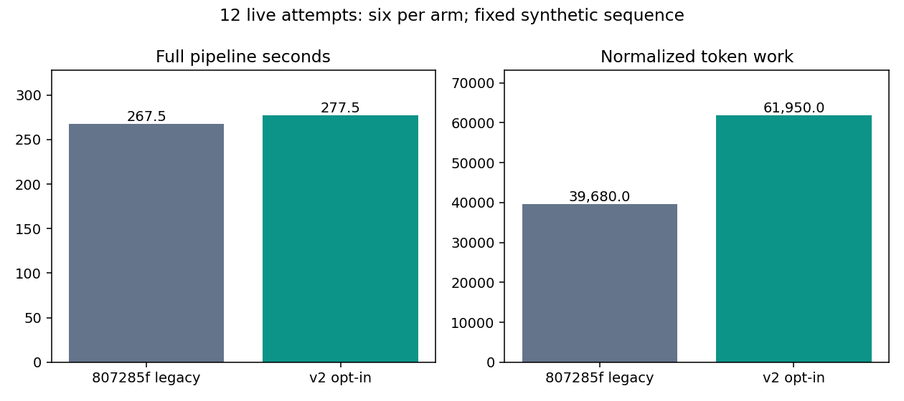

# CAMI v2: работающий opt-in путь и отрицательный малый тест

По заранее записанному критерию улучшение отклонено. Все 12 попыток завершились,
независимое качество baseline 6/6 и v2 6/6. Полное время выросло на **3,76%**,
нормализованный token work — на **56,12%**. Сокращение обоих показателей на 50%
**не достигнуто**. Legacy остаётся default.

| Показатель, сумма шести попыток | Baseline 807285f | Измеренная v2 |
|---|---:|---:|
| Полное время, с | 267,498 | 277,547 |
| Token work | 39 680 | 61 950 |
| Input | 31 389 | 53 741 |
| Output | 7 453 | 7 615 |
| Reasoning | 838 | 594 |
| Cache read | 244 992 | 225 664 |
| Cache write | 0 | 0 |

Token work = input + output + reasoning + cache write. Cache read показан отдельно.
Это наблюдаемый расход OpenCode, не invoice. Нулевые компоненты получены из полных
наблюдаемых ответов; неизвестные компоненты не заменяются нулями. Полнота скрытых
provider retries по-прежнему не доказана.

## Что проверяли

Один последовательный парный опыт: две новые задачи, два точных повтора и две
похожие задачи после изменения кода **на каждый вариант**, 12 arm-попыток всего.
Это синтетические Python API для нормализации меток и разбора длительности,
с фиксированными проверками типов, границ, Unicode, чисел и изменённых требований.
Протокол содержит точные исходники, тесты, задачи, внешний контекст, порядок,
формулы и критерий. Он запечатан до оцениваемых запросов. Base отвергнут и gold
принят во всех четырёх состояниях. Попытки не заменялись и не добавлялись.

| Сценарий, по две попытки на arm | Время baseline / v2, с | Token work baseline / v2 |
|---|---:|---:|
| Новые задачи | 79,180 / 88,073 | 10 124 / 28 749 |
| Точные повторы | 84,962 / 87,741 | 10 238 / 18 396 |
| Похожие после изменения | 103,355 / 101,733 | 19 318 / 14 805 |

Последняя строка положительна по обеим метрикам, но не меняет общего критерия.
Заданная доля повторов не является частотой пользовательских повторов. Это один
малый зависимый блок, без популяционного вывода или доверительного интервала.
Модель и фиксированный grader одинаковы; порядок arm чередуется. Рабочие пути
стабильны, памяти отдельных вариантов разделены и начинают пустыми.

Время включает восстановление входов, capture, подготовку контекста, модель,
инструменты, проверки, replay и допустимое сохранение вплоть до fsync результата.
Модельный интервал занимает 263,444 с baseline и 269,813 с v2; подготовка контекста
и lookup — 0,021 и 4,238 с. Основная задержка находится в агентном интервале;
это не профиль CPU провайдера. Рост token work прежде всего связан с input.
Реальные запросы и использование packet подтверждены durable task_prompt и
API receipts. Диапазон времени отдельных разных задач: 31,87–59,09 с baseline,
38,38–57,12 с v2; это не разброс повторных измерений одной задачи.

Хост общий: рядом выполнялись локальные тесты, изоляция нагрузки не доказана.
Load записан перед каждой попыткой. Малое различие времени не даёт устойчивого
вывода о скорости, но установленный критерий всё равно не пройден и по токенам.

## Реализация и граница допуска

Обычный `cami task --mode v2` автоматически выполняет durable capture, строгий
поиск exact результата, материализацию в отдельный journal candidate со свежей
фиксированной проверкой, либо task-aware контекст и модель; затем проверяет и
сохраняет только допустимый результат. Используется существующий task_replay.
Контекст ограничен 14 000 UTF-8 байт вместе с metadata, содержит кодовые интервалы,
связи и окна тестов/конфигурации с путями, строками и хешами. Инструменты доступны.
Постоянный существующий ProductMemory/index живёт в отдельном namespace; refresh
и reuse существующего индекса не выдаются за новый инкрементальный парсер/daemon.

Контракт не позволяет учить кеш по результатам обычного OpenCode: в этом адаптере
`request_coverage=False`, поскольку скрытые retries не доказаны. Поэтому **в живом
тесте нет обученных решений, method hints или exact-replay попаданий**; все 12
попыток вызвали модель. Повторные исходные snapshots используют подготовленный
индекс. Работу записи, hints и exact replay с новым допуском проверяют отдельные
реальные локальные child-process contract/fault tests, не подставленные ответы в
модельном сравнении. Для контролируемого адаптера с явным полным покрытием обычный
`task_session.run` автоматически создаёт и replay, и структурированные методы.

Структура метода хранит симптом, неизвестную без независимого доказательства
причину, компоненты, фактический patch, команду/результат/хеш проверки и условия
применимости. Скрытых рассуждений нет. Похожая запись — только подсказка; её patch
не переносится автоматически.

## Измеренная и финальная сборки

`evaluated.whl` — неизменная сборка всех 12 попыток. После начала опыта ручной
аудит обнаружил, что низкоуровневый record не является сертификатом допуска.
Финальная сборка добавляет требование committed eligible journal и неизменного
receipt проверки, привязку replay digest, binding каталога к worktree и хеши
модулей v2 во внешний ключ. Проверено восстановление после публикации метода.
Расписание, результаты и исполняемая измеренная wheel не менялись.

Финальная сборка проверена отдельно; **этот тест не является измерением скорости
финальной усиленной wheel**. В измеренной версии не было hits/обучения, поэтому
обнаруженный путь допуска не использовался; это не основание приписывать финальной
версии те же числа или объявлять незамеренную оптимизацию.

## Проверки и артефакты

Общий non-Docker прогон исходной реализации v2: **1821 passed**. Финальный focused
контур: **57 passed**, включая изменённые входы, неполный usage, ошибки, parent
death, восстановление после публикации, exact admission, hints, freshness, бюджет,
изоляцию старой БД и namespace. Docker: **4 passed**; mypy: **56 файлов**; Ruff
прошёл. Группы пересекаются; количества не складываются. Общий набор не выдаётся
за повторный полный прогон финальной усиленной реализации.

- [Запечатанный протокол](protocol.json), [seal](protocol-seal.json), [base/gold admission](quality-admission.json).
- [Независимый аудит и все компоненты по попыткам](results.json).
- [Допуски и учёт всех модельных попыток](all-attempt-accounting.json).
- [Финальная сборка и хеши модулей](final-package.json).
- [Сверка обязательных частей](completion-manifest.json).
- [Воспроизведение и границы таймера](REPRODUCE.md).
- [Команды legacy/v2, откат режима/версии и патчей](../../integrations/opencode/TASK_V2.md).

Baseline tag сохранён. Изменения предназначены только для feature-ветки; main
не переписывается и автоматически не мержится.
