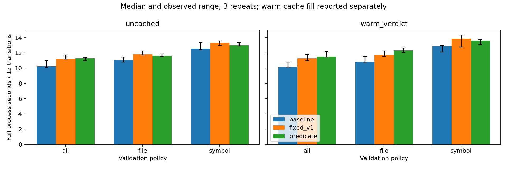

# Проверенные операционные измерения

Значения относятся к 120 claim-transition за одно повторение. Время — сумма 12 процессов;
медиана и диапазон по трём повторениям. Cache fill измерен отдельно. Labels отсутствуют.

| Variant | Mode / phase | Policy | Selected | Logical / actual / hits | Index, s | Full process, median [min; max], s |
|---|---|---|---:|---:|---:|---:|
| baseline | uncached / measure | all_validate | 120 | 120 / 120 / 0 | 5.066 | 10.254 [10.097; 10.979] |
| baseline | uncached / measure | clear_all | 0 | 0 / 0 / 0 | 0.000 | 4.773 [4.480; 4.844] |
| baseline | uncached / measure | file_invalidate | 120 | 0 / 0 / 0 | 5.048 | 10.718 [10.544; 11.417] |
| baseline | uncached / measure | file_validate | 120 | 120 / 120 / 0 | 4.971 | 11.074 [10.787; 11.439] |
| baseline | uncached / measure | keep_all | 0 | 0 / 0 / 0 | 0.000 | 4.740 [4.455; 5.060] |
| baseline | uncached / measure | symbol_invalidate | 120 | 0 / 0 / 0 | 6.351 | 11.914 [11.895; 12.620] |
| baseline | uncached / measure | symbol_validate | 120 | 120 / 120 / 0 | 6.378 | 12.558 [12.420; 13.398] |
| baseline | warm_verdict / cache_fill | all_validate | 120 | 120 / 120 / 0 | 5.118 | 10.808 [10.604; 11.339] |
| baseline | warm_verdict / measure | all_validate | 120 | 120 / 0 / 120 | 4.992 | 10.185 [10.151; 10.788] |
| baseline | warm_verdict / measure | file_validate | 120 | 120 / 0 / 120 | 4.988 | 10.857 [10.681; 11.524] |
| baseline | warm_verdict / measure | symbol_validate | 120 | 120 / 0 / 120 | 6.776 | 12.861 [12.127; 12.971] |
| fixed_v1 | uncached / measure | all_validate | 120 | 120 / 120 / 0 | 6.020 | 11.213 [11.174; 11.750] |
| fixed_v1 | uncached / measure | clear_all | 0 | 0 / 0 / 0 | 0.000 | 4.650 [4.449; 4.900] |
| fixed_v1 | uncached / measure | file_invalidate | 120 | 0 / 0 / 0 | 5.966 | 11.733 [11.343; 12.009] |
| fixed_v1 | uncached / measure | file_validate | 120 | 120 / 120 / 0 | 5.986 | 11.811 [11.732; 12.236] |
| fixed_v1 | uncached / measure | keep_all | 0 | 0 / 0 / 0 | 0.000 | 4.611 [4.469; 4.785] |
| fixed_v1 | uncached / measure | symbol_invalidate | 120 | 0 / 0 / 0 | 7.486 | 13.522 [13.139; 13.698] |
| fixed_v1 | uncached / measure | symbol_validate | 120 | 120 / 120 / 0 | 7.534 | 13.325 [12.950; 13.567] |
| fixed_v1 | warm_verdict / cache_fill | all_validate | 120 | 120 / 120 / 0 | 6.184 | 11.836 [11.337; 11.874] |
| fixed_v1 | warm_verdict / measure | all_validate | 120 | 120 / 0 / 120 | 5.925 | 11.273 [10.987; 11.810] |
| fixed_v1 | warm_verdict / measure | file_validate | 120 | 120 / 0 / 120 | 6.094 | 11.738 [11.552; 12.267] |
| fixed_v1 | warm_verdict / measure | symbol_validate | 120 | 120 / 0 / 120 | 7.855 | 13.893 [12.772; 14.323] |
| predicate | uncached / measure | all_validate | 120 | 120 / 120 / 0 | 5.997 | 11.289 [10.954; 11.416] |
| predicate | uncached / measure | clear_all | 0 | 0 / 0 / 0 | 0.000 | 4.563 [4.517; 4.850] |
| predicate | uncached / measure | file_invalidate | 5 | 0 / 0 / 0 | 5.951 | 11.645 [11.315; 11.834] |
| predicate | uncached / measure | file_validate | 5 | 5 / 5 / 0 | 5.991 | 11.637 [11.510; 11.886] |
| predicate | uncached / measure | keep_all | 0 | 0 / 0 / 0 | 0.000 | 4.626 [4.606; 4.672] |
| predicate | uncached / measure | symbol_invalidate | 0 | 0 / 0 / 0 | 7.449 | 13.096 [12.798; 13.415] |
| predicate | uncached / measure | symbol_validate | 0 | 0 / 0 / 0 | 7.387 | 12.977 [12.872; 13.371] |
| predicate | warm_verdict / cache_fill | all_validate | 120 | 120 / 120 / 0 | 6.032 | 11.446 [11.216; 11.756] |
| predicate | warm_verdict / measure | all_validate | 120 | 120 / 0 / 120 | 6.166 | 11.535 [11.466; 12.162] |
| predicate | warm_verdict / measure | file_validate | 5 | 5 / 0 / 5 | 6.196 | 12.324 [12.094; 12.637] |
| predicate | warm_verdict / measure | symbol_validate | 0 | 0 / 0 / 0 | 7.723 | 13.609 [13.083; 13.739] |

