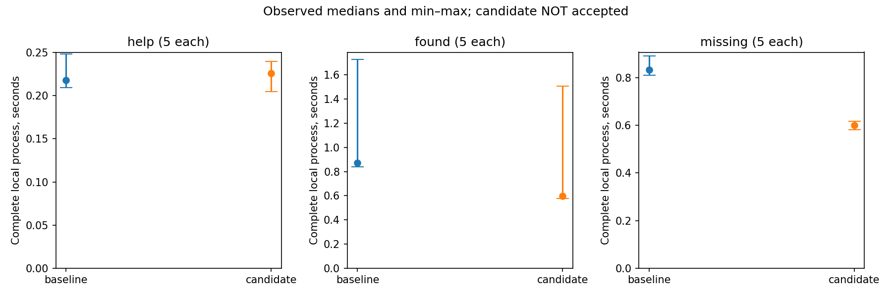

# Практическая проверка CAMI, 15 ноября 2026

Решение: оставить Python и текущий алгоритм поиска. Кандидат ускорения не включён.
Добавлен рабочий перспективный сбор входов и расходов с восстановлением после
остановки процесса. Общая польза памяти исходников на новых модельных задачах
**не установлена**: новый модельный сравнительный опыт не выполнен. Эта часть
задания остаётся невыполненной, а не заменяется локальным ускорением.
Исторические отчёты и вердикты не изменены.

## Критерии и границы выполненной работы

[Протокол](protocol.json), SHA256
`937bb4e8776c9da380c79ab2687f690bc7897cc7ca296f848808d708db6ea223`,
записан до новых замеров. Бюджет: 30 минут локальных проверок, ноль платных
модельных вызовов, без замены попыток. Нулевой модельный бюджет выбран исполнителем,
это не запрет пользователя и не доказательство отсутствия доступа к провайдеру.
Условия после результатов не менялись. Повторный запуск тестов после исправления
кода отделён от единственного сравнительного замера.

| Гипотеза | Решение по фиксированному критерию | Основание |
|---|---|---|
| История позволяет оценить точные повторы | Измерительный контур не прошёл проверку | Нет полных стартовых файлов и режимов, внешнего контекста и связки результата с затратами |
| Перспективный журнал сохраняет вход, ответы, решение и независимые статусы | Принято в проверенной области | 14 поведенческих проверок, реальные дочерние процессы, SIGKILL и отдельный процесс восстановления |
| Журнал даёт полный расход произвольного провайдера | Измерительный контур не прошёл проверку | Не видит скрытые внутренние запросы и потерянный usage; billing недоступен |
| Замена построения родительских путей ускоряет полный локальный путь | Отклонено по заданному критерию | Справка не ускорилась; интервалы найденного символа пересекаются; строгий выходной gate не пройден |
| CAMI полезнее plain на новых задачах | Измерительный контур не прошёл admission | Нет закреплённого образа; ноль новых модельных попыток |
| Нужна реализация на Rust | Оснований для прототипа нет; оставить Python | Найдена лишняя алгоритмическая работа; доля неизбежных расходов языка в полном агентном пути не установлена |

## Исторические пользовательские задачи

[Инвентаризация](history.json) читает только локальные Codex rollouts и OpenCode DB
для этого репозитория, включая рабочие деревья. В исходном каталоге 387 rollouts
для всех проектов. Фильтры исходного текста и происхождения сохранены в
[скрипте](../../scripts/practical/history.py). Полный текст не публикуется:
у каждой записи сохранены ссылка на оригинальный файл и строку, время и хеш.

Найдено 215 содержательных записей: 64 исключены как делегированные задания или
эксперименты, 151 остаются кандидатами на пользовательские обращения. **151 —
верхняя граница числа независимых задач**, поскольку сюда входят уточнения и
продолжения. Эвристическая классификация не доказывает происхождение каждой записи.
Число достоверно разделённых независимых реальных задач не установлено.
OpenCode DB не содержит сессий с каталогом данного репозитория. Экспериментальные
архивы в `reports/` не считаются обычным пользовательским потоком.

Пригодны 0 из 151 обращений, непригодны 151 из 151. Для всех отсутствуют полный
стартовый снимок байтов с режимами, связанный внешний контекст и подтверждённая
связка качества с полными затратами. Git commit, текущие файлы и накопительные
счётчики сессии не заменяют отсутствующих входов. Точное число повторов и
хронологическая доля попаданий — **unknown**, знаменатель допустимых задач 0.
Это не нулевая частота повторов. Восстановление по похожему тексту не применялось.

## Реализованный сбор и аварии

Код: [task_session.py](../../integrations/opencode/task_session.py),
[проверки](../../tests/test_task_session.py). Это новый CLI в существующей
OpenCode-интеграции; прежние пользовательские клиенты автоматически на него
не переключены. Контролируемые прогоны тестов не являются реальным потоком задач.

Перед запуском фиксируются точный переданный текст, полный инвентарь файлов и
режимов по `task_replay`, снимок исходных байтов, контекст и строгий ключ.
Ограничения `task_replay` сохранены: регулярные файлы, не более 64 MiB и 10 000
файлов, исключена только `.git`. Каталог журнала должен быть вне рабочего дерева.
SQLite `synchronous=FULL` подтверждает каждое событие до следующей операции.
Ответы сохраняются построчно, до итоговой агрегации. Снимки публикуются после fsync.

Независимы `quality`, `execution`, `telemetry.complete`, `cache_eligible`.
Сначала сохраняется решение, затем запускается свежий grader даже при неизвестном
расходе или ненулевом exit code. Grader работает с сохранённым артефактом и не
должен его менять. Обучение разрешено только после качества, успешного завершения,
полного usage и явного объявления покрытия запросов адаптером. Обычный непрозрачный
OpenCode без такого адаптера не обучает кеш. Само объявление не доказывает полноту
чужого API. Каждое последующее применение кеша требует свежей оценки.

Покрыты успешный ответ, частичный ответ, отсутствующий usage, транспортная ошибка
с внутренним повтором, ненулевой exit code при правильном решении, ошибка запуска,
дубликаты usage, повреждённая SQLite, отсутствие наблюдаемых запросов, точное
воспроизведение со свежей оценкой и промахи при изменении байтов, режима и контекста.
SIGKILL введён после начала захвата входа, до запуска агента, во время поступления
ответов, после завершения агента и после сохранения решения. Восстановление
выполняется новым процессом, модель не вызывается повторно. До фиксации входа
восстановление отказывает, не придумывая снимок. Повторное завершение терминального
журнала не создаёт новых событий.

Непокрыты потеря питания и физическое повреждение носителя, неподконтрольные
параллельные изменения рабочего дерева, скрытые запросы провайдера, потерянные
им usage и автоматическое прекращение осиротевшего агента при SIGKILL родителя.
Перед `recover` такой агент должен быть остановлен. Между созданием процесса и
записью его ответов часть расходов может быть неизвестна. Эти случаи не получают
точный денежный итог. Строки stdout/stderr хранятся приватно и могут содержать
чувствительные данные; каталог сеанса создаётся с режимом 0700.

Точный расход суммируется только по уникальным парам `request_started` и
`request_finished` с пятью целыми неотрицательными компонентами. При пропуске
`total=null`, известный subtotal сохранён отдельно. Ноль не подставляется.
Локальные DB содержат лишь сессионные накопительные показатели; независимого
invoice/billing-источника в доступном контуре нет. Потерянный usage не восстановлен.
Полный денежный эффект не вычислялся.

В существующем [container_worker](../../scripts/opencode_benchmark/harness/container_worker.py)
включены fsync потока SSE после каждого события и fsync admission перед POST.
Это усиление сохранности старого контура; оно не добавляет ему недостающий billing
или автоматическое восстановление всех стадий.

## Профиль и единственный кандидат

Профиль полного локального `find` с `--source-root src`:
[исходный cProfile](find.prof), [importtime](importtime.txt).
4,738 s под профилировщиком: построение индекса 2,143 s, две проверки capture
1,497 s, локальные import edges 0,788 s. Вложенные интервалы нельзя складывать.
Построение `tracked_parents` создаёт много `PurePosixPath` и их родителей;
выбранная замена использует строки и множество с тем же содержимым.
Не добавлены кеш, демон или повторное использование без проверки свежести.
[Исходный вариант](worktree-baseline.py), [кандидат](worktree-candidate.py).
Оба запускаются на реальном текущем репозитории в отдельных копиях пакета. [Проверка множества родителей на реальных Git-путях](parent-set-audit.json) отдельно подтверждает равенство результата этого вычисления.

Начальная неудачная команда `python -m cami` обнаружила отсутствие `__main__`.
Незавершённый профиль без source-root остановлен: он обходил крупное дерево
артефактов. Эти попытки не входят в сравнительные времена. Ошибки первого парсера истории и команд сохранены в [реестре неудачных попыток](failed-attempts.json). Полезный профиль
отделён от 30 обычных процессов. При замере load average был 0,79 на двух CPU;
хост не изолирован. Варианты чередуются, фоновые процессы не останавливались.

| Полный локальный процесс | Baseline, медиана [min–max], s | Кандидат, медиана [min–max], s | n на вариант |
|---|---:|---:|---:|
| help | 0,2181 [0,2093–0,2482] | 0,2262 [0,2050–0,2398] | 5 |
| find found | 0,8716 [0,8404–1,7290] | 0,5984 [0,5758–1,5077] | 5 |
| find missing | 0,8335 [0,8090–0,8911] | 0,6009 [0,5823–0,6164] | 5 |

В `found` первая пара включает построение пустого индекса; последующие используют
его только после свежих capture. `missing` использует уже подготовленный индекс.
Импорты входят в каждый процесс. Чтение, хеширование, загрузка/сериализация,
обслуживание индекса и выдача JSON включены в измеряемый путь. Разбор и обновление
видны в холодной паре; повторное чтение сохраняет защиту актуальности.
В больших исторических базах и модельных задачах этот кандидат не измерялся.
Действие пользователя здесь — поиск определения; никакое действие модельного
агента улучшенная выдача памяти не заменяла.

[Все 30 измерений](benchmark/attempts.jsonl),
[первичный вердикт](benchmark/summary.json), отдельные полные JSON в `benchmark/`.
Нет ненулевых exit, кроме ожидаемого 1 для отсутствующего символа. Строгая
проверка выходов не прошла: fingerprint и generation_id закономерно меняются
при изменении кода анализатора. Это дефект измерительного gate, а не установленная
порча индекса. [Отдельная проверка после опыта](secondary-output-audit.json)
убирает только observation и эти два идентификатора: все 10 пар семантически
равны, включая snapshot_id и политику. Первичный вердикт не изменён, опыт не повторён.
Даже без этого дефекта кандидат не прошёл бы условие для help и разброса found.
Диапазоны — наблюдаемые min–max, не доверительные интервалы.



## Проверки и воспроизведение

[14 тестов со снимками аварий](fault-tests.log),
[сырые журналы аварий](fault-evidence/), [сводка журналов](fault-audit.json).
[Расширенный набор интеграции: 667 passed](integration-tests-final.log) и
[Ruff](ruff-final.log). Полный тестовый набор продукта и реальные Docker/MCP
сессии в этом этапе не запускались. Проверки не дают нового модельного результата.

```bash
.venv/bin/pytest -q tests/test_task_session.py tests/test_opencode_task_replay.py
.venv/bin/pytest -q scripts/opencode_benchmark/harness scripts/opencode_benchmark/controller scripts/opencode_benchmark/experiments/test_task_replay_study.py tests/test_task_session.py tests/test_opencode_task_replay.py
.venv/bin/python scripts/practical/benchmark.py runs/practical-benchmark-new
.venv/bin/python scripts/practical/render.py
.venv/bin/python scripts/practical/history.py
.venv/bin/ruff check integrations/opencode/task_session.py tests/test_task_session.py scripts/practical scripts/opencode_benchmark/harness/container_worker.py
```

Историческая инвентаризация зависит от приватных локальных журналов; сохранённый
срез в `history.json` позволяет проверить знаменатели без их публикации. Новый
запуск меняет срез, поэтому исходный JSON нужно предварительно сохранить.
Бенчмарк требует новый каталог, отказывается перезаписывать прежние попытки.
Профиль воспроизводится через `cProfile.run` над `cami.cli.main` с аргументами
`find run_experiment --repo . --source-root src --format json`.

Перспективный запуск (JSON argv исключает shell-подстановки):

```bash
.venv/bin/python -m integrations.opencode.task_session run \
  --directory /tmp/cami-session-new --workspace /path/to/bounded-checkout \
  --task-file /path/to/task.txt --context-file /path/to/external-context.json \
  --agent-json '["/path/to/agent","its-arguments"]' \
  --grade-json '["/path/to/fixed-grader"]'
.venv/bin/python -m integrations.opencode.task_session recover --directory /tmp/cami-session-new
```

Внешний контекст должен связывать инструментарий, окружение, инструкции и другие
значимые внешние входы. Без проверенного адаптера не задавать
`--declared-request-coverage`. Формат событий описан в docstring модуля;
`--cache` включает запись только допустимых результатов.

## Продуктовое решение и Rust

По умолчанию остаются прежние Python-поиск, строгий task_replay и schema 3.
Усиление fsync включено в старый worker. Новый runner доступен явно; кандидату
оптимизации не добавлен даже флаг в продукт. Отрицательный общий критерий сохранён.

[Admission](model-admission.json) подтверждает совпадение установленного бинарника
OpenCode с историческим SHA256, но Docker не имеет образа
`sha256:b0ac577d424f3ef181e3c4a5b188abf0ecf8a4fde0d544e55a3e825999826040`.
Другой образ не подставлялся. Доступность провайдера и возможность построить новый
контур не проверялись модельными запросами. Поэтому отсутствие образа блокирует
повтор исторического контура, но не доказывает принципиальную невозможность нового.
Подготовка нового модельного runtime и сравнение CAMI/plain на новых задачах
остаются невыполненной частью этого задания. Нового доказательства практической
пользы памяти исходников нет; решение продукта на его основании не меняется.

Rust не выбран. Конкретные горячие операции — AST-обходы, построение родителей
Git-путей и повторная проверка capture. Профиль показал алгоритмическую избыточность,
но не отделил неизбежную стоимость Python от стоимости алгоритма и I/O в полном
агентном пути. Условия для изолированного Rust-прототипа не установлены.
