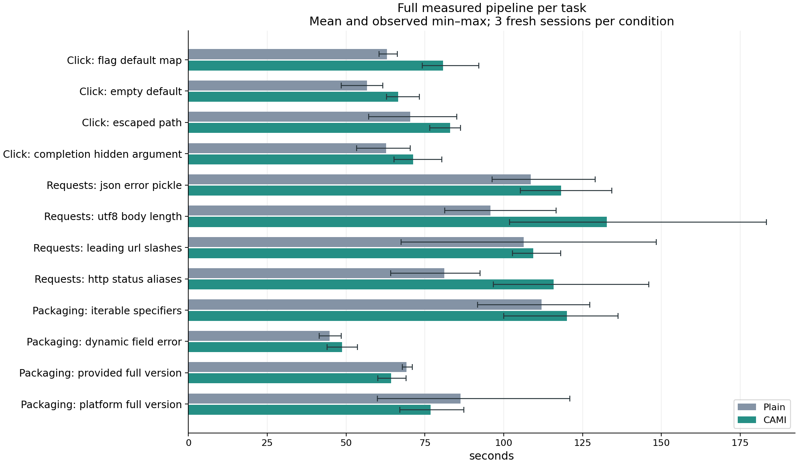
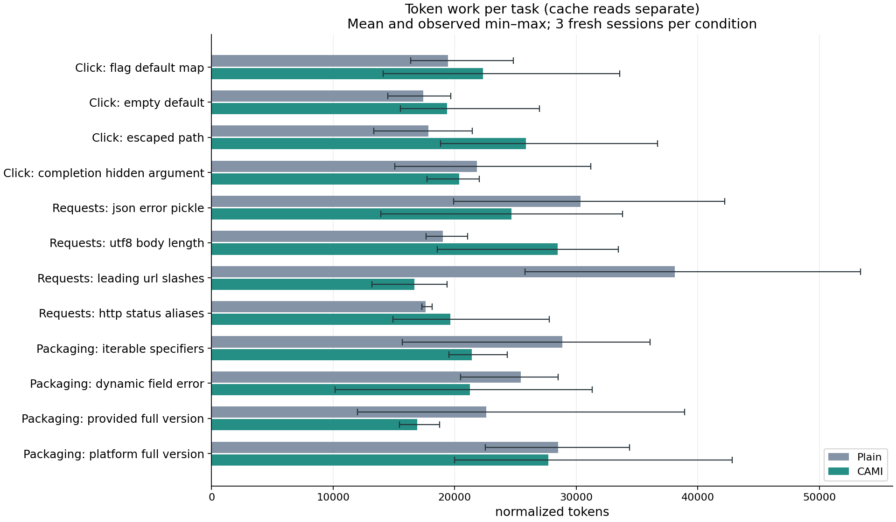

# Практическая эффективность CAMI: завершённое сравнение

Включение CAMI по умолчанию отклонено по заранее заданному критерию.

Выполнены все 72 запланированные сессии: 12 исторических задач из Click, Requests и Packaging, по три свежих запуска plain и CAMI на задачу. Проверки качества прошли plain 36/36 и CAMI 36/36.

Медиана отношения средних времён по 12 парным задачам: CAMI +11.25% относительно plain. Медиана отношения учитываемых токенов: -4.78%. Знак плюс означает увеличение затрат. Это медианы отношений по задачам, а не отношение общих сумм или медиан всех сессий.

## Решение по критериям

| Критерий | Пройден |
|---|---|
| all_sessions_operational | да |
| all_usage_complete | да |
| minimum_cami_quality_30_of_36 | да |
| no_total_quality_regression | да |
| no_repository_quality_regression | да |
| time_improves_at_least_10_percent | нет |
| token_work_improves_at_least_10_percent | нет |

## Результаты по задачам

| Задача | Качество plain / CAMI | Среднее время plain / CAMI, с | Средние токены plain / CAMI |
|---|---:|---:|---:|
| flag-default-map | 3/3 / 3/3 | 63.00 / 80.82 | 19,456 / 22,348 |
| empty-default | 3/3 / 3/3 | 56.65 / 66.50 | 17,413 / 19,373 |
| escaped-path | 3/3 / 3/3 | 70.30 / 82.98 | 17,828 / 25,863 |
| completion-hidden-argument | 3/3 / 3/3 | 62.77 / 71.23 | 21,843 / 20,372 |
| json-error-pickle | 3/3 / 3/3 | 108.60 / 118.18 | 30,345 / 24,657 |
| utf8-body-length | 3/3 / 3/3 | 95.80 / 132.72 | 19,013 / 28,460 |
| leading-url-slashes | 3/3 / 3/3 | 106.35 / 109.43 | 38,101 / 16,689 |
| http-status-aliases | 3/3 / 3/3 | 81.19 / 115.83 | 17,606 / 19,657 |
| iterable-specifiers | 3/3 / 3/3 | 112.01 / 120.09 | 28,842 / 21,399 |
| dynamic-field-error | 3/3 / 3/3 | 44.75 / 48.78 | 25,441 / 21,260 |
| provided-full-version | 3/3 / 3/3 | 69.18 / 64.32 | 22,591 / 16,922 |
| platform-full-version | 3/3 / 3/3 | 86.28 / 76.76 | 28,519 / 27,716 |

## Что именно измерено

Модель openai/gpt-6.1-sol#high одинакова. Порядок условий чередуется. Каждый запуск получает чистое рабочее дерево и новую модельную сессию. CAMI строит новую общую память префиксов из исходного кода, без ответов на задачи. Кеш готовых решений отключён. Стоимость построения памяти включена. Это проверка холодного начала работы с новым набором памяти, а не измерение её амортизации в долгоживущей пользовательской сессии.

Время включает подготовку входов, память, контейнерный запуск, авторизацию, работу модели, сохранение исходников и свежую проверку качества. Общая стоимость допуска base/gold распределена поровну между 72 попытками. Подготовка итоговых графиков и отчёта исключена. Хост общий, его нагрузка и ресурсы записаны перед каждой попыткой.

При аудите обнаружено различие границы таймера и текста протокола: исполнитель остановил таймер непосредственно перед публикацией терминальной записи, после сохранения решения и устойчивой записи оценки качества. Исходный протокол и результаты сохранены. Отдельный [аудит этого интервала](publication-tail-audit.json) ограничивает пропущенный хвост сверху: максимум 0,143 с, медиана 0,010 с. Даже наиболее выгодная для CAMI поправка оставляет отношение времени 1,11236; решение об отклонении также независимо следует из непройденного порога токенов. Текст генератора будущих протоколов исправлен после завершения опыта.

Качество проверяет отдельный контейнер с фиксированными acceptance-тестами и полным выбранным upstream-модулем регрессионных тестов. Исходная версия провалила проверку каждой задачи, эталонная прошла. Для оценки используются исходники решения и канонические тесты, независимо от правок тестов моделью. Это не полный тестовый набор каждого репозитория.

Токены разделены на input, output, reasoning, cache read и cache write. Основной token work исключает cache read; все компоненты сохранены отдельно. Неполная попытка не получает выдуманный полный расход. Данные usage являются наблюдаемыми показателями OpenCode, а не фактическим счётом провайдера.

Три запуска одной задачи не считаются тремя независимыми задачами. Набор состоит из публичных исторических исправлений в уже изучавшихся репозиториях. Он не доказывает отсутствие этих исходников в обучении модели. Min–max на графиках являются наблюдаемым разбросом, а не доверительными интервалами.

## Локальная оптимизация и Rust

Новый локальный опыт local-comparison-v3 выполнил 50 сравнительных запусков. Все семантические выходы и коды завершения совпали. Общий критерий не пройден в случаях: missing-cold. Изменение не включено. Исходные версии и оба новых опыта сохранены отдельно.

Решение по языку: оставить Python. Полная перепись на Rust не является результатом этого эксперимента. Наблюдаемые интервалы backend и числа вызовов инструментов находятся в model-summary.json; они не заменяют полный профиль CPU и транспорта.

## Журнал обычных задач

Команда cami task автоматически сохраняет входные файлы, режимы, точный текст задачи, объявленный внешний контекст, ответы и расход. Проверена установленная wheel-сборка и настоящий запуск через существующий OpenCode. Первые две проверки обнаружили неверную неявную привязку каталога в CLI. Исправление создаёт сессию с явным каталогом через API и проверяет привязку до отправки задания. Неудачные проверки и их расходы сохранены.

[Инструкция обычного запуска и восстановления](../../integrations/opencode/TASK_SESSION.md). Прерывание, тайм-аут и гибель управляющего процесса проверены. При ошибке провайдера известные отдельные компоненты usage сохраняются как нижние границы, без двойного учёта; полный итог остаётся неизвестным. Все модельные admission-попытки, включая неудачные, отделены от основного сравнения в [общем журнале расходов](all-opencode-attempt-accounting.json).

Историческая проверка ранее нашла 151 кандидатное пользовательское обращение без полного стартового снимка. Из этих записей частоту точных повторов восстановить нельзя. Смоук-проверки и 72 экспериментальные сессии не выдаются за обычный пользовательский поток. Новый сбор создаёт пригодные записи для последующего хронологического подсчёта.

## Артефакты

- [Первичный протокол](protocol.json) и [его хеш](protocol-seal.json).
- [Независимая проверка](model-audit.json) и [все результаты](model-summary.json).
- [Допуск задач](task-admission.json), [локальный опыт](local-comparison-v3/summary.json).
- [Команды воспроизведения](REPRODUCE.md).
- [Сверка всех обязательных результатов](completion-manifest.json).
- Архивы runtime, исходников и всех сырых попыток: [output/practical-complete-20261115](../../output/practical-complete-20261115/).
- Исходники, журналы и решения: runs/practical-complete-20261115/.

## Финальная проверка реализации

Общий прогон без Docker: 1813 passed. Отдельная проверка последней версии контура запуска и контрактов: 33 passed. Docker: 4 passed. Эти группы частично пересекаются; числа не складываются. Ruff прошёл, mypy проверил 56 файлов без ошибок. Финальный установленный пакет проверен настоящей модельной задачей; хеш wheel и привязка его исходников находятся в installed-task-accounting-admission.json.

Изменения учёта и обычного запуска включены. Локальный кандидат отклонён; фактический worktree.py побайтно совпадает с baseline. Исходная версия модельного опыта сохранена отдельно от последующих исправлений команды. Исторические журналы и предыдущие неудачные проверки сохранены.
